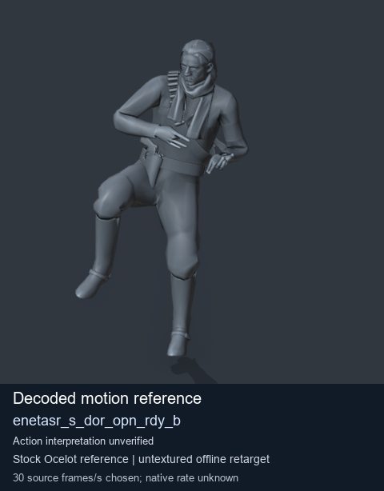
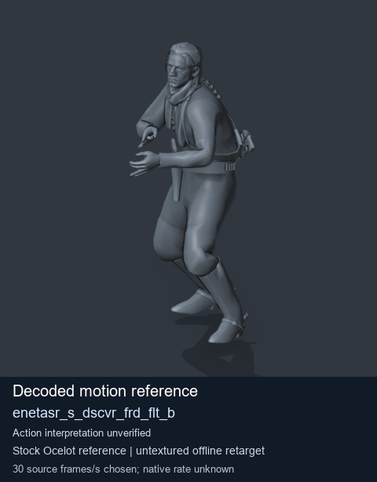
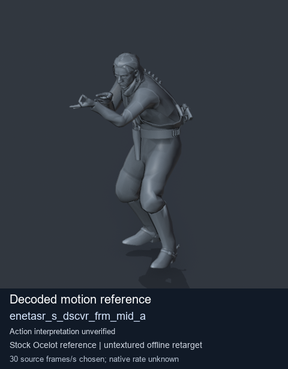
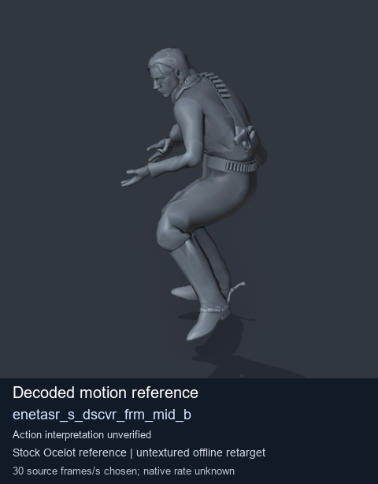

# Stock Soldier_common motion references / /Assets/tpp/motion/SI_game/fani/bodies/enet/enetasr - page 76

[Library](../README.md) · [Grouped directory](../browse/README.md) · [This source family](../browse/stock-soldier-enetasr-dd428991.md) · [Switch mode](browse-stock-soldier-enetasr-dd428991-76.md)

**Still images: no GIFs loaded** · 4 clips · 0.36 MiB downloaded.

Images reuse existing files. A small display width does not reduce download size. Open one clip for its larger titled GIF and original technical data.

Source-family grouping uses only recorded virtual directories; it does not establish an action, weapon, actor, rig or native compatibility. Existing descriptions and tags below are unchanged. Per-clip visual review may be pending; chosen preview speed is separate from unmeasured native timing.

| Preview | Animation | Category | Tags | Virtual GANI directory / file | MTAR / container location | Description | Frames / data |
| --- | --- | --- | --- | --- | --- | --- | --- |
|  | [Stock motion reference: enetasr_s_dor_opn_rdy_b](../clips/mgsv-tpp-soldier_common-payloadsha256-b5211f0582fe53825b4164289853ec4b95c5da8367aa9e3074f3e36d59ca1683.md) <code>enetasr_s_dor_opn_rdy_b</code> | Stock Soldier_common motion references | <code>stock body motion</code> <code>Soldier_common</code> <code>source-derived label</code> <code>Ocelot reference mesh</code> | <code>/Assets/tpp/motion/SI_game/fani/bodies/enet/enetasr</code> <code>enetasr_s_dor_opn_rdy_b.gani</code> | Retained MTAR: <code>Soldier_common.mtar</code> DAT / FPK membership unverified | Decoded stock body-motion reference enetasr_s_dor_opn_rdy_b; action interpretation unverified. | 154 raw 5.13 s chosen; native rate unknown [Full data](../clips/mgsv-tpp-soldier_common-payloadsha256-b5211f0582fe53825b4164289853ec4b95c5da8367aa9e3074f3e36d59ca1683.md#technical-data) |
|  | [Stock reference: enetasr_s_dscvr_frd_flt_b](../clips/mgsv-tpp-soldier_common-payloadsha256-31c28461389ea7cdf8b373e23389b0dc0df0fbb7f2747fe8bbafd1769b0dc83f.md) <code>enetasr_s_dscvr_frd_flt_b</code> | Stock Soldier_common motion references | <code>stock animation reference</code> <code>Soldier_common</code> <code>source-derived label</code> <code>Ocelot reference mesh</code> | <code>/Assets/tpp/motion/SI_game/fani/bodies/enet/enetasr</code> <code>enetasr_s_dscvr_frd_flt_b.gani</code> | Retained MTAR: <code>Soldier_common.mtar</code> DAT / FPK membership unverified | Decoded stock reference enetasr_s_dscvr_frd_flt_b; action interpretation unverified. | 270 raw 9.0 s chosen; native rate unknown [Full data](../clips/mgsv-tpp-soldier_common-payloadsha256-31c28461389ea7cdf8b373e23389b0dc0df0fbb7f2747fe8bbafd1769b0dc83f.md#technical-data) |
|  | [Stock reference: enetasr_s_dscvr_frm_mid_a](../clips/mgsv-tpp-soldier_common-payloadsha256-bd3b5c27dcce6ad99b4ce2207e796cd48eb349d53c31c4071a8530a5d46853da.md) <code>enetasr_s_dscvr_frm_mid_a</code> | Stock Soldier_common motion references | <code>stock animation reference</code> <code>Soldier_common</code> <code>source-derived label</code> <code>Ocelot reference mesh</code> | <code>/Assets/tpp/motion/SI_game/fani/bodies/enet/enetasr</code> <code>enetasr_s_dscvr_frm_mid_a.gani</code> | Retained MTAR: <code>Soldier_common.mtar</code> DAT / FPK membership unverified | Decoded stock reference enetasr_s_dscvr_frm_mid_a; action interpretation unverified. | 35 raw 1.17 s chosen; native rate unknown [Full data](../clips/mgsv-tpp-soldier_common-payloadsha256-bd3b5c27dcce6ad99b4ce2207e796cd48eb349d53c31c4071a8530a5d46853da.md#technical-data) |
|  | [Stock reference: enetasr_s_dscvr_frm_mid_b](../clips/mgsv-tpp-soldier_common-payloadsha256-a5bcf56d3f869502dd56539700666578545252c791a1a4c994ad4baef0347caa.md) <code>enetasr_s_dscvr_frm_mid_b</code> | Stock Soldier_common motion references | <code>stock animation reference</code> <code>Soldier_common</code> <code>source-derived label</code> <code>Ocelot reference mesh</code> | <code>/Assets/tpp/motion/SI_game/fani/bodies/enet/enetasr</code> <code>enetasr_s_dscvr_frm_mid_b.gani</code> | Retained MTAR: <code>Soldier_common.mtar</code> DAT / FPK membership unverified | Decoded stock reference enetasr_s_dscvr_frm_mid_b; action interpretation unverified. | 57 raw 1.9 s chosen; native rate unknown [Full data](../clips/mgsv-tpp-soldier_common-payloadsha256-a5bcf56d3f869502dd56539700666578545252c791a1a4c994ad4baef0347caa.md#technical-data) |

[Source descriptions, confidence and credits](../description-sources.md) · [Complete JSON](../catalogue.json) · [CSV](../catalogue.csv)
