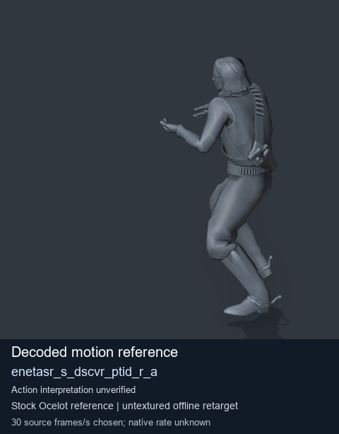
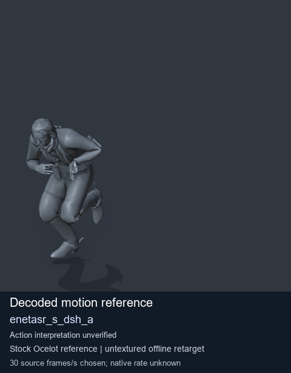
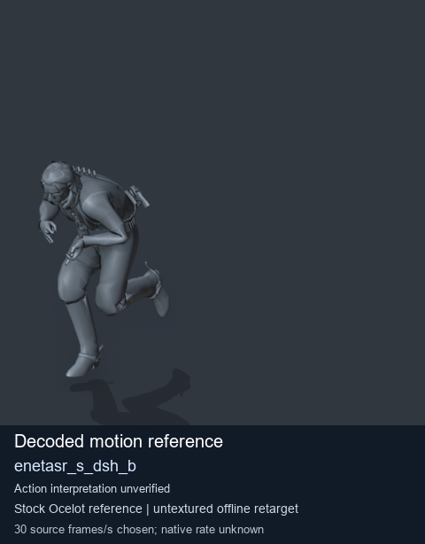
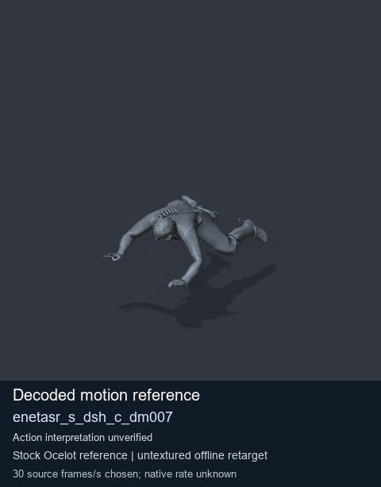

# Stock Soldier_common motion references / /Assets/tpp/motion/SI_game/fani/bodies/enet/enetasr - page 78

[Library](../README.md) · [Grouped directory](../browse/README.md) · [This source family](../browse/stock-soldier-enetasr-dd428991.md) · [Switch mode](browse-stock-soldier-enetasr-dd428991-78.md)

**Still images: no GIFs loaded** · 4 clips · 0.29 MiB downloaded.

Images reuse existing files. A small display width does not reduce download size. Open one clip for its larger titled GIF and original technical data.

Source-family grouping uses only recorded virtual directories; it does not establish an action, weapon, actor, rig or native compatibility. Existing descriptions and tags below are unchanged. Per-clip visual review may be pending; chosen preview speed is separate from unmeasured native timing.

| Preview | Animation | Category | Tags | Virtual GANI directory / file | MTAR / container location | Description | Frames / data |
| --- | --- | --- | --- | --- | --- | --- | --- |
|  | [Stock reference: enetasr_s_dscvr_ptid_r_a](../clips/mgsv-tpp-soldier_common-payloadsha256-ac16fe1a788c14f559565491b2225c3e2d6ffb6c10184a50ce33da84b4e93b16.md) <code>enetasr_s_dscvr_ptid_r_a</code> | Stock Soldier_common motion references | <code>stock animation reference</code> <code>Soldier_common</code> <code>source-derived label</code> <code>Ocelot reference mesh</code> | <code>/Assets/tpp/motion/SI_game/fani/bodies/enet/enetasr</code> <code>enetasr_s_dscvr_ptid_r_a.gani</code> | Retained MTAR: <code>Soldier_common.mtar</code> DAT / FPK membership unverified | Decoded stock reference enetasr_s_dscvr_ptid_r_a; action interpretation unverified. | 74 raw 2.47 s chosen; native rate unknown [Full data](../clips/mgsv-tpp-soldier_common-payloadsha256-ac16fe1a788c14f559565491b2225c3e2d6ffb6c10184a50ce33da84b4e93b16.md#technical-data) |
|  | [Stock reference: enetasr_s_dsh_a](../clips/mgsv-tpp-soldier_common-payloadsha256-ce189dbf8f3fe5c7e545af48b07a80913c4121bf3f518389bd841fab8fe4daca.md) <code>enetasr_s_dsh_a</code> | Stock Soldier_common motion references | <code>stock animation reference</code> <code>Soldier_common</code> <code>source-derived label</code> <code>Ocelot reference mesh</code> | <code>/Assets/tpp/motion/SI_game/fani/bodies/enet/enetasr</code> <code>enetasr_s_dsh_a.gani</code> | Retained MTAR: <code>Soldier_common.mtar</code> DAT / FPK membership unverified | Decoded stock reference enetasr_s_dsh_a; action interpretation unverified. | 33 raw 1.1 s chosen; native rate unknown [Full data](../clips/mgsv-tpp-soldier_common-payloadsha256-ce189dbf8f3fe5c7e545af48b07a80913c4121bf3f518389bd841fab8fe4daca.md#technical-data) |
|  | [Stock motion reference: enetasr_s_dsh_b](../clips/mgsv-tpp-soldier_common-payloadsha256-7791ae43bed30fb9dd7252fbfc1a7cc6cfc28df7f8b0856569578fcfc2747be5.md) <code>enetasr_s_dsh_b</code> | Stock Soldier_common motion references | <code>stock body motion</code> <code>Soldier_common</code> <code>source-derived label</code> <code>Ocelot reference mesh</code> | <code>/Assets/tpp/motion/SI_game/fani/bodies/enet/enetasr</code> <code>enetasr_s_dsh_b.gani</code> | Retained MTAR: <code>Soldier_common.mtar</code> DAT / FPK membership unverified | Decoded stock body-motion reference enetasr_s_dsh_b; action interpretation unverified. | 31 raw 1.03 s chosen; native rate unknown [Full data](../clips/mgsv-tpp-soldier_common-payloadsha256-7791ae43bed30fb9dd7252fbfc1a7cc6cfc28df7f8b0856569578fcfc2747be5.md#technical-data) |
|  | [Stock motion reference: enetasr_s_dsh_c_dm007](../clips/mgsv-tpp-soldier_common-payloadsha256-342c78092405dea639eebf3e1eecd969587885c490d7cbe44bf46baf82524aa6.md) <code>enetasr_s_dsh_c_dm007</code> | Stock Soldier_common motion references | <code>stock body motion</code> <code>Soldier_common</code> <code>source-derived label</code> <code>Ocelot reference mesh</code> | <code>/Assets/tpp/motion/SI_game/fani/bodies/enet/enetasr</code> <code>enetasr_s_dsh_c_dm007.gani</code> | Retained MTAR: <code>Soldier_common.mtar</code> DAT / FPK membership unverified | Decoded stock body-motion reference enetasr_s_dsh_c_dm007; action interpretation unverified. | 70 raw 2.33 s chosen; native rate unknown [Full data](../clips/mgsv-tpp-soldier_common-payloadsha256-342c78092405dea639eebf3e1eecd969587885c490d7cbe44bf46baf82524aa6.md#technical-data) |

[Source descriptions, confidence and credits](../description-sources.md) · [Complete JSON](../catalogue.json) · [CSV](../catalogue.csv)
