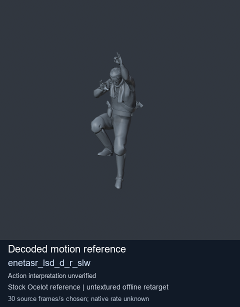
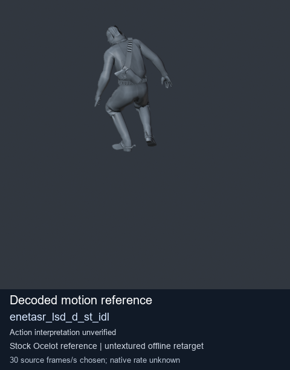
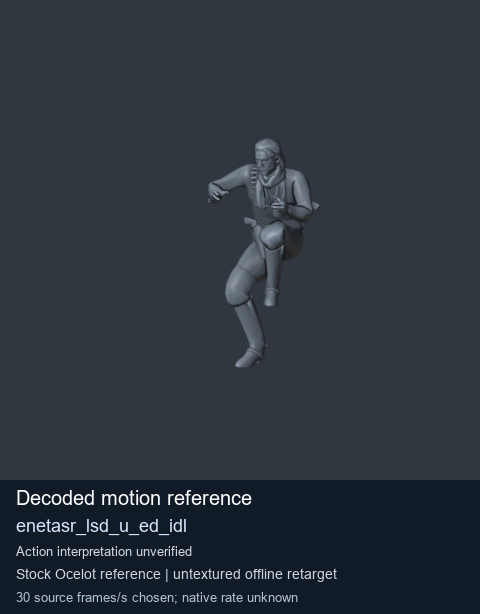
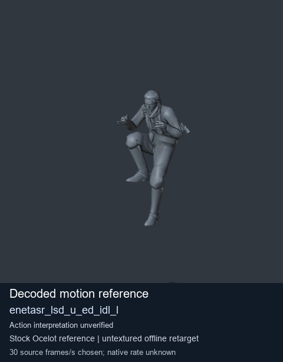

# Stock Soldier_common motion references / /Assets/tpp/motion/SI_game/fani/bodies/enet/enetasr - page 8

[Library](../README.md) · [Grouped directory](../browse/README.md) · [This source family](../browse/stock-soldier-enetasr-dd428991.md) · [Switch mode](browse-stock-soldier-enetasr-dd428991-8.md)

**Still images: no GIFs loaded** · 4 clips · 0.24 MiB downloaded.

Images reuse existing files. A small display width does not reduce download size. Open one clip for its larger titled GIF and original technical data.

Source-family grouping uses only recorded virtual directories; it does not establish an action, weapon, actor, rig or native compatibility. Existing descriptions and tags below are unchanged. Per-clip visual review may be pending; chosen preview speed is separate from unmeasured native timing.

| Preview | Animation | Category | Tags | Virtual GANI directory / file | MTAR / container location | Description | Frames / data |
| --- | --- | --- | --- | --- | --- | --- | --- |
|  | [Stock motion reference: enetasr_lsd_d_r_slw](../clips/mgsv-tpp-soldier_common-payloadsha256-85e5357b5ca32b27efc738aed4e85dbed4335f8a5343aa3fb9c3395591eeaec0.md) <code>enetasr_lsd_d_r_slw</code> | Stock Soldier_common motion references | <code>stock body motion</code> <code>Soldier_common</code> <code>source-derived label</code> <code>Ocelot reference mesh</code> | <code>/Assets/tpp/motion/SI_game/fani/bodies/enet/enetasr</code> <code>enetasr_lsd_d_r_slw.gani</code> | Retained MTAR: <code>Soldier_common.mtar</code> DAT / FPK membership unverified | Decoded stock body-motion reference enetasr_lsd_d_r_slw; action interpretation unverified. | 92 raw 3.07 s chosen; native rate unknown [Full data](../clips/mgsv-tpp-soldier_common-payloadsha256-85e5357b5ca32b27efc738aed4e85dbed4335f8a5343aa3fb9c3395591eeaec0.md#technical-data) |
|  | [Stock motion reference: enetasr_lsd_d_st_idl](../clips/mgsv-tpp-soldier_common-payloadsha256-623f15e400d02efe56a1c7d8f334b53b03b9ecd42bcef86f5c1ddd7cbf0f5dbb.md) <code>enetasr_lsd_d_st_idl</code> | Stock Soldier_common motion references | <code>stock body motion</code> <code>Soldier_common</code> <code>source-derived label</code> <code>Ocelot reference mesh</code> | <code>/Assets/tpp/motion/SI_game/fani/bodies/enet/enetasr</code> <code>enetasr_lsd_d_st_idl.gani</code> | Retained MTAR: <code>Soldier_common.mtar</code> DAT / FPK membership unverified | Decoded stock body-motion reference enetasr_lsd_d_st_idl; action interpretation unverified. | 160 raw 5.33 s chosen; native rate unknown [Full data](../clips/mgsv-tpp-soldier_common-payloadsha256-623f15e400d02efe56a1c7d8f334b53b03b9ecd42bcef86f5c1ddd7cbf0f5dbb.md#technical-data) |
|  | [Stock motion reference: enetasr_lsd_u_ed_idl](../clips/mgsv-tpp-soldier_common-payloadsha256-132032ee1ad1547fa3bfd6db8fe9a0e5f9e822f02e4743fbb0bfed3fbeda194e.md) <code>enetasr_lsd_u_ed_idl</code> | Stock Soldier_common motion references | <code>stock body motion</code> <code>Soldier_common</code> <code>source-derived label</code> <code>Ocelot reference mesh</code> | <code>/Assets/tpp/motion/SI_game/fani/bodies/enet/enetasr</code> <code>enetasr_lsd_u_ed_idl.gani</code> | Retained MTAR: <code>Soldier_common.mtar</code> DAT / FPK membership unverified | Decoded stock body-motion reference enetasr_lsd_u_ed_idl; action interpretation unverified. | 125 raw 4.17 s chosen; native rate unknown [Full data](../clips/mgsv-tpp-soldier_common-payloadsha256-132032ee1ad1547fa3bfd6db8fe9a0e5f9e822f02e4743fbb0bfed3fbeda194e.md#technical-data) |
|  | [Stock motion reference: enetasr_lsd_u_ed_idl_l](../clips/mgsv-tpp-soldier_common-payloadsha256-c385affdb1eabcea595059b194acc6153eb06cc2e4907f31f8dd32c76d0fb0f2.md) <code>enetasr_lsd_u_ed_idl_l</code> | Stock Soldier_common motion references | <code>stock body motion</code> <code>Soldier_common</code> <code>source-derived label</code> <code>Ocelot reference mesh</code> | <code>/Assets/tpp/motion/SI_game/fani/bodies/enet/enetasr</code> <code>enetasr_lsd_u_ed_idl_l.gani</code> | Retained MTAR: <code>Soldier_common.mtar</code> DAT / FPK membership unverified | Decoded stock body-motion reference enetasr_lsd_u_ed_idl_l; action interpretation unverified. | 139 raw 4.63 s chosen; native rate unknown [Full data](../clips/mgsv-tpp-soldier_common-payloadsha256-c385affdb1eabcea595059b194acc6153eb06cc2e4907f31f8dd32c76d0fb0f2.md#technical-data) |

[Source descriptions, confidence and credits](../description-sources.md) · [Complete JSON](../catalogue.json) · [CSV](../catalogue.csv)
