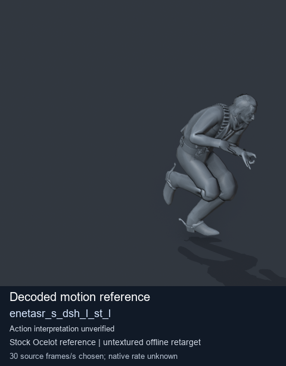
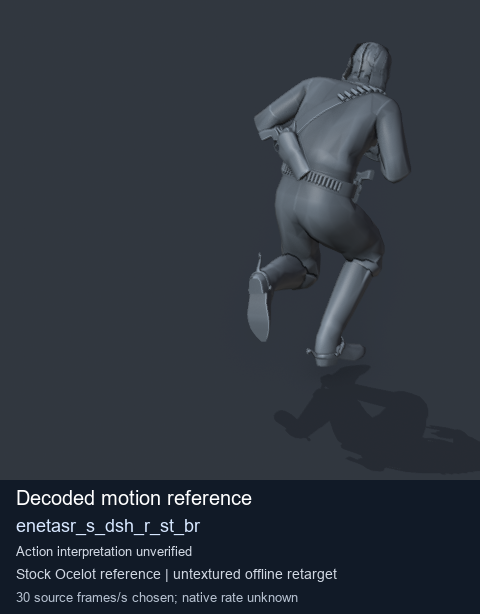
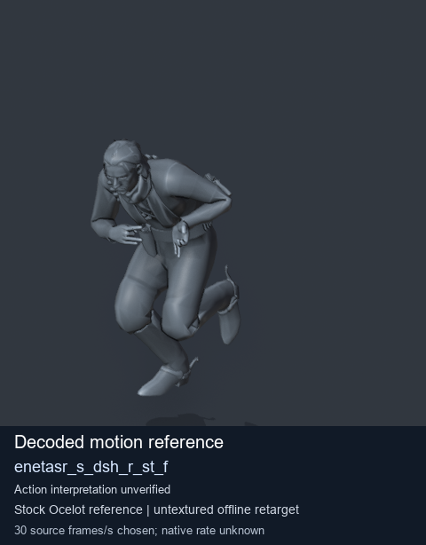
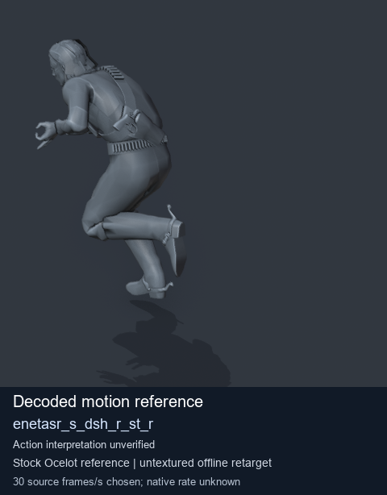

# Stock Soldier_common motion references / /Assets/tpp/motion/SI_game/fani/bodies/enet/enetasr - page 82

[Library](../README.md) · [Grouped directory](../browse/README.md) · [This source family](../browse/stock-soldier-enetasr-dd428991.md) · [Switch mode](browse-stock-soldier-enetasr-dd428991-82.md)

**Still images: no GIFs loaded** · 4 clips · 0.33 MiB downloaded.

Images reuse existing files. A small display width does not reduce download size. Open one clip for its larger titled GIF and original technical data.

Source-family grouping uses only recorded virtual directories; it does not establish an action, weapon, actor, rig or native compatibility. Existing descriptions and tags below are unchanged. Per-clip visual review may be pending; chosen preview speed is separate from unmeasured native timing.

| Preview | Animation | Category | Tags | Virtual GANI directory / file | MTAR / container location | Description | Frames / data |
| --- | --- | --- | --- | --- | --- | --- | --- |
|  | [Stock reference: enetasr_s_dsh_l_st_l](../clips/mgsv-tpp-soldier_common-payloadsha256-50905cd8837130db5391824544597a9a0a97618a0fbd52a6f0ab7b1a6838ca8e.md) <code>enetasr_s_dsh_l_st_l</code> | Stock Soldier_common motion references | <code>stock animation reference</code> <code>Soldier_common</code> <code>source-derived label</code> <code>Ocelot reference mesh</code> | <code>/Assets/tpp/motion/SI_game/fani/bodies/enet/enetasr</code> <code>enetasr_s_dsh_l_st_l.gani</code> | Retained MTAR: <code>Soldier_common.mtar</code> DAT / FPK membership unverified | Decoded stock reference enetasr_s_dsh_l_st_l; action interpretation unverified. | 25 raw 0.83 s chosen; native rate unknown [Full data](../clips/mgsv-tpp-soldier_common-payloadsha256-50905cd8837130db5391824544597a9a0a97618a0fbd52a6f0ab7b1a6838ca8e.md#technical-data) |
|  | [Stock motion reference: enetasr_s_dsh_r_st_br](../clips/mgsv-tpp-soldier_common-payloadsha256-3c765550912c48fa4ce32055853260d4bee6fbb8122ebb31501503194988ccec.md) <code>enetasr_s_dsh_r_st_br</code> | Stock Soldier_common motion references | <code>stock body motion</code> <code>Soldier_common</code> <code>source-derived label</code> <code>Ocelot reference mesh</code> | <code>/Assets/tpp/motion/SI_game/fani/bodies/enet/enetasr</code> <code>enetasr_s_dsh_r_st_br.gani</code> | Retained MTAR: <code>Soldier_common.mtar</code> DAT / FPK membership unverified | Decoded stock body-motion reference enetasr_s_dsh_r_st_br; action interpretation unverified. | 30 raw 1.0 s chosen; native rate unknown [Full data](../clips/mgsv-tpp-soldier_common-payloadsha256-3c765550912c48fa4ce32055853260d4bee6fbb8122ebb31501503194988ccec.md#technical-data) |
|  | [Stock motion reference: enetasr_s_dsh_r_st_f](../clips/mgsv-tpp-soldier_common-payloadsha256-07c564c9fbdf3b6a79c0cb8c13325810e933b8874aaa8713a040607391ef3c0d.md) <code>enetasr_s_dsh_r_st_f</code> | Stock Soldier_common motion references | <code>stock body motion</code> <code>Soldier_common</code> <code>source-derived label</code> <code>Ocelot reference mesh</code> | <code>/Assets/tpp/motion/SI_game/fani/bodies/enet/enetasr</code> <code>enetasr_s_dsh_r_st_f.gani</code> | Retained MTAR: <code>Soldier_common.mtar</code> DAT / FPK membership unverified | Decoded stock body-motion reference enetasr_s_dsh_r_st_f; action interpretation unverified. | 25 raw 0.83 s chosen; native rate unknown [Full data](../clips/mgsv-tpp-soldier_common-payloadsha256-07c564c9fbdf3b6a79c0cb8c13325810e933b8874aaa8713a040607391ef3c0d.md#technical-data) |
|  | [Stock reference: enetasr_s_dsh_r_st_r](../clips/mgsv-tpp-soldier_common-payloadsha256-85b449e9af84134b84485bda4e917090464d74c601ffde145a1eee54f6cf7baa.md) <code>enetasr_s_dsh_r_st_r</code> | Stock Soldier_common motion references | <code>stock animation reference</code> <code>Soldier_common</code> <code>source-derived label</code> <code>Ocelot reference mesh</code> | <code>/Assets/tpp/motion/SI_game/fani/bodies/enet/enetasr</code> <code>enetasr_s_dsh_r_st_r.gani</code> | Retained MTAR: <code>Soldier_common.mtar</code> DAT / FPK membership unverified | Decoded stock reference enetasr_s_dsh_r_st_r; action interpretation unverified. | 25 raw 0.83 s chosen; native rate unknown [Full data](../clips/mgsv-tpp-soldier_common-payloadsha256-85b449e9af84134b84485bda4e917090464d74c601ffde145a1eee54f6cf7baa.md#technical-data) |

[Source descriptions, confidence and credits](../description-sources.md) · [Complete JSON](../catalogue.json) · [CSV](../catalogue.csv)
