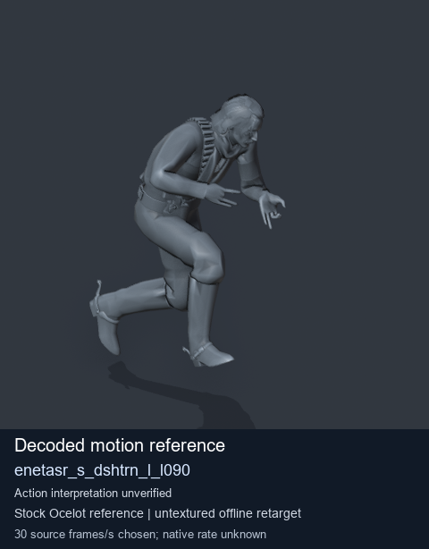
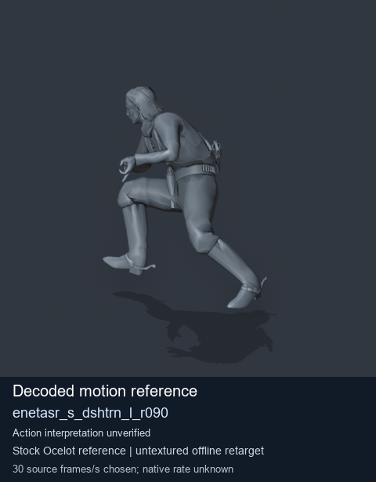
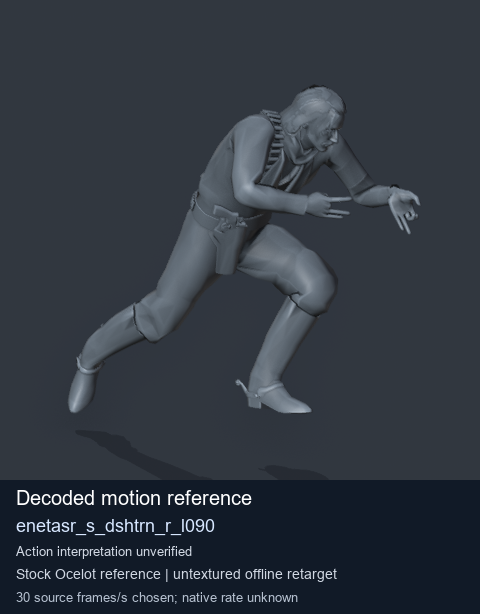
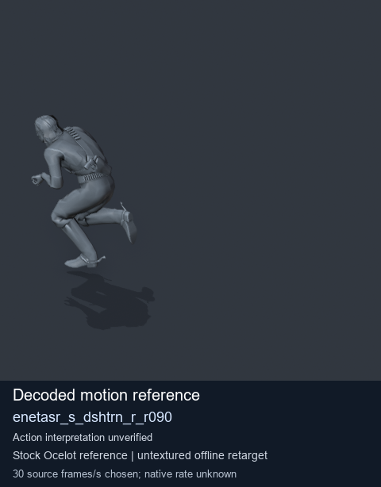

# Stock Soldier_common motion references / /Assets/tpp/motion/SI_game/fani/bodies/enet/enetasr - page 83

[Library](../README.md) · [Grouped directory](../browse/README.md) · [This source family](../browse/stock-soldier-enetasr-dd428991.md) · [Switch mode](browse-stock-soldier-enetasr-dd428991-83.md)

**Still images: no GIFs loaded** · 4 clips · 0.34 MiB downloaded.

Images reuse existing files. A small display width does not reduce download size. Open one clip for its larger titled GIF and original technical data.

Source-family grouping uses only recorded virtual directories; it does not establish an action, weapon, actor, rig or native compatibility. Existing descriptions and tags below are unchanged. Per-clip visual review may be pending; chosen preview speed is separate from unmeasured native timing.

| Preview | Animation | Category | Tags | Virtual GANI directory / file | MTAR / container location | Description | Frames / data |
| --- | --- | --- | --- | --- | --- | --- | --- |
|  | [Stock reference: enetasr_s_dshtrn_l_l090](../clips/mgsv-tpp-soldier_common-payloadsha256-bc942a6d4218ca67f3caac31dc823dc4c604e1034f1bfca17fc8c3852ceca517.md) <code>enetasr_s_dshtrn_l_l090</code> | Stock Soldier_common motion references | <code>stock animation reference</code> <code>Soldier_common</code> <code>source-derived label</code> <code>Ocelot reference mesh</code> | <code>/Assets/tpp/motion/SI_game/fani/bodies/enet/enetasr</code> <code>enetasr_s_dshtrn_l_l090.gani</code> | Retained MTAR: <code>Soldier_common.mtar</code> DAT / FPK membership unverified | Decoded stock reference enetasr_s_dshtrn_l_l090; action interpretation unverified. | 42 raw 1.4 s chosen; native rate unknown [Full data](../clips/mgsv-tpp-soldier_common-payloadsha256-bc942a6d4218ca67f3caac31dc823dc4c604e1034f1bfca17fc8c3852ceca517.md#technical-data) |
|  | [Stock reference: enetasr_s_dshtrn_l_r090](../clips/mgsv-tpp-soldier_common-payloadsha256-8a69b27e953591a9c4f78f3950fca09a4639c9813c7bb64150033041bfe9a0b0.md) <code>enetasr_s_dshtrn_l_r090</code> | Stock Soldier_common motion references | <code>stock animation reference</code> <code>Soldier_common</code> <code>source-derived label</code> <code>Ocelot reference mesh</code> | <code>/Assets/tpp/motion/SI_game/fani/bodies/enet/enetasr</code> <code>enetasr_s_dshtrn_l_r090.gani</code> | Retained MTAR: <code>Soldier_common.mtar</code> DAT / FPK membership unverified | Decoded stock reference enetasr_s_dshtrn_l_r090; action interpretation unverified. | 45 raw 1.5 s chosen; native rate unknown [Full data](../clips/mgsv-tpp-soldier_common-payloadsha256-8a69b27e953591a9c4f78f3950fca09a4639c9813c7bb64150033041bfe9a0b0.md#technical-data) |
|  | [Stock reference: enetasr_s_dshtrn_r_l090](../clips/mgsv-tpp-soldier_common-payloadsha256-bc8f16482a02c941cc2c72a6626adc61653029bbc64d0859989ee3644ac16b58.md) <code>enetasr_s_dshtrn_r_l090</code> | Stock Soldier_common motion references | <code>stock animation reference</code> <code>Soldier_common</code> <code>source-derived label</code> <code>Ocelot reference mesh</code> | <code>/Assets/tpp/motion/SI_game/fani/bodies/enet/enetasr</code> <code>enetasr_s_dshtrn_r_l090.gani</code> | Retained MTAR: <code>Soldier_common.mtar</code> DAT / FPK membership unverified | Decoded stock reference enetasr_s_dshtrn_r_l090; action interpretation unverified. | 39 raw 1.3 s chosen; native rate unknown [Full data](../clips/mgsv-tpp-soldier_common-payloadsha256-bc8f16482a02c941cc2c72a6626adc61653029bbc64d0859989ee3644ac16b58.md#technical-data) |
|  | [Stock reference: enetasr_s_dshtrn_r_r090](../clips/mgsv-tpp-soldier_common-payloadsha256-0cd44b69a7d2e9ee5742810e3b2a9011572ce9bbf4a4993ca98300e8779200c5.md) <code>enetasr_s_dshtrn_r_r090</code> | Stock Soldier_common motion references | <code>stock animation reference</code> <code>Soldier_common</code> <code>source-derived label</code> <code>Ocelot reference mesh</code> | <code>/Assets/tpp/motion/SI_game/fani/bodies/enet/enetasr</code> <code>enetasr_s_dshtrn_r_r090.gani</code> | Retained MTAR: <code>Soldier_common.mtar</code> DAT / FPK membership unverified | Decoded stock reference enetasr_s_dshtrn_r_r090; action interpretation unverified. | 31 raw 1.03 s chosen; native rate unknown [Full data](../clips/mgsv-tpp-soldier_common-payloadsha256-0cd44b69a7d2e9ee5742810e3b2a9011572ce9bbf4a4993ca98300e8779200c5.md#technical-data) |

[Source descriptions, confidence and credits](../description-sources.md) · [Complete JSON](../catalogue.json) · [CSV](../catalogue.csv)
