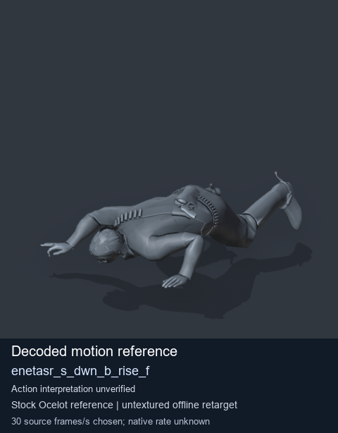
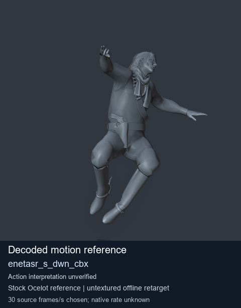
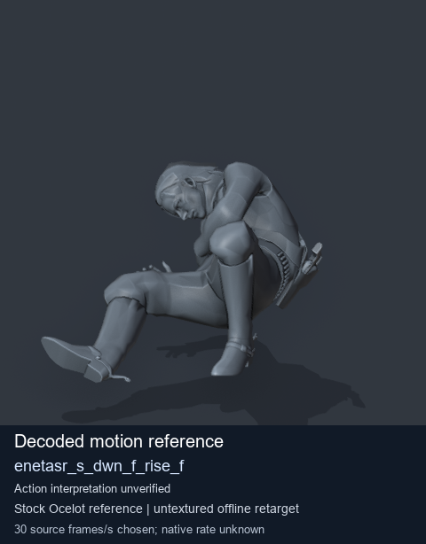
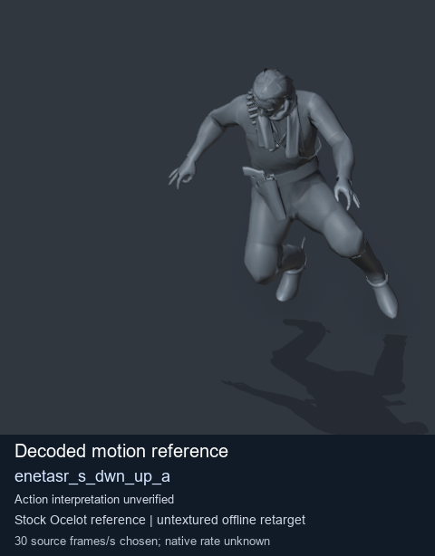

# Stock Soldier_common motion references / /Assets/tpp/motion/SI_game/fani/bodies/enet/enetasr - page 84

[Library](../README.md) · [Grouped directory](../browse/README.md) · [This source family](../browse/stock-soldier-enetasr-dd428991.md) · [Switch mode](browse-stock-soldier-enetasr-dd428991-84.md)

**Still images: no GIFs loaded** · 4 clips · 0.36 MiB downloaded.

Images reuse existing files. A small display width does not reduce download size. Open one clip for its larger titled GIF and original technical data.

Source-family grouping uses only recorded virtual directories; it does not establish an action, weapon, actor, rig or native compatibility. Existing descriptions and tags below are unchanged. Per-clip visual review may be pending; chosen preview speed is separate from unmeasured native timing.

| Preview | Animation | Category | Tags | Virtual GANI directory / file | MTAR / container location | Description | Frames / data |
| --- | --- | --- | --- | --- | --- | --- | --- |
|  | [Stock reference: enetasr_s_dwn_b_rise_f](../clips/mgsv-tpp-soldier_common-payloadsha256-b9bb003d6bf34894759b27ae3b5bc8d6cfc7f61159544111a30575b31591c381.md) <code>enetasr_s_dwn_b_rise_f</code> | Stock Soldier_common motion references | <code>stock animation reference</code> <code>Soldier_common</code> <code>source-derived label</code> <code>Ocelot reference mesh</code> | <code>/Assets/tpp/motion/SI_game/fani/bodies/enet/enetasr</code> <code>enetasr_s_dwn_b_rise_f.gani</code> | Retained MTAR: <code>Soldier_common.mtar</code> DAT / FPK membership unverified | Decoded stock reference enetasr_s_dwn_b_rise_f; action interpretation unverified. | 180 raw 6.0 s chosen; native rate unknown [Full data](../clips/mgsv-tpp-soldier_common-payloadsha256-b9bb003d6bf34894759b27ae3b5bc8d6cfc7f61159544111a30575b31591c381.md#technical-data) |
|  | [Stock motion reference: enetasr_s_dwn_cbx](../clips/mgsv-tpp-soldier_common-payloadsha256-341313c586f970b2ec7d58c63b5bbdc8032f9507a9757dd6f7619830ed245eaf.md) <code>enetasr_s_dwn_cbx</code> | Stock Soldier_common motion references | <code>stock body motion</code> <code>Soldier_common</code> <code>source-derived label</code> <code>Ocelot reference mesh</code> | <code>/Assets/tpp/motion/SI_game/fani/bodies/enet/enetasr</code> <code>enetasr_s_dwn_cbx.gani</code> | Retained MTAR: <code>Soldier_common.mtar</code> DAT / FPK membership unverified | Decoded stock body-motion reference enetasr_s_dwn_cbx; action interpretation unverified. | 112 raw 3.73 s chosen; native rate unknown [Full data](../clips/mgsv-tpp-soldier_common-payloadsha256-341313c586f970b2ec7d58c63b5bbdc8032f9507a9757dd6f7619830ed245eaf.md#technical-data) |
|  | [Stock reference: enetasr_s_dwn_f_rise_f](../clips/mgsv-tpp-soldier_common-payloadsha256-eb5cdee34dd9f94157658d3de2ec31537c8f92dadcaa931b69bd7f2dea663710.md) <code>enetasr_s_dwn_f_rise_f</code> | Stock Soldier_common motion references | <code>stock animation reference</code> <code>Soldier_common</code> <code>source-derived label</code> <code>Ocelot reference mesh</code> | <code>/Assets/tpp/motion/SI_game/fani/bodies/enet/enetasr</code> <code>enetasr_s_dwn_f_rise_f.gani</code> | Retained MTAR: <code>Soldier_common.mtar</code> DAT / FPK membership unverified | Decoded stock reference enetasr_s_dwn_f_rise_f; action interpretation unverified. | 125 raw 4.17 s chosen; native rate unknown [Full data](../clips/mgsv-tpp-soldier_common-payloadsha256-eb5cdee34dd9f94157658d3de2ec31537c8f92dadcaa931b69bd7f2dea663710.md#technical-data) |
|  | [Stock reference: enetasr_s_dwn_up_a](../clips/mgsv-tpp-soldier_common-payloadsha256-d588a98af67ab9b96465fc114bd656c03ba8f026f084840571523e3d60502007.md) <code>enetasr_s_dwn_up_a</code> | Stock Soldier_common motion references | <code>stock animation reference</code> <code>Soldier_common</code> <code>source-derived label</code> <code>Ocelot reference mesh</code> | <code>/Assets/tpp/motion/SI_game/fani/bodies/enet/enetasr</code> <code>enetasr_s_dwn_up_a.gani</code> | Retained MTAR: <code>Soldier_common.mtar</code> DAT / FPK membership unverified | Decoded stock reference enetasr_s_dwn_up_a; action interpretation unverified. | 90 raw 3.0 s chosen; native rate unknown [Full data](../clips/mgsv-tpp-soldier_common-payloadsha256-d588a98af67ab9b96465fc114bd656c03ba8f026f084840571523e3d60502007.md#technical-data) |

[Source descriptions, confidence and credits](../description-sources.md) · [Complete JSON](../catalogue.json) · [CSV](../catalogue.csv)
