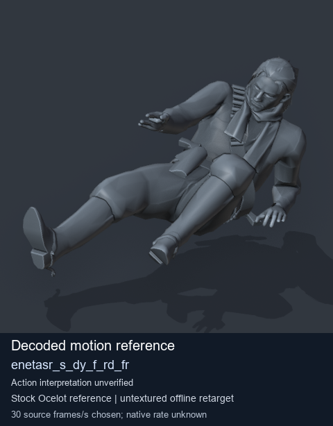
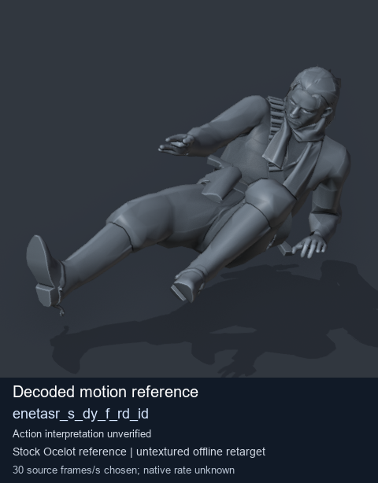
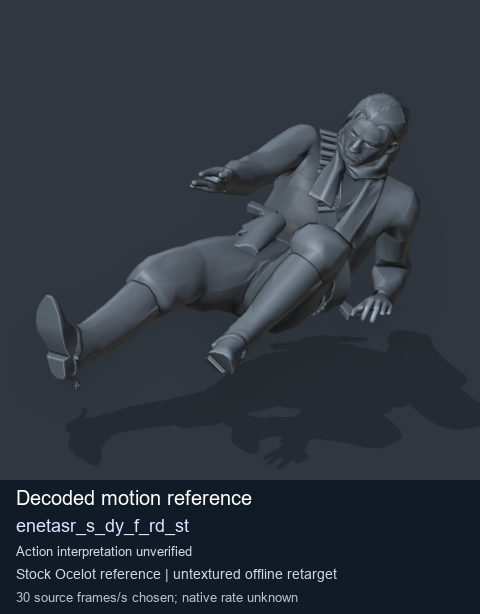
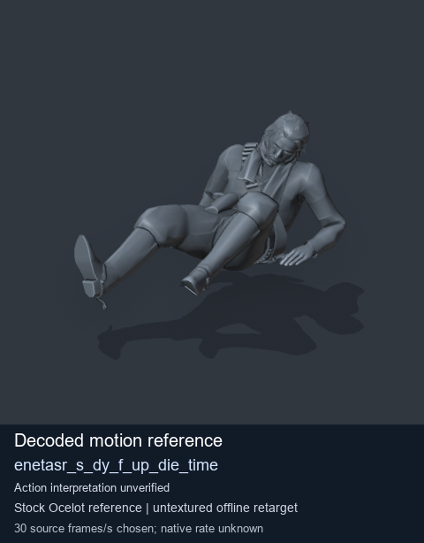

# Stock Soldier_common motion references / /Assets/tpp/motion/SI_game/fani/bodies/enet/enetasr - page 86

[Library](../README.md) · [Grouped directory](../browse/README.md) · [This source family](../browse/stock-soldier-enetasr-dd428991.md) · [Switch mode](browse-stock-soldier-enetasr-dd428991-86.md)

**Still images: no GIFs loaded** · 4 clips · 0.48 MiB downloaded.

Images reuse existing files. A small display width does not reduce download size. Open one clip for its larger titled GIF and original technical data.

Source-family grouping uses only recorded virtual directories; it does not establish an action, weapon, actor, rig or native compatibility. Existing descriptions and tags below are unchanged. Per-clip visual review may be pending; chosen preview speed is separate from unmeasured native timing.

| Preview | Animation | Category | Tags | Virtual GANI directory / file | MTAR / container location | Description | Frames / data |
| --- | --- | --- | --- | --- | --- | --- | --- |
|  | [Stock motion reference: enetasr_s_dy_f_rd_fr](../clips/mgsv-tpp-soldier_common-payloadsha256-e32ab220f8ea040173b1cd7b45aca3293acfecadc69b4bc1a392ac49f808dc5c.md) <code>enetasr_s_dy_f_rd_fr</code> | Stock Soldier_common motion references | <code>stock body motion</code> <code>Soldier_common</code> <code>source-derived label</code> <code>Ocelot reference mesh</code> | <code>/Assets/tpp/motion/SI_game/fani/bodies/enet/enetasr</code> <code>enetasr_s_dy_f_rd_fr.gani</code> | Retained MTAR: <code>Soldier_common.mtar</code> DAT / FPK membership unverified | Decoded stock body-motion reference enetasr_s_dy_f_rd_fr; action interpretation unverified. | 30 raw 1.0 s chosen; native rate unknown [Full data](../clips/mgsv-tpp-soldier_common-payloadsha256-e32ab220f8ea040173b1cd7b45aca3293acfecadc69b4bc1a392ac49f808dc5c.md#technical-data) |
|  | [Stock reference: enetasr_s_dy_f_rd_id](../clips/mgsv-tpp-soldier_common-payloadsha256-7aa01a5cec0ec318118f6c66eea151afeba45ba134820a0b49c5e9ae5fcac820.md) <code>enetasr_s_dy_f_rd_id</code> | Stock Soldier_common motion references | <code>stock animation reference</code> <code>Soldier_common</code> <code>source-derived label</code> <code>Ocelot reference mesh</code> | <code>/Assets/tpp/motion/SI_game/fani/bodies/enet/enetasr</code> <code>enetasr_s_dy_f_rd_id.gani</code> | Retained MTAR: <code>Soldier_common.mtar</code> DAT / FPK membership unverified | Decoded stock reference enetasr_s_dy_f_rd_id; action interpretation unverified. | 160 raw 5.33 s chosen; native rate unknown [Full data](../clips/mgsv-tpp-soldier_common-payloadsha256-7aa01a5cec0ec318118f6c66eea151afeba45ba134820a0b49c5e9ae5fcac820.md#technical-data) |
|  | [Stock reference: enetasr_s_dy_f_rd_st](../clips/mgsv-tpp-soldier_common-payloadsha256-89331f60e9f8dc793c14f18005b34d99409853b519d9961889fee3840a436728.md) <code>enetasr_s_dy_f_rd_st</code> | Stock Soldier_common motion references | <code>stock animation reference</code> <code>Soldier_common</code> <code>source-derived label</code> <code>Ocelot reference mesh</code> | <code>/Assets/tpp/motion/SI_game/fani/bodies/enet/enetasr</code> <code>enetasr_s_dy_f_rd_st.gani</code> | Retained MTAR: <code>Soldier_common.mtar</code> DAT / FPK membership unverified | Decoded stock reference enetasr_s_dy_f_rd_st; action interpretation unverified. | 27 raw 0.9 s chosen; native rate unknown [Full data](../clips/mgsv-tpp-soldier_common-payloadsha256-89331f60e9f8dc793c14f18005b34d99409853b519d9961889fee3840a436728.md#technical-data) |
|  | [Stock motion reference: enetasr_s_dy_f_up_die_time](../clips/mgsv-tpp-soldier_common-payloadsha256-9030925cf20e3e581617fbe142386b1f81818482f11e2bbc18427d555deb91f2.md) <code>enetasr_s_dy_f_up_die_time</code> | Stock Soldier_common motion references | <code>stock body motion</code> <code>Soldier_common</code> <code>source-derived label</code> <code>Ocelot reference mesh</code> | <code>/Assets/tpp/motion/SI_game/fani/bodies/enet/enetasr</code> <code>enetasr_s_dy_f_up_die_time.gani</code> | Retained MTAR: <code>Soldier_common.mtar</code> DAT / FPK membership unverified | Decoded stock body-motion reference enetasr_s_dy_f_up_die_time; action interpretation unverified. | 175 raw 5.83 s chosen; native rate unknown [Full data](../clips/mgsv-tpp-soldier_common-payloadsha256-9030925cf20e3e581617fbe142386b1f81818482f11e2bbc18427d555deb91f2.md#technical-data) |

[Source descriptions, confidence and credits](../description-sources.md) · [Complete JSON](../catalogue.json) · [CSV](../catalogue.csv)
