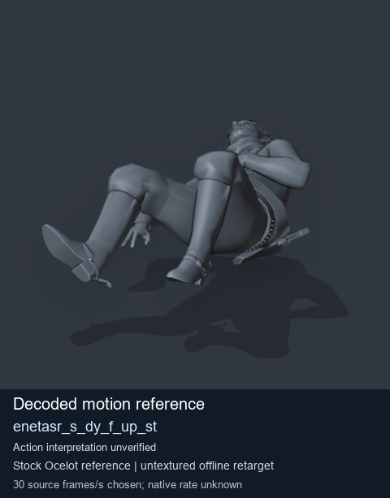
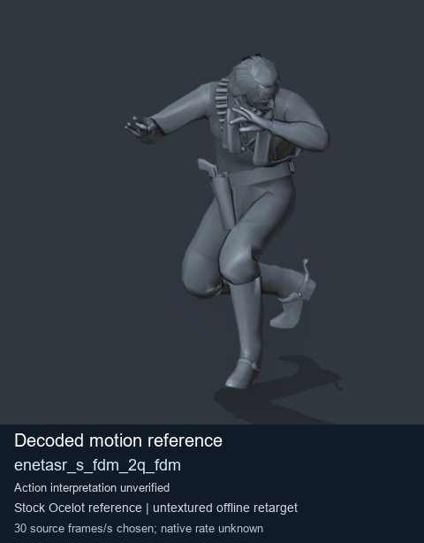
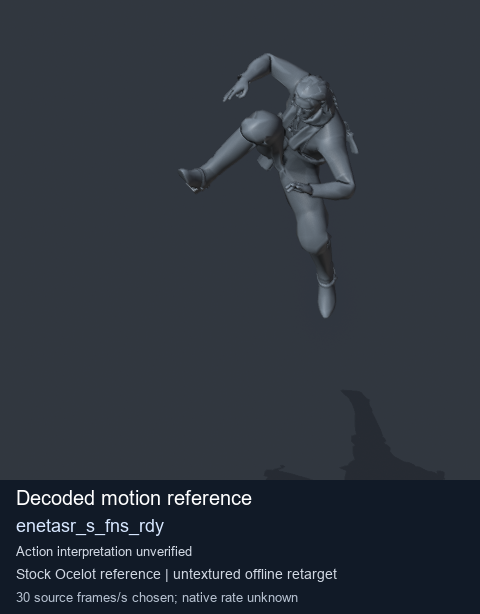
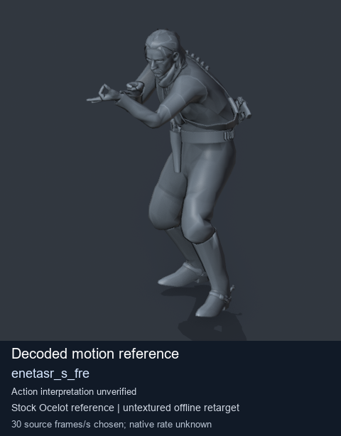

# Stock Soldier_common motion references / /Assets/tpp/motion/SI_game/fani/bodies/enet/enetasr - page 88

[Library](../README.md) · [Grouped directory](../browse/README.md) · [This source family](../browse/stock-soldier-enetasr-dd428991.md) · [Switch mode](browse-stock-soldier-enetasr-dd428991-88.md)

**Still images: no GIFs loaded** · 4 clips · 0.36 MiB downloaded.

Images reuse existing files. A small display width does not reduce download size. Open one clip for its larger titled GIF and original technical data.

Source-family grouping uses only recorded virtual directories; it does not establish an action, weapon, actor, rig or native compatibility. Existing descriptions and tags below are unchanged. Per-clip visual review may be pending; chosen preview speed is separate from unmeasured native timing.

| Preview | Animation | Category | Tags | Virtual GANI directory / file | MTAR / container location | Description | Frames / data |
| --- | --- | --- | --- | --- | --- | --- | --- |
|  | [Stock reference: enetasr_s_dy_f_up_st](../clips/mgsv-tpp-soldier_common-payloadsha256-052cf22916003625f1b78d4eae450cc36444fe5e1a4c7d363e81f25715901475.md) <code>enetasr_s_dy_f_up_st</code> | Stock Soldier_common motion references | <code>stock animation reference</code> <code>Soldier_common</code> <code>source-derived label</code> <code>Ocelot reference mesh</code> | <code>/Assets/tpp/motion/SI_game/fani/bodies/enet/enetasr</code> <code>enetasr_s_dy_f_up_st.gani</code> | Retained MTAR: <code>Soldier_common.mtar</code> DAT / FPK membership unverified | Decoded stock reference enetasr_s_dy_f_up_st; action interpretation unverified. | 216 raw 7.2 s chosen; native rate unknown [Full data](../clips/mgsv-tpp-soldier_common-payloadsha256-052cf22916003625f1b78d4eae450cc36444fe5e1a4c7d363e81f25715901475.md#technical-data) |
|  | [Stock reference: enetasr_s_fdm_2q_fdm](../clips/mgsv-tpp-soldier_common-payloadsha256-0d16df3ac8301d2e7a94e50921ffef631e8123337a77451c6162f92b03882f98.md) <code>enetasr_s_fdm_2q_fdm</code> | Stock Soldier_common motion references | <code>stock animation reference</code> <code>Soldier_common</code> <code>source-derived label</code> <code>Ocelot reference mesh</code> | <code>/Assets/tpp/motion/SI_game/fani/bodies/enet/enetasr</code> <code>enetasr_s_fdm_2q_fdm.gani</code> | Retained MTAR: <code>Soldier_common.mtar</code> DAT / FPK membership unverified | Decoded stock reference enetasr_s_fdm_2q_fdm; action interpretation unverified. | 80 raw 2.67 s chosen; native rate unknown [Full data](../clips/mgsv-tpp-soldier_common-payloadsha256-0d16df3ac8301d2e7a94e50921ffef631e8123337a77451c6162f92b03882f98.md#technical-data) |
|  | [Stock motion reference: enetasr_s_fns_rdy](../clips/mgsv-tpp-soldier_common-payloadsha256-8e4e2be2bd96e54dd784bc4c15743abc2b73d69d8f0fcbae8ab1edd001d10cf8.md) <code>enetasr_s_fns_rdy</code> | Stock Soldier_common motion references | <code>stock body motion</code> <code>Soldier_common</code> <code>source-derived label</code> <code>Ocelot reference mesh</code> | <code>/Assets/tpp/motion/SI_game/fani/bodies/enet/enetasr</code> <code>enetasr_s_fns_rdy.gani</code> | Retained MTAR: <code>Soldier_common.mtar</code> DAT / FPK membership unverified | Decoded stock body-motion reference enetasr_s_fns_rdy; action interpretation unverified. | 85 raw 2.83 s chosen; native rate unknown [Full data](../clips/mgsv-tpp-soldier_common-payloadsha256-8e4e2be2bd96e54dd784bc4c15743abc2b73d69d8f0fcbae8ab1edd001d10cf8.md#technical-data) |
|  | [Stock reference: enetasr_s_fre](../clips/mgsv-tpp-soldier_common-payloadsha256-c179406c95acd3a42dfcf795d41c4eb27e256edc661cff173460dfd153812fa9.md) <code>enetasr_s_fre</code> | Stock Soldier_common motion references | <code>stock animation reference</code> <code>Soldier_common</code> <code>source-derived label</code> <code>Ocelot reference mesh</code> | <code>/Assets/tpp/motion/SI_game/fani/bodies/enet/enetasr</code> <code>enetasr_s_fre.gani</code> | Retained MTAR: <code>Soldier_common.mtar</code> DAT / FPK membership unverified | Decoded stock reference enetasr_s_fre; action interpretation unverified. | 40 raw 1.33 s chosen; native rate unknown [Full data](../clips/mgsv-tpp-soldier_common-payloadsha256-c179406c95acd3a42dfcf795d41c4eb27e256edc661cff173460dfd153812fa9.md#technical-data) |

[Source descriptions, confidence and credits](../description-sources.md) · [Complete JSON](../catalogue.json) · [CSV](../catalogue.csv)
