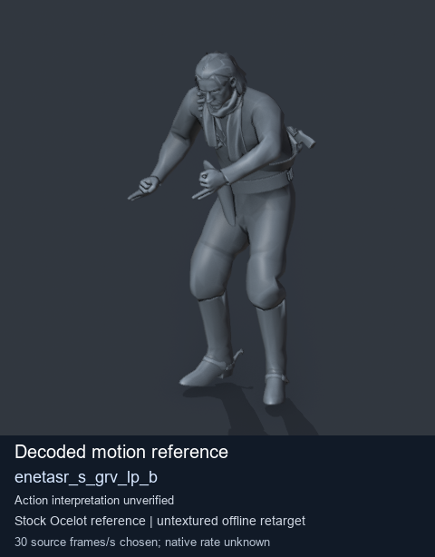
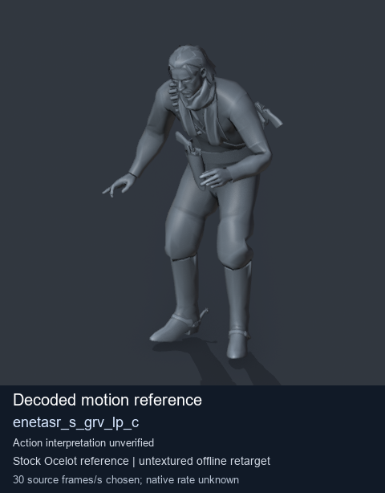
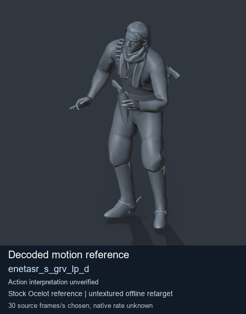

# Stock Soldier_common motion references / /Assets/tpp/motion/SI_game/fani/bodies/enet/enetasr - page 90

[Library](../README.md) · [Grouped directory](../browse/README.md) · [This source family](../browse/stock-soldier-enetasr-dd428991.md) · [Switch mode](browse-stock-soldier-enetasr-dd428991-90.md)

**Still images: no GIFs loaded** · 3 clips · 0.29 MiB downloaded.

Images reuse existing files. A small display width does not reduce download size. Open one clip for its larger titled GIF and original technical data.

Source-family grouping uses only recorded virtual directories; it does not establish an action, weapon, actor, rig or native compatibility. Existing descriptions and tags below are unchanged. Per-clip visual review may be pending; chosen preview speed is separate from unmeasured native timing.

| Preview | Animation | Category | Tags | Virtual GANI directory / file | MTAR / container location | Description | Frames / data |
| --- | --- | --- | --- | --- | --- | --- | --- |
|  | [Stock reference: enetasr_s_grv_lp_b](../clips/mgsv-tpp-soldier_common-payloadsha256-11ddc4d9b3ef93c26bbaf94b0d5aa3143f9a660f07328f8c78cc986e0d6b9153.md) <code>enetasr_s_grv_lp_b</code> | Stock Soldier_common motion references | <code>stock animation reference</code> <code>Soldier_common</code> <code>source-derived label</code> <code>Ocelot reference mesh</code> | <code>/Assets/tpp/motion/SI_game/fani/bodies/enet/enetasr</code> <code>enetasr_s_grv_lp_b.gani</code> | Retained MTAR: <code>Soldier_common.mtar</code> DAT / FPK membership unverified | Decoded stock reference enetasr_s_grv_lp_b; action interpretation unverified. | 164 raw 5.47 s chosen; native rate unknown [Full data](../clips/mgsv-tpp-soldier_common-payloadsha256-11ddc4d9b3ef93c26bbaf94b0d5aa3143f9a660f07328f8c78cc986e0d6b9153.md#technical-data) |
|  | [Stock reference: enetasr_s_grv_lp_c](../clips/mgsv-tpp-soldier_common-payloadsha256-0a330ee193a29e5711a0c6a3952efb391e8bd52e0263347ab283bcc9463b6d5f.md) <code>enetasr_s_grv_lp_c</code> | Stock Soldier_common motion references | <code>stock animation reference</code> <code>Soldier_common</code> <code>source-derived label</code> <code>Ocelot reference mesh</code> | <code>/Assets/tpp/motion/SI_game/fani/bodies/enet/enetasr</code> <code>enetasr_s_grv_lp_c.gani</code> | Retained MTAR: <code>Soldier_common.mtar</code> DAT / FPK membership unverified | Decoded stock reference enetasr_s_grv_lp_c; action interpretation unverified. | 130 raw 4.33 s chosen; native rate unknown [Full data](../clips/mgsv-tpp-soldier_common-payloadsha256-0a330ee193a29e5711a0c6a3952efb391e8bd52e0263347ab283bcc9463b6d5f.md#technical-data) |
|  | [Stock motion reference: enetasr_s_grv_lp_d](../clips/mgsv-tpp-soldier_common-payloadsha256-889266fde70eb1e68f26624c4605d33c2290c84996a9e5d575b4f6c9ab15983e.md) <code>enetasr_s_grv_lp_d</code> | Stock Soldier_common motion references | <code>stock body motion</code> <code>Soldier_common</code> <code>source-derived label</code> <code>Ocelot reference mesh</code> | <code>/Assets/tpp/motion/SI_game/fani/bodies/enet/enetasr</code> <code>enetasr_s_grv_lp_d.gani</code> | Retained MTAR: <code>Soldier_common.mtar</code> DAT / FPK membership unverified | Decoded stock body-motion reference enetasr_s_grv_lp_d; action interpretation unverified. | 170 raw 5.67 s chosen; native rate unknown [Full data](../clips/mgsv-tpp-soldier_common-payloadsha256-889266fde70eb1e68f26624c4605d33c2290c84996a9e5d575b4f6c9ab15983e.md#technical-data) |

[Source descriptions, confidence and credits](../description-sources.md) · [Complete JSON](../catalogue.json) · [CSV](../catalogue.csv)
