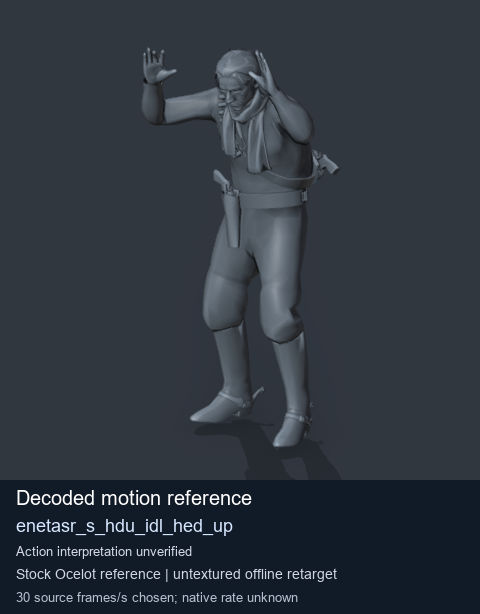
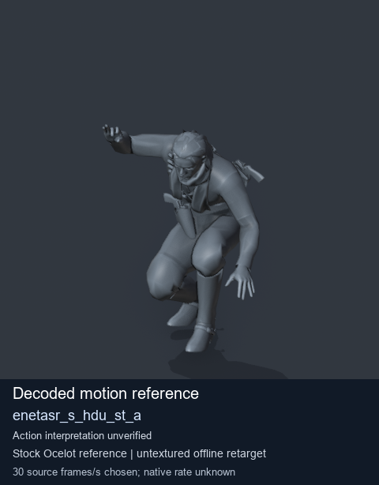
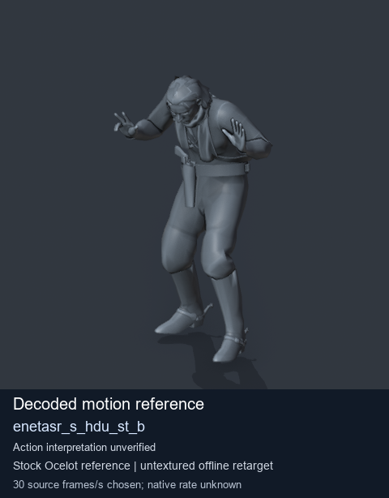

# Stock Soldier_common motion references / /Assets/tpp/motion/SI_game/fani/bodies/enet/enetasr - page 94

[Library](../README.md) · [Grouped directory](../browse/README.md) · [This source family](../browse/stock-soldier-enetasr-dd428991.md) · [Switch mode](browse-stock-soldier-enetasr-dd428991-94.md)

**Still images: no GIFs loaded** · 3 clips · 0.26 MiB downloaded.

Images reuse existing files. A small display width does not reduce download size. Open one clip for its larger titled GIF and original technical data.

Source-family grouping uses only recorded virtual directories; it does not establish an action, weapon, actor, rig or native compatibility. Existing descriptions and tags below are unchanged. Per-clip visual review may be pending; chosen preview speed is separate from unmeasured native timing.

| Preview | Animation | Category | Tags | Virtual GANI directory / file | MTAR / container location | Description | Frames / data |
| --- | --- | --- | --- | --- | --- | --- | --- |
|  | [Stock motion reference: enetasr_s_hdu_idl_hed_up](../clips/mgsv-tpp-soldier_common-payloadsha256-89afe05dc08b554168b0dac7e06da7276e2fec86c5c5e6dceac82285e64b30f9.md) <code>enetasr_s_hdu_idl_hed_up</code> | Stock Soldier_common motion references | <code>stock body motion</code> <code>Soldier_common</code> <code>source-derived label</code> <code>Ocelot reference mesh</code> | <code>/Assets/tpp/motion/SI_game/fani/bodies/enet/enetasr</code> <code>enetasr_s_hdu_idl_hed_up.gani</code> | Retained MTAR: <code>Soldier_common.mtar</code> DAT / FPK membership unverified | Decoded stock body-motion reference enetasr_s_hdu_idl_hed_up; action interpretation unverified. | 180 raw 6.0 s chosen; native rate unknown [Full data](../clips/mgsv-tpp-soldier_common-payloadsha256-89afe05dc08b554168b0dac7e06da7276e2fec86c5c5e6dceac82285e64b30f9.md#technical-data) |
|  | [Stock reference: enetasr_s_hdu_st_a](../clips/mgsv-tpp-soldier_common-payloadsha256-ee7e89a9c7e3eeb75c76adeee2ee30409ecb25d5d3117befc47b90b3243ad810.md) <code>enetasr_s_hdu_st_a</code> | Stock Soldier_common motion references | <code>stock animation reference</code> <code>Soldier_common</code> <code>source-derived label</code> <code>Ocelot reference mesh</code> | <code>/Assets/tpp/motion/SI_game/fani/bodies/enet/enetasr</code> <code>enetasr_s_hdu_st_a.gani</code> | Retained MTAR: <code>Soldier_common.mtar</code> DAT / FPK membership unverified | Decoded stock reference enetasr_s_hdu_st_a; action interpretation unverified. | 129 raw 4.3 s chosen; native rate unknown [Full data](../clips/mgsv-tpp-soldier_common-payloadsha256-ee7e89a9c7e3eeb75c76adeee2ee30409ecb25d5d3117befc47b90b3243ad810.md#technical-data) |
|  | [Stock reference: enetasr_s_hdu_st_b](../clips/mgsv-tpp-soldier_common-payloadsha256-d5ea68888acd9232787ead3623a6b2ed321897e7b69b8cb4a908a8778e7733e5.md) <code>enetasr_s_hdu_st_b</code> | Stock Soldier_common motion references | <code>stock animation reference</code> <code>Soldier_common</code> <code>source-derived label</code> <code>Ocelot reference mesh</code> | <code>/Assets/tpp/motion/SI_game/fani/bodies/enet/enetasr</code> <code>enetasr_s_hdu_st_b.gani</code> | Retained MTAR: <code>Soldier_common.mtar</code> DAT / FPK membership unverified | Decoded stock reference enetasr_s_hdu_st_b; action interpretation unverified. | 92 raw 3.07 s chosen; native rate unknown [Full data](../clips/mgsv-tpp-soldier_common-payloadsha256-d5ea68888acd9232787ead3623a6b2ed321897e7b69b8cb4a908a8778e7733e5.md#technical-data) |

[Source descriptions, confidence and credits](../description-sources.md) · [Complete JSON](../catalogue.json) · [CSV](../catalogue.csv)
