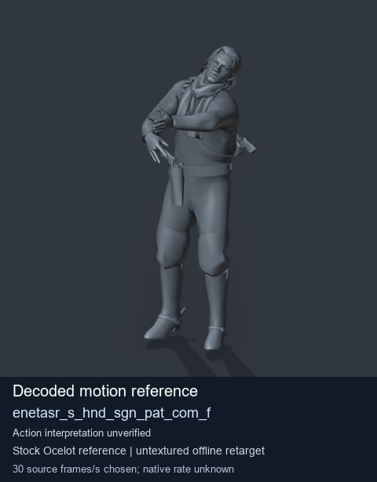
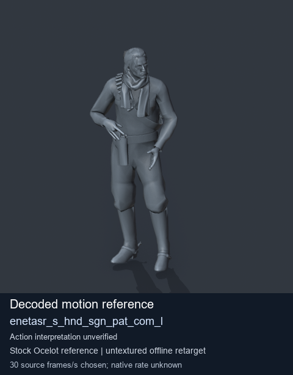
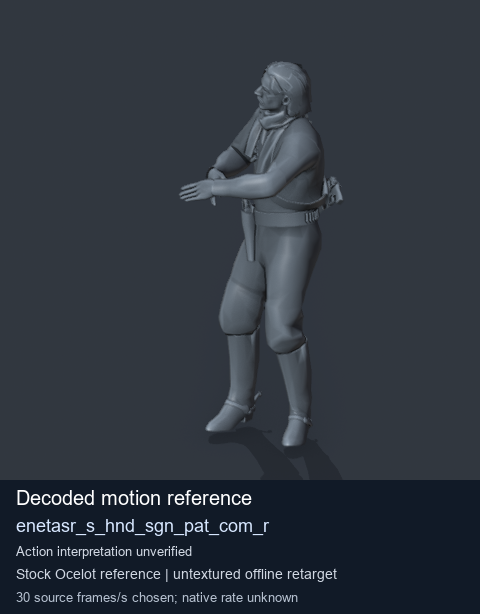

# Stock Soldier_common motion references / /Assets/tpp/motion/SI_game/fani/bodies/enet/enetasr - page 97

[Library](../README.md) · [Grouped directory](../browse/README.md) · [This source family](../browse/stock-soldier-enetasr-dd428991.md) · [Switch mode](browse-stock-soldier-enetasr-dd428991-97.md)

**Still images: no GIFs loaded** · 3 clips · 0.26 MiB downloaded.

Images reuse existing files. A small display width does not reduce download size. Open one clip for its larger titled GIF and original technical data.

Source-family grouping uses only recorded virtual directories; it does not establish an action, weapon, actor, rig or native compatibility. Existing descriptions and tags below are unchanged. Per-clip visual review may be pending; chosen preview speed is separate from unmeasured native timing.

| Preview | Animation | Category | Tags | Virtual GANI directory / file | MTAR / container location | Description | Frames / data |
| --- | --- | --- | --- | --- | --- | --- | --- |
|  | [Stock motion reference: enetasr_s_hnd_sgn_pat_com_f](../clips/mgsv-tpp-soldier_common-payloadsha256-0d1bbcc8d3a69f5fc3aa1a0ea7642f6764a9dd3ef601660dbaae696454555571.md) <code>enetasr_s_hnd_sgn_pat_com_f</code> | Stock Soldier_common motion references | <code>stock body motion</code> <code>Soldier_common</code> <code>source-derived label</code> <code>Ocelot reference mesh</code> | <code>/Assets/tpp/motion/SI_game/fani/bodies/enet/enetasr</code> <code>enetasr_s_hnd_sgn_pat_com_f.gani</code> | Retained MTAR: <code>Soldier_common.mtar</code> DAT / FPK membership unverified | Decoded stock body-motion reference enetasr_s_hnd_sgn_pat_com_f; action interpretation unverified. | 120 raw 4.0 s chosen; native rate unknown [Full data](../clips/mgsv-tpp-soldier_common-payloadsha256-0d1bbcc8d3a69f5fc3aa1a0ea7642f6764a9dd3ef601660dbaae696454555571.md#technical-data) |
|  | [Stock motion reference: enetasr_s_hnd_sgn_pat_com_l](../clips/mgsv-tpp-soldier_common-payloadsha256-c5762bfdfb421dd99f1cb4eb3ad36d364f8f4d0e45ba4773cd81d9b0a8b5dec1.md) <code>enetasr_s_hnd_sgn_pat_com_l</code> | Stock Soldier_common motion references | <code>stock body motion</code> <code>Soldier_common</code> <code>source-derived label</code> <code>Ocelot reference mesh</code> | <code>/Assets/tpp/motion/SI_game/fani/bodies/enet/enetasr</code> <code>enetasr_s_hnd_sgn_pat_com_l.gani</code> | Retained MTAR: <code>Soldier_common.mtar</code> DAT / FPK membership unverified | Decoded stock body-motion reference enetasr_s_hnd_sgn_pat_com_l; action interpretation unverified. | 153 raw 5.1 s chosen; native rate unknown [Full data](../clips/mgsv-tpp-soldier_common-payloadsha256-c5762bfdfb421dd99f1cb4eb3ad36d364f8f4d0e45ba4773cd81d9b0a8b5dec1.md#technical-data) |
|  | [Stock motion reference: enetasr_s_hnd_sgn_pat_com_r](../clips/mgsv-tpp-soldier_common-payloadsha256-e23940a9ee8226ca5ff59731685111bb1c79a54876db9165e319f899e9e7a2bd.md) <code>enetasr_s_hnd_sgn_pat_com_r</code> | Stock Soldier_common motion references | <code>stock body motion</code> <code>Soldier_common</code> <code>source-derived label</code> <code>Ocelot reference mesh</code> | <code>/Assets/tpp/motion/SI_game/fani/bodies/enet/enetasr</code> <code>enetasr_s_hnd_sgn_pat_com_r.gani</code> | Retained MTAR: <code>Soldier_common.mtar</code> DAT / FPK membership unverified | Decoded stock body-motion reference enetasr_s_hnd_sgn_pat_com_r; action interpretation unverified. | 160 raw 5.33 s chosen; native rate unknown [Full data](../clips/mgsv-tpp-soldier_common-payloadsha256-e23940a9ee8226ca5ff59731685111bb1c79a54876db9165e319f899e9e7a2bd.md#technical-data) |

[Source descriptions, confidence and credits](../description-sources.md) · [Complete JSON](../catalogue.json) · [CSV](../catalogue.csv)
