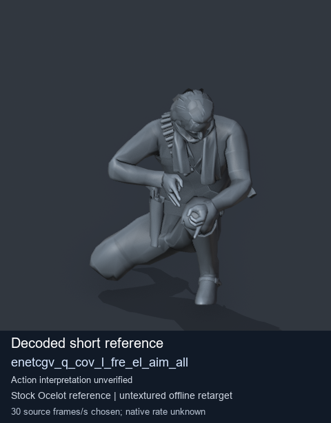
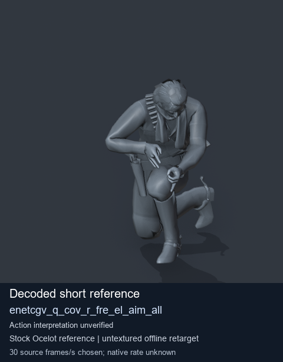
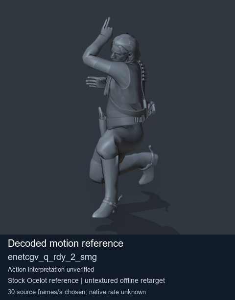
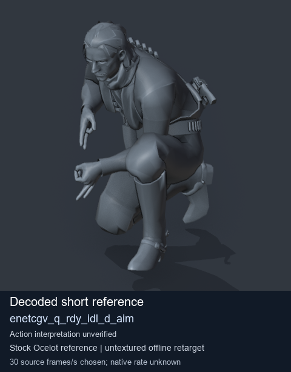

# Stock Soldier_common motion references / /Assets/tpp/motion/SI_game/fani/bodies/enet/enetcgv - page 1

[Library](../README.md) · [Grouped directory](../browse/README.md) · [This source family](../browse/stock-soldier-enetcgv-a4788320.md) · [Switch mode](browse-stock-soldier-enetcgv-a4788320-1.md)

**Still images: no GIFs loaded** · 4 clips · 0.42 MiB downloaded.

Images reuse existing files. A small display width does not reduce download size. Open one clip for its larger titled GIF and original technical data.

Source-family grouping uses only recorded virtual directories; it does not establish an action, weapon, actor, rig or native compatibility. Existing descriptions and tags below are unchanged. Per-clip visual review may be pending; chosen preview speed is separate from unmeasured native timing.

| Preview | Animation | Category | Tags | Virtual GANI directory / file | MTAR / container location | Description | Frames / data |
| --- | --- | --- | --- | --- | --- | --- | --- |
|  | [Stock reference: enetcgv_q_cov_l_fre_el_aim_all](../clips/mgsv-tpp-soldier_common-payloadsha256-a74c5ed52b9990aa55fbcbfcb02ae2673209e893c9fe1f125dd6a0c8bf4b494b.md) <code>enetcgv_q_cov_l_fre_el_aim_all</code> | Stock Soldier_common motion references | <code>stock animation reference</code> <code>Soldier_common</code> <code>source-derived label</code> <code>Ocelot reference mesh</code> | <code>/Assets/tpp/motion/SI_game/fani/bodies/enet/enetcgv</code> <code>enetcgv_q_cov_l_fre_el_aim_all.gani</code> | Retained MTAR: <code>Soldier_common.mtar</code> DAT / FPK membership unverified | Decoded stock reference enetcgv_q_cov_l_fre_el_aim_all; action interpretation unverified. | 8 raw 0.27 s chosen; native rate unknown [Full data](../clips/mgsv-tpp-soldier_common-payloadsha256-a74c5ed52b9990aa55fbcbfcb02ae2673209e893c9fe1f125dd6a0c8bf4b494b.md#technical-data) |
|  | [Stock reference: enetcgv_q_cov_r_fre_el_aim_all](../clips/mgsv-tpp-soldier_common-payloadsha256-1202a457cf8c0a177be6c2123b40609de649c5ce1c2a603b9dd86d9aca422f8f.md) <code>enetcgv_q_cov_r_fre_el_aim_all</code> | Stock Soldier_common motion references | <code>stock animation reference</code> <code>Soldier_common</code> <code>source-derived label</code> <code>Ocelot reference mesh</code> | <code>/Assets/tpp/motion/SI_game/fani/bodies/enet/enetcgv</code> <code>enetcgv_q_cov_r_fre_el_aim_all.gani</code> | Retained MTAR: <code>Soldier_common.mtar</code> DAT / FPK membership unverified | Decoded stock reference enetcgv_q_cov_r_fre_el_aim_all; action interpretation unverified. | 8 raw 0.27 s chosen; native rate unknown [Full data](../clips/mgsv-tpp-soldier_common-payloadsha256-1202a457cf8c0a177be6c2123b40609de649c5ce1c2a603b9dd86d9aca422f8f.md#technical-data) |
|  | [Stock motion reference: enetcgv_q_rdy_2_smg](../clips/mgsv-tpp-soldier_common-payloadsha256-70f9cd7718dcf1d9e6c88f0dc10248d1ef73a29832507d1aed2a93fab046fd34.md) <code>enetcgv_q_rdy_2_smg</code> | Stock Soldier_common motion references | <code>stock body motion</code> <code>Soldier_common</code> <code>source-derived label</code> <code>Ocelot reference mesh</code> | <code>/Assets/tpp/motion/SI_game/fani/bodies/enet/enetcgv</code> <code>enetcgv_q_rdy_2_smg.gani</code> | Retained MTAR: <code>Soldier_common.mtar</code> DAT / FPK membership unverified | Decoded stock body-motion reference enetcgv_q_rdy_2_smg; action interpretation unverified. | 95 raw 3.17 s chosen; native rate unknown [Full data](../clips/mgsv-tpp-soldier_common-payloadsha256-70f9cd7718dcf1d9e6c88f0dc10248d1ef73a29832507d1aed2a93fab046fd34.md#technical-data) |
|  | [Stock reference: enetcgv_q_rdy_idl_d_aim](../clips/mgsv-tpp-soldier_common-payloadsha256-d35eb0cf536e05c98dd70c7ec54520f9f2f78df556998e4930e326fee2531670.md) <code>enetcgv_q_rdy_idl_d_aim</code> | Stock Soldier_common motion references | <code>stock animation reference</code> <code>Soldier_common</code> <code>source-derived label</code> <code>Ocelot reference mesh</code> | <code>/Assets/tpp/motion/SI_game/fani/bodies/enet/enetcgv</code> <code>enetcgv_q_rdy_idl_d_aim.gani</code> | Retained MTAR: <code>Soldier_common.mtar</code> DAT / FPK membership unverified | Decoded stock reference enetcgv_q_rdy_idl_d_aim; action interpretation unverified. | 1 raw 0.03 s chosen; native rate unknown [Full data](../clips/mgsv-tpp-soldier_common-payloadsha256-d35eb0cf536e05c98dd70c7ec54520f9f2f78df556998e4930e326fee2531670.md#technical-data) |

[Source descriptions, confidence and credits](../description-sources.md) · [Complete JSON](../catalogue.json) · [CSV](../catalogue.csv)
