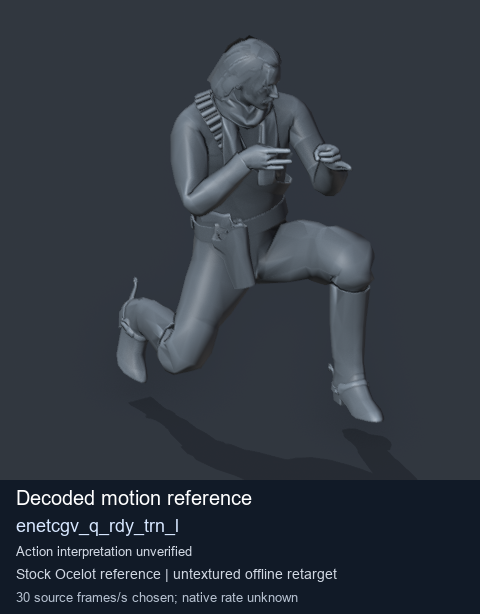
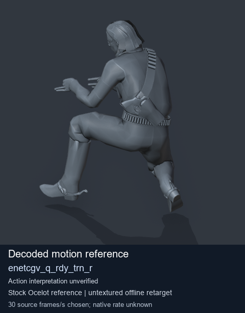
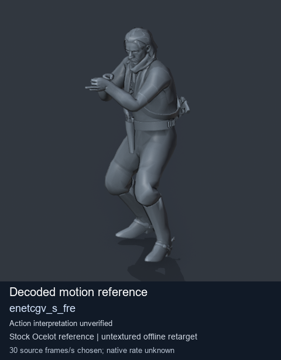
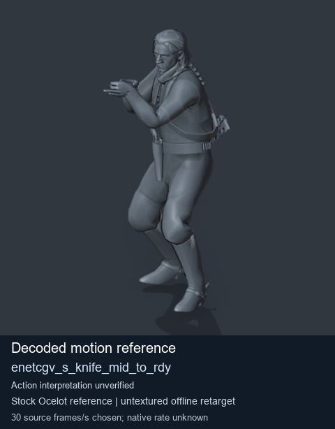

# Stock Soldier_common motion references / /Assets/tpp/motion/SI_game/fani/bodies/enet/enetcgv - page 3

[Library](../README.md) · [Grouped directory](../browse/README.md) · [This source family](../browse/stock-soldier-enetcgv-a4788320.md) · [Switch mode](browse-stock-soldier-enetcgv-a4788320-3.md)

**Still images: no GIFs loaded** · 4 clips · 0.40 MiB downloaded.

Images reuse existing files. A small display width does not reduce download size. Open one clip for its larger titled GIF and original technical data.

Source-family grouping uses only recorded virtual directories; it does not establish an action, weapon, actor, rig or native compatibility. Existing descriptions and tags below are unchanged. Per-clip visual review may be pending; chosen preview speed is separate from unmeasured native timing.

| Preview | Animation | Category | Tags | Virtual GANI directory / file | MTAR / container location | Description | Frames / data |
| --- | --- | --- | --- | --- | --- | --- | --- |
|  | [Stock motion reference: enetcgv_q_rdy_trn_l](../clips/mgsv-tpp-soldier_common-payloadsha256-203355127be38bd28958ccd7366cc435688f3d33f8fd1ab572ab391bf16ceb18.md) <code>enetcgv_q_rdy_trn_l</code> | Stock Soldier_common motion references | <code>stock body motion</code> <code>Soldier_common</code> <code>source-derived label</code> <code>Ocelot reference mesh</code> | <code>/Assets/tpp/motion/SI_game/fani/bodies/enet/enetcgv</code> <code>enetcgv_q_rdy_trn_l.gani</code> | Retained MTAR: <code>Soldier_common.mtar</code> DAT / FPK membership unverified | Decoded stock body-motion reference enetcgv_q_rdy_trn_l; action interpretation unverified. | 50 raw 1.67 s chosen; native rate unknown [Full data](../clips/mgsv-tpp-soldier_common-payloadsha256-203355127be38bd28958ccd7366cc435688f3d33f8fd1ab572ab391bf16ceb18.md#technical-data) |
|  | [Stock motion reference: enetcgv_q_rdy_trn_r](../clips/mgsv-tpp-soldier_common-payloadsha256-af79b11bdeb63de7c40d325b176bc11a5623c14ccf1768c0a1dc03a56a5f0858.md) <code>enetcgv_q_rdy_trn_r</code> | Stock Soldier_common motion references | <code>stock body motion</code> <code>Soldier_common</code> <code>source-derived label</code> <code>Ocelot reference mesh</code> | <code>/Assets/tpp/motion/SI_game/fani/bodies/enet/enetcgv</code> <code>enetcgv_q_rdy_trn_r.gani</code> | Retained MTAR: <code>Soldier_common.mtar</code> DAT / FPK membership unverified | Decoded stock body-motion reference enetcgv_q_rdy_trn_r; action interpretation unverified. | 50 raw 1.67 s chosen; native rate unknown [Full data](../clips/mgsv-tpp-soldier_common-payloadsha256-af79b11bdeb63de7c40d325b176bc11a5623c14ccf1768c0a1dc03a56a5f0858.md#technical-data) |
|  | [Stock reference: enetcgv_s_fre](../clips/mgsv-tpp-soldier_common-payloadsha256-dd3c6e22f3796aba1b45faeb0df157c78cfdca29a7a13ba82ea6d45014bdfd22.md) <code>enetcgv_s_fre</code> | Stock Soldier_common motion references | <code>stock animation reference</code> <code>Soldier_common</code> <code>source-derived label</code> <code>Ocelot reference mesh</code> | <code>/Assets/tpp/motion/SI_game/fani/bodies/enet/enetcgv</code> <code>enetcgv_s_fre.gani</code> | Retained MTAR: <code>Soldier_common.mtar</code> DAT / FPK membership unverified | Decoded stock reference enetcgv_s_fre; action interpretation unverified. | 40 raw 1.33 s chosen; native rate unknown [Full data](../clips/mgsv-tpp-soldier_common-payloadsha256-dd3c6e22f3796aba1b45faeb0df157c78cfdca29a7a13ba82ea6d45014bdfd22.md#technical-data) |
|  | [Stock reference: enetcgv_s_knife_mid_to_rdy](../clips/mgsv-tpp-soldier_common-payloadsha256-8cec2d8e54f51c1f55630b34f142efa6705f7c390ecbbb71a9edf13fb842d811.md) <code>enetcgv_s_knife_mid_to_rdy</code> | Stock Soldier_common motion references | <code>stock animation reference</code> <code>Soldier_common</code> <code>source-derived label</code> <code>Ocelot reference mesh</code> | <code>/Assets/tpp/motion/SI_game/fani/bodies/enet/enetcgv</code> <code>enetcgv_s_knife_mid_to_rdy.gani</code> | Retained MTAR: <code>Soldier_common.mtar</code> DAT / FPK membership unverified | Decoded stock reference enetcgv_s_knife_mid_to_rdy; action interpretation unverified. | 45 raw 1.5 s chosen; native rate unknown [Full data](../clips/mgsv-tpp-soldier_common-payloadsha256-8cec2d8e54f51c1f55630b34f142efa6705f7c390ecbbb71a9edf13fb842d811.md#technical-data) |

[Source descriptions, confidence and credits](../description-sources.md) · [Complete JSON](../catalogue.json) · [CSV](../catalogue.csv)
