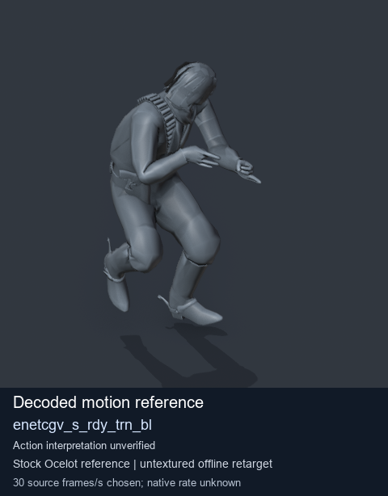
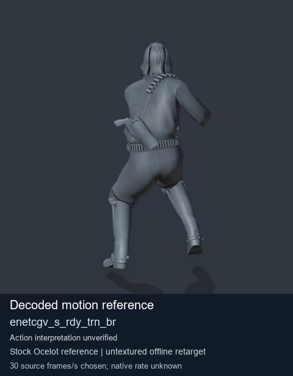
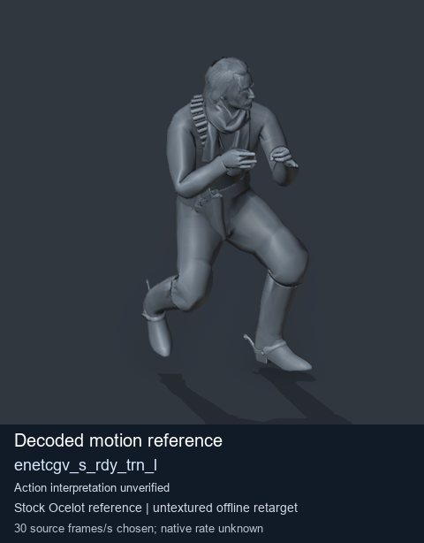
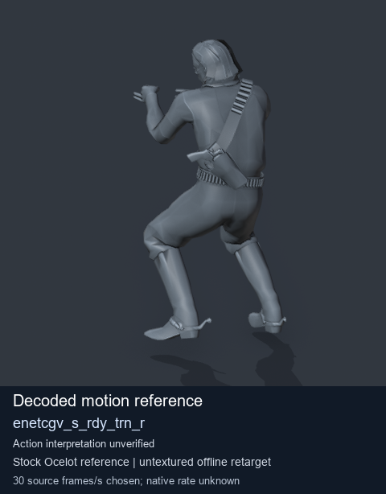

# Stock Soldier_common motion references / /Assets/tpp/motion/SI_game/fani/bodies/enet/enetcgv - page 5

[Library](../README.md) · [Grouped directory](../browse/README.md) · [This source family](../browse/stock-soldier-enetcgv-a4788320.md) · [Switch mode](browse-stock-soldier-enetcgv-a4788320-5.md)

**Still images: no GIFs loaded** · 4 clips · 0.38 MiB downloaded.

Images reuse existing files. A small display width does not reduce download size. Open one clip for its larger titled GIF and original technical data.

Source-family grouping uses only recorded virtual directories; it does not establish an action, weapon, actor, rig or native compatibility. Existing descriptions and tags below are unchanged. Per-clip visual review may be pending; chosen preview speed is separate from unmeasured native timing.

| Preview | Animation | Category | Tags | Virtual GANI directory / file | MTAR / container location | Description | Frames / data |
| --- | --- | --- | --- | --- | --- | --- | --- |
|  | [Stock motion reference: enetcgv_s_rdy_trn_bl](../clips/mgsv-tpp-soldier_common-payloadsha256-5d5565939917f8eb030afb9f25423ab293d22acb5b0690ab7e7448949a5e0dc9.md) <code>enetcgv_s_rdy_trn_bl</code> | Stock Soldier_common motion references | <code>stock body motion</code> <code>Soldier_common</code> <code>source-derived label</code> <code>Ocelot reference mesh</code> | <code>/Assets/tpp/motion/SI_game/fani/bodies/enet/enetcgv</code> <code>enetcgv_s_rdy_trn_bl.gani</code> | Retained MTAR: <code>Soldier_common.mtar</code> DAT / FPK membership unverified | Decoded stock body-motion reference enetcgv_s_rdy_trn_bl; action interpretation unverified. | 65 raw 2.17 s chosen; native rate unknown [Full data](../clips/mgsv-tpp-soldier_common-payloadsha256-5d5565939917f8eb030afb9f25423ab293d22acb5b0690ab7e7448949a5e0dc9.md#technical-data) |
|  | [Stock motion reference: enetcgv_s_rdy_trn_br](../clips/mgsv-tpp-soldier_common-payloadsha256-4005dd90c2d22e4d69165eb33aa6b18863b610c340d7fbfa7380b2d1e8454716.md) <code>enetcgv_s_rdy_trn_br</code> | Stock Soldier_common motion references | <code>stock body motion</code> <code>Soldier_common</code> <code>source-derived label</code> <code>Ocelot reference mesh</code> | <code>/Assets/tpp/motion/SI_game/fani/bodies/enet/enetcgv</code> <code>enetcgv_s_rdy_trn_br.gani</code> | Retained MTAR: <code>Soldier_common.mtar</code> DAT / FPK membership unverified | Decoded stock body-motion reference enetcgv_s_rdy_trn_br; action interpretation unverified. | 75 raw 2.5 s chosen; native rate unknown [Full data](../clips/mgsv-tpp-soldier_common-payloadsha256-4005dd90c2d22e4d69165eb33aa6b18863b610c340d7fbfa7380b2d1e8454716.md#technical-data) |
|  | [Stock motion reference: enetcgv_s_rdy_trn_l](../clips/mgsv-tpp-soldier_common-payloadsha256-7a08a54fa258835a9278966b1eb72471ac29fc9b9781a9d37f7eb7c929b5f5de.md) <code>enetcgv_s_rdy_trn_l</code> | Stock Soldier_common motion references | <code>stock body motion</code> <code>Soldier_common</code> <code>source-derived label</code> <code>Ocelot reference mesh</code> | <code>/Assets/tpp/motion/SI_game/fani/bodies/enet/enetcgv</code> <code>enetcgv_s_rdy_trn_l.gani</code> | Retained MTAR: <code>Soldier_common.mtar</code> DAT / FPK membership unverified | Decoded stock body-motion reference enetcgv_s_rdy_trn_l; action interpretation unverified. | 61 raw 2.03 s chosen; native rate unknown [Full data](../clips/mgsv-tpp-soldier_common-payloadsha256-7a08a54fa258835a9278966b1eb72471ac29fc9b9781a9d37f7eb7c929b5f5de.md#technical-data) |
|  | [Stock motion reference: enetcgv_s_rdy_trn_r](../clips/mgsv-tpp-soldier_common-payloadsha256-c77df25793a0d1bb69c89933e8b5a832e0062a94ad6109620c4e41a6326ada0f.md) <code>enetcgv_s_rdy_trn_r</code> | Stock Soldier_common motion references | <code>stock body motion</code> <code>Soldier_common</code> <code>source-derived label</code> <code>Ocelot reference mesh</code> | <code>/Assets/tpp/motion/SI_game/fani/bodies/enet/enetcgv</code> <code>enetcgv_s_rdy_trn_r.gani</code> | Retained MTAR: <code>Soldier_common.mtar</code> DAT / FPK membership unverified | Decoded stock body-motion reference enetcgv_s_rdy_trn_r; action interpretation unverified. | 60 raw 2.0 s chosen; native rate unknown [Full data](../clips/mgsv-tpp-soldier_common-payloadsha256-c77df25793a0d1bb69c89933e8b5a832e0062a94ad6109620c4e41a6326ada0f.md#technical-data) |

[Source descriptions, confidence and credits](../description-sources.md) · [Complete JSON](../catalogue.json) · [CSV](../catalogue.csv)
