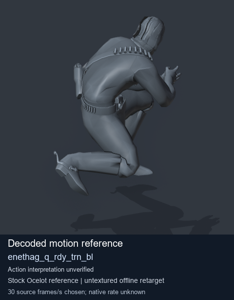
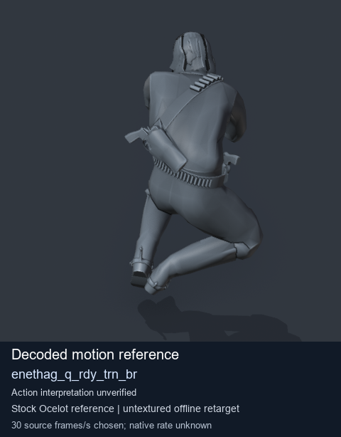
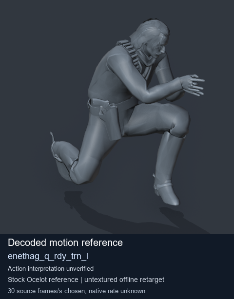
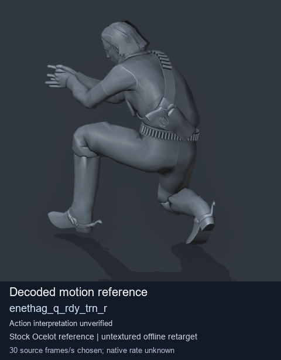

# Stock Soldier_common motion references / /Assets/tpp/motion/SI_game/fani/bodies/enet/enethag - page 2

[Library](../README.md) · [Grouped directory](../browse/README.md) · [This source family](../browse/stock-soldier-enethag-40ac3f36.md) · [Switch mode](browse-stock-soldier-enethag-40ac3f36-2.md)

**Still images: no GIFs loaded** · 4 clips · 0.45 MiB downloaded.

Images reuse existing files. A small display width does not reduce download size. Open one clip for its larger titled GIF and original technical data.

Source-family grouping uses only recorded virtual directories; it does not establish an action, weapon, actor, rig or native compatibility. Existing descriptions and tags below are unchanged. Per-clip visual review may be pending; chosen preview speed is separate from unmeasured native timing.

| Preview | Animation | Category | Tags | Virtual GANI directory / file | MTAR / container location | Description | Frames / data |
| --- | --- | --- | --- | --- | --- | --- | --- |
|  | [Stock motion reference: enethag_q_rdy_trn_bl](../clips/mgsv-tpp-soldier_common-payloadsha256-272c96184cc219683706600abe5bb4701d3433dae3b38d9a2a81722f35899959.md) <code>enethag_q_rdy_trn_bl</code> | Stock Soldier_common motion references | <code>stock body motion</code> <code>Soldier_common</code> <code>source-derived label</code> <code>Ocelot reference mesh</code> | <code>/Assets/tpp/motion/SI_game/fani/bodies/enet/enethag</code> <code>enethag_q_rdy_trn_bl.gani</code> | Retained MTAR: <code>Soldier_common.mtar</code> DAT / FPK membership unverified | Decoded stock body-motion reference enethag_q_rdy_trn_bl; action interpretation unverified. | 50 raw 1.67 s chosen; native rate unknown [Full data](../clips/mgsv-tpp-soldier_common-payloadsha256-272c96184cc219683706600abe5bb4701d3433dae3b38d9a2a81722f35899959.md#technical-data) |
|  | [Stock motion reference: enethag_q_rdy_trn_br](../clips/mgsv-tpp-soldier_common-payloadsha256-d96189f6a5cc27bd443d08a0e32bc38fc71feeb18b3c30b5cdf6846f5cc2e701.md) <code>enethag_q_rdy_trn_br</code> | Stock Soldier_common motion references | <code>stock body motion</code> <code>Soldier_common</code> <code>source-derived label</code> <code>Ocelot reference mesh</code> | <code>/Assets/tpp/motion/SI_game/fani/bodies/enet/enethag</code> <code>enethag_q_rdy_trn_br.gani</code> | Retained MTAR: <code>Soldier_common.mtar</code> DAT / FPK membership unverified | Decoded stock body-motion reference enethag_q_rdy_trn_br; action interpretation unverified. | 50 raw 1.67 s chosen; native rate unknown [Full data](../clips/mgsv-tpp-soldier_common-payloadsha256-d96189f6a5cc27bd443d08a0e32bc38fc71feeb18b3c30b5cdf6846f5cc2e701.md#technical-data) |
|  | [Stock motion reference: enethag_q_rdy_trn_l](../clips/mgsv-tpp-soldier_common-payloadsha256-78016aa17b576f22508d6c97866fd46c036f9cc45d2adcf275e924b0e3aea724.md) <code>enethag_q_rdy_trn_l</code> | Stock Soldier_common motion references | <code>stock body motion</code> <code>Soldier_common</code> <code>source-derived label</code> <code>Ocelot reference mesh</code> | <code>/Assets/tpp/motion/SI_game/fani/bodies/enet/enethag</code> <code>enethag_q_rdy_trn_l.gani</code> | Retained MTAR: <code>Soldier_common.mtar</code> DAT / FPK membership unverified | Decoded stock body-motion reference enethag_q_rdy_trn_l; action interpretation unverified. | 50 raw 1.67 s chosen; native rate unknown [Full data](../clips/mgsv-tpp-soldier_common-payloadsha256-78016aa17b576f22508d6c97866fd46c036f9cc45d2adcf275e924b0e3aea724.md#technical-data) |
|  | [Stock motion reference: enethag_q_rdy_trn_r](../clips/mgsv-tpp-soldier_common-payloadsha256-765cd838f67e67fb3df79f00b44c8a37689bce9b2a8778a5e3e0a31f72b1595b.md) <code>enethag_q_rdy_trn_r</code> | Stock Soldier_common motion references | <code>stock body motion</code> <code>Soldier_common</code> <code>source-derived label</code> <code>Ocelot reference mesh</code> | <code>/Assets/tpp/motion/SI_game/fani/bodies/enet/enethag</code> <code>enethag_q_rdy_trn_r.gani</code> | Retained MTAR: <code>Soldier_common.mtar</code> DAT / FPK membership unverified | Decoded stock body-motion reference enethag_q_rdy_trn_r; action interpretation unverified. | 50 raw 1.67 s chosen; native rate unknown [Full data](../clips/mgsv-tpp-soldier_common-payloadsha256-765cd838f67e67fb3df79f00b44c8a37689bce9b2a8778a5e3e0a31f72b1595b.md#technical-data) |

[Source descriptions, confidence and credits](../description-sources.md) · [Complete JSON](../catalogue.json) · [CSV](../catalogue.csv)
