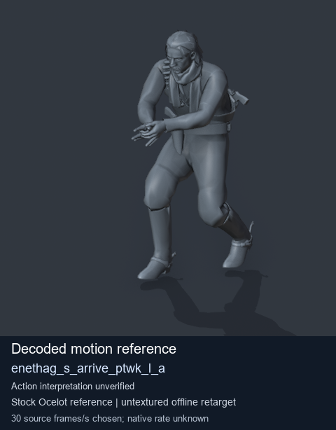
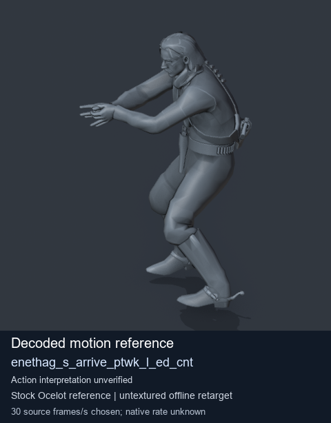
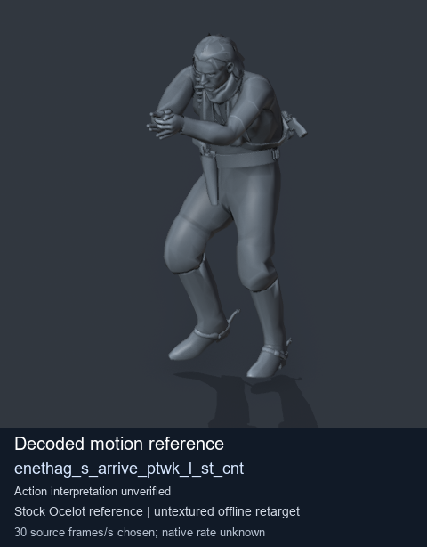

# Stock Soldier_common motion references / /Assets/tpp/motion/SI_game/fani/bodies/enet/enethag - page 3

[Library](../README.md) · [Grouped directory](../browse/README.md) · [This source family](../browse/stock-soldier-enethag-40ac3f36.md) · [Switch mode](browse-stock-soldier-enethag-40ac3f36-3.md)

**Still images: no GIFs loaded** · 3 clips · 0.29 MiB downloaded.

Images reuse existing files. A small display width does not reduce download size. Open one clip for its larger titled GIF and original technical data.

Source-family grouping uses only recorded virtual directories; it does not establish an action, weapon, actor, rig or native compatibility. Existing descriptions and tags below are unchanged. Per-clip visual review may be pending; chosen preview speed is separate from unmeasured native timing.

| Preview | Animation | Category | Tags | Virtual GANI directory / file | MTAR / container location | Description | Frames / data |
| --- | --- | --- | --- | --- | --- | --- | --- |
|  | [Stock reference: enethag_s_arrive_ptwk_l_a](../clips/mgsv-tpp-soldier_common-payloadsha256-e85a8ed56c4d710b464e76090ee23bbe6bcd3d68e31590e0b81fae8455303ae4.md) <code>enethag_s_arrive_ptwk_l_a</code> | Stock Soldier_common motion references | <code>stock animation reference</code> <code>Soldier_common</code> <code>source-derived label</code> <code>Ocelot reference mesh</code> | <code>/Assets/tpp/motion/SI_game/fani/bodies/enet/enethag</code> <code>enethag_s_arrive_ptwk_l_a.gani</code> | Retained MTAR: <code>Soldier_common.mtar</code> DAT / FPK membership unverified | Decoded stock reference enethag_s_arrive_ptwk_l_a; action interpretation unverified. | 240 raw 8.0 s chosen; native rate unknown [Full data](../clips/mgsv-tpp-soldier_common-payloadsha256-e85a8ed56c4d710b464e76090ee23bbe6bcd3d68e31590e0b81fae8455303ae4.md#technical-data) |
|  | [Stock reference: enethag_s_arrive_ptwk_l_ed_cnt](../clips/mgsv-tpp-soldier_common-payloadsha256-4c9b303926b16ed5efb7aae2b3d6870b2c33f75640b7bb49b5bfee78aa93e286.md) <code>enethag_s_arrive_ptwk_l_ed_cnt</code> | Stock Soldier_common motion references | <code>stock animation reference</code> <code>Soldier_common</code> <code>source-derived label</code> <code>Ocelot reference mesh</code> | <code>/Assets/tpp/motion/SI_game/fani/bodies/enet/enethag</code> <code>enethag_s_arrive_ptwk_l_ed_cnt.gani</code> | Retained MTAR: <code>Soldier_common.mtar</code> DAT / FPK membership unverified | Decoded stock reference enethag_s_arrive_ptwk_l_ed_cnt; action interpretation unverified. | 125 raw 4.17 s chosen; native rate unknown [Full data](../clips/mgsv-tpp-soldier_common-payloadsha256-4c9b303926b16ed5efb7aae2b3d6870b2c33f75640b7bb49b5bfee78aa93e286.md#technical-data) |
|  | [Stock motion reference: enethag_s_arrive_ptwk_l_st_cnt](../clips/mgsv-tpp-soldier_common-payloadsha256-376638f264a00d48be6c9985181bc879b0e0dfa294ed8401677c850cc92eae03.md) <code>enethag_s_arrive_ptwk_l_st_cnt</code> | Stock Soldier_common motion references | <code>stock body motion</code> <code>Soldier_common</code> <code>source-derived label</code> <code>Ocelot reference mesh</code> | <code>/Assets/tpp/motion/SI_game/fani/bodies/enet/enethag</code> <code>enethag_s_arrive_ptwk_l_st_cnt.gani</code> | Retained MTAR: <code>Soldier_common.mtar</code> DAT / FPK membership unverified | Decoded stock body-motion reference enethag_s_arrive_ptwk_l_st_cnt; action interpretation unverified. | 100 raw 3.33 s chosen; native rate unknown [Full data](../clips/mgsv-tpp-soldier_common-payloadsha256-376638f264a00d48be6c9985181bc879b0e0dfa294ed8401677c850cc92eae03.md#technical-data) |

[Source descriptions, confidence and credits](../description-sources.md) · [Complete JSON](../catalogue.json) · [CSV](../catalogue.csv)
