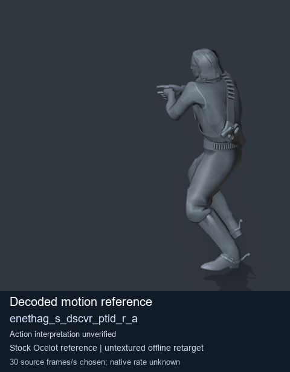
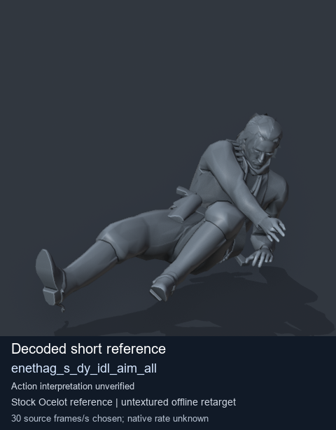
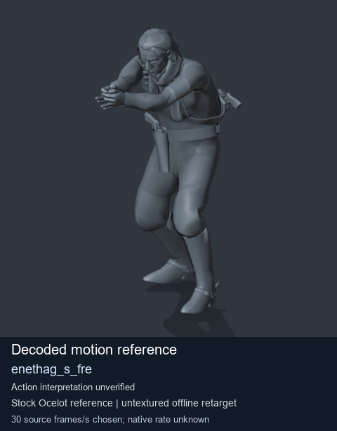
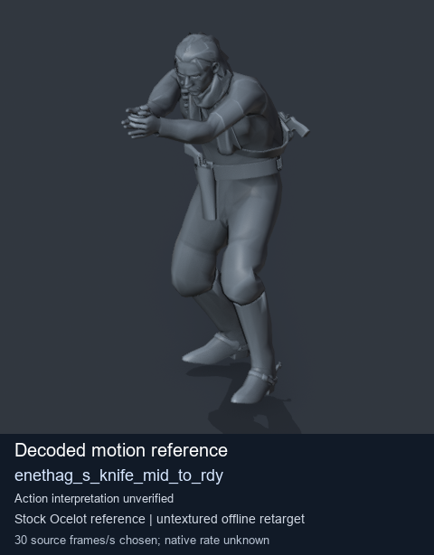

# Stock Soldier_common motion references / /Assets/tpp/motion/SI_game/fani/bodies/enet/enethag - page 5

[Library](../README.md) · [Grouped directory](../browse/README.md) · [This source family](../browse/stock-soldier-enethag-40ac3f36.md) · [Switch mode](browse-stock-soldier-enethag-40ac3f36-5.md)

**Still images: no GIFs loaded** · 4 clips · 0.38 MiB downloaded.

Images reuse existing files. A small display width does not reduce download size. Open one clip for its larger titled GIF and original technical data.

Source-family grouping uses only recorded virtual directories; it does not establish an action, weapon, actor, rig or native compatibility. Existing descriptions and tags below are unchanged. Per-clip visual review may be pending; chosen preview speed is separate from unmeasured native timing.

| Preview | Animation | Category | Tags | Virtual GANI directory / file | MTAR / container location | Description | Frames / data |
| --- | --- | --- | --- | --- | --- | --- | --- |
|  | [Stock reference: enethag_s_dscvr_ptid_r_a](../clips/mgsv-tpp-soldier_common-payloadsha256-e953abca5da1a07d9b2f1d3e844b1be224e074c166e1b4d88c76d5f2b6b99aac.md) <code>enethag_s_dscvr_ptid_r_a</code> | Stock Soldier_common motion references | <code>stock animation reference</code> <code>Soldier_common</code> <code>source-derived label</code> <code>Ocelot reference mesh</code> | <code>/Assets/tpp/motion/SI_game/fani/bodies/enet/enethag</code> <code>enethag_s_dscvr_ptid_r_a.gani</code> | Retained MTAR: <code>Soldier_common.mtar</code> DAT / FPK membership unverified | Decoded stock reference enethag_s_dscvr_ptid_r_a; action interpretation unverified. | 74 raw 2.47 s chosen; native rate unknown [Full data](../clips/mgsv-tpp-soldier_common-payloadsha256-e953abca5da1a07d9b2f1d3e844b1be224e074c166e1b4d88c76d5f2b6b99aac.md#technical-data) |
|  | [Stock reference: enethag_s_dy_idl_aim_all](../clips/mgsv-tpp-soldier_common-payloadsha256-6d634093d2db86502f6456c6e4bc73b217936d5ccda05ce9736a5f31eba1da0d.md) <code>enethag_s_dy_idl_aim_all</code> | Stock Soldier_common motion references | <code>stock animation reference</code> <code>Soldier_common</code> <code>source-derived label</code> <code>Ocelot reference mesh</code> | <code>/Assets/tpp/motion/SI_game/fani/bodies/enet/enethag</code> <code>enethag_s_dy_idl_aim_all.gani</code> | Retained MTAR: <code>Soldier_common.mtar</code> DAT / FPK membership unverified | Decoded stock reference enethag_s_dy_idl_aim_all; action interpretation unverified. | 8 raw 0.27 s chosen; native rate unknown [Full data](../clips/mgsv-tpp-soldier_common-payloadsha256-6d634093d2db86502f6456c6e4bc73b217936d5ccda05ce9736a5f31eba1da0d.md#technical-data) |
|  | [Stock reference: enethag_s_fre](../clips/mgsv-tpp-soldier_common-payloadsha256-35767603a8e8eb6ee4f768cd9519b7ad0ec5145b22d2d28d76840e3547d61153.md) <code>enethag_s_fre</code> | Stock Soldier_common motion references | <code>stock animation reference</code> <code>Soldier_common</code> <code>source-derived label</code> <code>Ocelot reference mesh</code> | <code>/Assets/tpp/motion/SI_game/fani/bodies/enet/enethag</code> <code>enethag_s_fre.gani</code> | Retained MTAR: <code>Soldier_common.mtar</code> DAT / FPK membership unverified | Decoded stock reference enethag_s_fre; action interpretation unverified. | 30 raw 1.0 s chosen; native rate unknown [Full data](../clips/mgsv-tpp-soldier_common-payloadsha256-35767603a8e8eb6ee4f768cd9519b7ad0ec5145b22d2d28d76840e3547d61153.md#technical-data) |
|  | [Stock motion reference: enethag_s_knife_mid_to_rdy](../clips/mgsv-tpp-soldier_common-payloadsha256-d33bfc0019e11d682188edd495dc8d49ccf230b7a54ac20924af546944b42c5a.md) <code>enethag_s_knife_mid_to_rdy</code> | Stock Soldier_common motion references | <code>stock body motion</code> <code>Soldier_common</code> <code>source-derived label</code> <code>Ocelot reference mesh</code> | <code>/Assets/tpp/motion/SI_game/fani/bodies/enet/enethag</code> <code>enethag_s_knife_mid_to_rdy.gani</code> | Retained MTAR: <code>Soldier_common.mtar</code> DAT / FPK membership unverified | Decoded stock body-motion reference enethag_s_knife_mid_to_rdy; action interpretation unverified. | 26 raw 0.87 s chosen; native rate unknown [Full data](../clips/mgsv-tpp-soldier_common-payloadsha256-d33bfc0019e11d682188edd495dc8d49ccf230b7a54ac20924af546944b42c5a.md#technical-data) |

[Source descriptions, confidence and credits](../description-sources.md) · [Complete JSON](../catalogue.json) · [CSV](../catalogue.csv)
