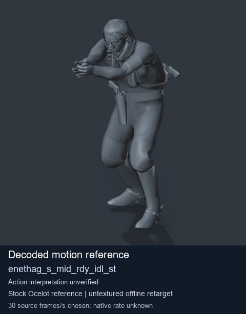
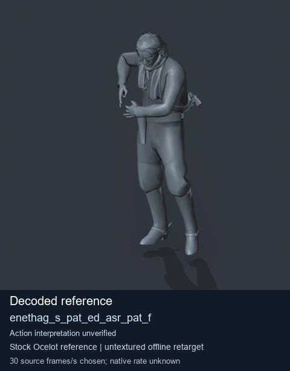

# Stock Soldier_common motion references / /Assets/tpp/motion/SI_game/fani/bodies/enet/enethag - page 6

[Library](../README.md) · [Grouped directory](../browse/README.md) · [This source family](../browse/stock-soldier-enethag-40ac3f36.md) · [Switch mode](browse-stock-soldier-enethag-40ac3f36-6.md)

**Still images: no GIFs loaded** · 2 clips · 0.18 MiB downloaded.

Images reuse existing files. A small display width does not reduce download size. Open one clip for its larger titled GIF and original technical data.

Source-family grouping uses only recorded virtual directories; it does not establish an action, weapon, actor, rig or native compatibility. Existing descriptions and tags below are unchanged. Per-clip visual review may be pending; chosen preview speed is separate from unmeasured native timing.

| Preview | Animation | Category | Tags | Virtual GANI directory / file | MTAR / container location | Description | Frames / data |
| --- | --- | --- | --- | --- | --- | --- | --- |
|  | [Stock motion reference: enethag_s_mid_rdy_idl_st](../clips/mgsv-tpp-soldier_common-payloadsha256-cae6c6a5fd1268735c7fa56272d04d62a49d9a2f9a7a57bf5341911b09e6d105.md) <code>enethag_s_mid_rdy_idl_st</code> | Stock Soldier_common motion references | <code>stock body motion</code> <code>Soldier_common</code> <code>source-derived label</code> <code>Ocelot reference mesh</code> | <code>/Assets/tpp/motion/SI_game/fani/bodies/enet/enethag</code> <code>enethag_s_mid_rdy_idl_st.gani</code> | Retained MTAR: <code>Soldier_common.mtar</code> DAT / FPK membership unverified | Decoded stock body-motion reference enethag_s_mid_rdy_idl_st; action interpretation unverified. | 30 raw 1.0 s chosen; native rate unknown [Full data](../clips/mgsv-tpp-soldier_common-payloadsha256-cae6c6a5fd1268735c7fa56272d04d62a49d9a2f9a7a57bf5341911b09e6d105.md#technical-data) |
|  | [Stock reference: enethag_s_pat_ed_asr_pat_f](../clips/mgsv-tpp-soldier_common-payloadsha256-69e925203117a2e3b60d6983cb55aab6365302188fbdde35610ffc4bfc19ac84.md) <code>enethag_s_pat_ed_asr_pat_f</code> | Stock Soldier_common motion references | <code>stock animation reference</code> <code>Soldier_common</code> <code>source-derived label</code> <code>Ocelot reference mesh</code> | <code>/Assets/tpp/motion/SI_game/fani/bodies/enet/enethag</code> <code>enethag_s_pat_ed_asr_pat_f.gani</code> | Retained MTAR: <code>Soldier_common.mtar</code> DAT / FPK membership unverified | Decoded stock reference enethag_s_pat_ed_asr_pat_f; action interpretation unverified. | 316 raw 10.53 s chosen; native rate unknown [Full data](../clips/mgsv-tpp-soldier_common-payloadsha256-69e925203117a2e3b60d6983cb55aab6365302188fbdde35610ffc4bfc19ac84.md#technical-data) |

[Source descriptions, confidence and credits](../description-sources.md) · [Complete JSON](../catalogue.json) · [CSV](../catalogue.csv)
