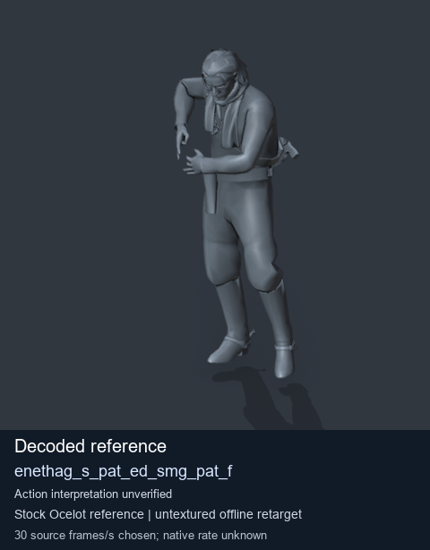
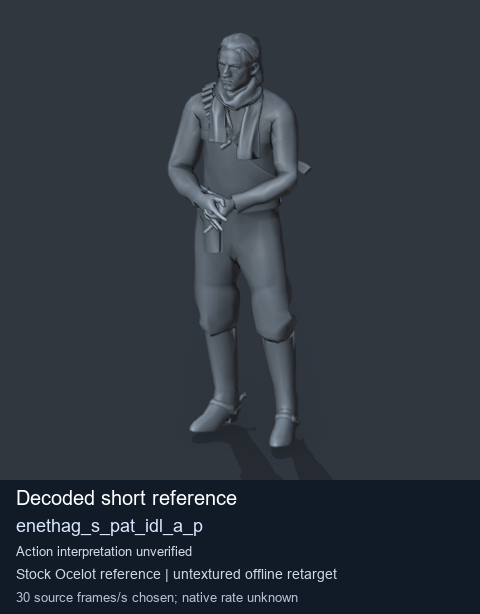
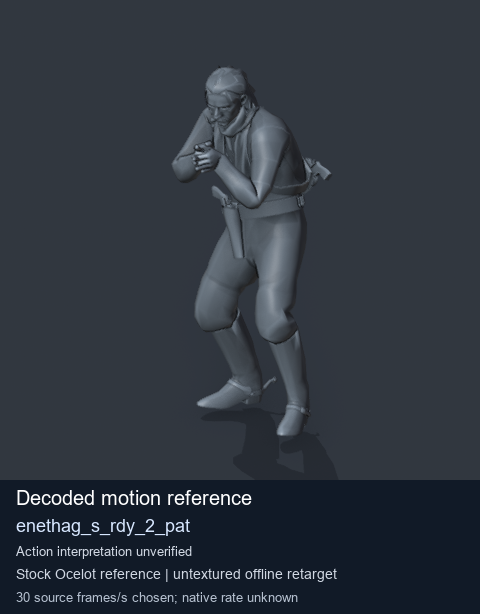
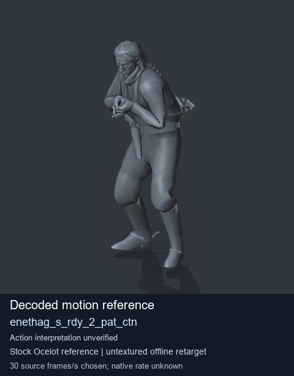

# Stock Soldier_common motion references / /Assets/tpp/motion/SI_game/fani/bodies/enet/enethag - page 7

[Library](../README.md) · [Grouped directory](../browse/README.md) · [This source family](../browse/stock-soldier-enethag-40ac3f36.md) · [Switch mode](browse-stock-soldier-enethag-40ac3f36-7.md)

**Still images: no GIFs loaded** · 4 clips · 0.35 MiB downloaded.

Images reuse existing files. A small display width does not reduce download size. Open one clip for its larger titled GIF and original technical data.

Source-family grouping uses only recorded virtual directories; it does not establish an action, weapon, actor, rig or native compatibility. Existing descriptions and tags below are unchanged. Per-clip visual review may be pending; chosen preview speed is separate from unmeasured native timing.

| Preview | Animation | Category | Tags | Virtual GANI directory / file | MTAR / container location | Description | Frames / data |
| --- | --- | --- | --- | --- | --- | --- | --- |
|  | [Stock reference: enethag_s_pat_ed_smg_pat_f](../clips/mgsv-tpp-soldier_common-payloadsha256-d86df80cff61e548c9763702ed9f62c7200e5207a599de04033eb88f01c652cc.md) <code>enethag_s_pat_ed_smg_pat_f</code> | Stock Soldier_common motion references | <code>stock animation reference</code> <code>Soldier_common</code> <code>source-derived label</code> <code>Ocelot reference mesh</code> | <code>/Assets/tpp/motion/SI_game/fani/bodies/enet/enethag</code> <code>enethag_s_pat_ed_smg_pat_f.gani</code> | Retained MTAR: <code>Soldier_common.mtar</code> DAT / FPK membership unverified | Decoded stock reference enethag_s_pat_ed_smg_pat_f; action interpretation unverified. | 316 raw 10.53 s chosen; native rate unknown [Full data](../clips/mgsv-tpp-soldier_common-payloadsha256-d86df80cff61e548c9763702ed9f62c7200e5207a599de04033eb88f01c652cc.md#technical-data) |
|  | [Stock reference: enethag_s_pat_idl_a_p](../clips/mgsv-tpp-soldier_common-payloadsha256-354d2000384bd9dad6d5fc7fcd37827af4524b35bba42992abb3ea5b45652bc4.md) <code>enethag_s_pat_idl_a_p</code> | Stock Soldier_common motion references | <code>stock animation reference</code> <code>Soldier_common</code> <code>source-derived label</code> <code>Ocelot reference mesh</code> | <code>/Assets/tpp/motion/SI_game/fani/bodies/enet/enethag</code> <code>enethag_s_pat_idl_a_p.gani</code> | Retained MTAR: <code>Soldier_common.mtar</code> DAT / FPK membership unverified | Decoded stock reference enethag_s_pat_idl_a_p; action interpretation unverified. | 1 raw 0.03 s chosen; native rate unknown [Full data](../clips/mgsv-tpp-soldier_common-payloadsha256-354d2000384bd9dad6d5fc7fcd37827af4524b35bba42992abb3ea5b45652bc4.md#technical-data) |
|  | [Stock motion reference: enethag_s_rdy_2_pat](../clips/mgsv-tpp-soldier_common-payloadsha256-d302807f9d050c555bfd27dee0eadd8f47f07dc28f3a87744f7b34bc8acb432f.md) <code>enethag_s_rdy_2_pat</code> | Stock Soldier_common motion references | <code>stock body motion</code> <code>Soldier_common</code> <code>source-derived label</code> <code>Ocelot reference mesh</code> | <code>/Assets/tpp/motion/SI_game/fani/bodies/enet/enethag</code> <code>enethag_s_rdy_2_pat.gani</code> | Retained MTAR: <code>Soldier_common.mtar</code> DAT / FPK membership unverified | Decoded stock body-motion reference enethag_s_rdy_2_pat; action interpretation unverified. | 95 raw 3.17 s chosen; native rate unknown [Full data](../clips/mgsv-tpp-soldier_common-payloadsha256-d302807f9d050c555bfd27dee0eadd8f47f07dc28f3a87744f7b34bc8acb432f.md#technical-data) |
|  | [Stock motion reference: enethag_s_rdy_2_pat_ctn](../clips/mgsv-tpp-soldier_common-payloadsha256-043bd58786cc970a01030bf3e696fd971a2f1d709246840c4a0c9dee24702bff.md) <code>enethag_s_rdy_2_pat_ctn</code> | Stock Soldier_common motion references | <code>stock body motion</code> <code>Soldier_common</code> <code>source-derived label</code> <code>Ocelot reference mesh</code> | <code>/Assets/tpp/motion/SI_game/fani/bodies/enet/enethag</code> <code>enethag_s_rdy_2_pat_ctn.gani</code> | Retained MTAR: <code>Soldier_common.mtar</code> DAT / FPK membership unverified | Decoded stock body-motion reference enethag_s_rdy_2_pat_ctn; action interpretation unverified. | 95 raw 3.17 s chosen; native rate unknown [Full data](../clips/mgsv-tpp-soldier_common-payloadsha256-043bd58786cc970a01030bf3e696fd971a2f1d709246840c4a0c9dee24702bff.md#technical-data) |

[Source descriptions, confidence and credits](../description-sources.md) · [Complete JSON](../catalogue.json) · [CSV](../catalogue.csv)
