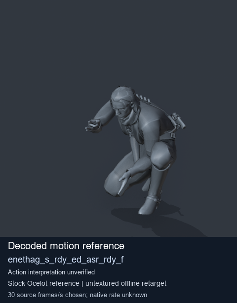
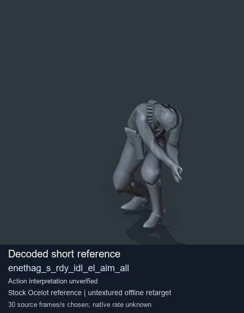
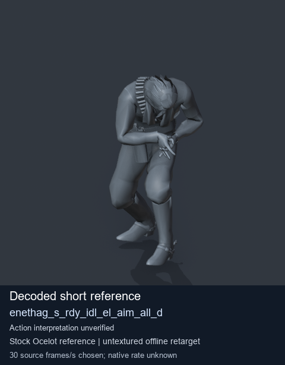
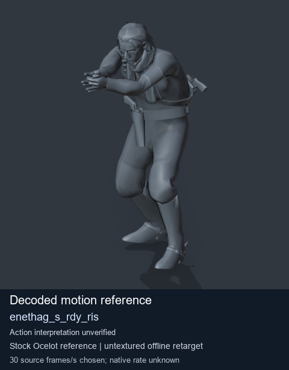

# Stock Soldier_common motion references / /Assets/tpp/motion/SI_game/fani/bodies/enet/enethag - page 8

[Library](../README.md) · [Grouped directory](../browse/README.md) · [This source family](../browse/stock-soldier-enethag-40ac3f36.md) · [Switch mode](browse-stock-soldier-enethag-40ac3f36-8.md)

**Still images: no GIFs loaded** · 4 clips · 0.34 MiB downloaded.

Images reuse existing files. A small display width does not reduce download size. Open one clip for its larger titled GIF and original technical data.

Source-family grouping uses only recorded virtual directories; it does not establish an action, weapon, actor, rig or native compatibility. Existing descriptions and tags below are unchanged. Per-clip visual review may be pending; chosen preview speed is separate from unmeasured native timing.

| Preview | Animation | Category | Tags | Virtual GANI directory / file | MTAR / container location | Description | Frames / data |
| --- | --- | --- | --- | --- | --- | --- | --- |
|  | [Stock motion reference: enethag_s_rdy_ed_asr_rdy_f](../clips/mgsv-tpp-soldier_common-payloadsha256-b06b4722a7e19e9fd599a50b05b767b49ed486ed40a9a21df42d82440dbbd6e7.md) <code>enethag_s_rdy_ed_asr_rdy_f</code> | Stock Soldier_common motion references | <code>stock body motion</code> <code>Soldier_common</code> <code>source-derived label</code> <code>Ocelot reference mesh</code> | <code>/Assets/tpp/motion/SI_game/fani/bodies/enet/enethag</code> <code>enethag_s_rdy_ed_asr_rdy_f.gani</code> | Retained MTAR: <code>Soldier_common.mtar</code> DAT / FPK membership unverified | Decoded stock body-motion reference enethag_s_rdy_ed_asr_rdy_f; action interpretation unverified. | 120 raw 4.0 s chosen; native rate unknown [Full data](../clips/mgsv-tpp-soldier_common-payloadsha256-b06b4722a7e19e9fd599a50b05b767b49ed486ed40a9a21df42d82440dbbd6e7.md#technical-data) |
|  | [Stock reference: enethag_s_rdy_idl_el_aim_all](../clips/mgsv-tpp-soldier_common-payloadsha256-b5333bfb225318c1f2208825d28e0eaac6b32463bd83183c6f253b2ba5a59925.md) <code>enethag_s_rdy_idl_el_aim_all</code> | Stock Soldier_common motion references | <code>stock animation reference</code> <code>Soldier_common</code> <code>source-derived label</code> <code>Ocelot reference mesh</code> | <code>/Assets/tpp/motion/SI_game/fani/bodies/enet/enethag</code> <code>enethag_s_rdy_idl_el_aim_all.gani</code> | Retained MTAR: <code>Soldier_common.mtar</code> DAT / FPK membership unverified | Decoded stock reference enethag_s_rdy_idl_el_aim_all; action interpretation unverified. | 8 raw 0.27 s chosen; native rate unknown [Full data](../clips/mgsv-tpp-soldier_common-payloadsha256-b5333bfb225318c1f2208825d28e0eaac6b32463bd83183c6f253b2ba5a59925.md#technical-data) |
|  | [Stock reference: enethag_s_rdy_idl_el_aim_all_d](../clips/mgsv-tpp-soldier_common-payloadsha256-b2c1740ecb94a61099f165a74d33c4b448bcc228c9c8810b0a1aab2ad17fb8a5.md) <code>enethag_s_rdy_idl_el_aim_all_d</code> | Stock Soldier_common motion references | <code>stock animation reference</code> <code>Soldier_common</code> <code>source-derived label</code> <code>Ocelot reference mesh</code> | <code>/Assets/tpp/motion/SI_game/fani/bodies/enet/enethag</code> <code>enethag_s_rdy_idl_el_aim_all_d.gani</code> | Retained MTAR: <code>Soldier_common.mtar</code> DAT / FPK membership unverified | Decoded stock reference enethag_s_rdy_idl_el_aim_all_d; action interpretation unverified. | 8 raw 0.27 s chosen; native rate unknown [Full data](../clips/mgsv-tpp-soldier_common-payloadsha256-b2c1740ecb94a61099f165a74d33c4b448bcc228c9c8810b0a1aab2ad17fb8a5.md#technical-data) |
|  | [Stock motion reference: enethag_s_rdy_ris](../clips/mgsv-tpp-soldier_common-payloadsha256-431e7ad794c849791f7d907bbc65c57a9746465c56ef7e17d002d71fe11a73cd.md) <code>enethag_s_rdy_ris</code> | Stock Soldier_common motion references | <code>stock body motion</code> <code>Soldier_common</code> <code>source-derived label</code> <code>Ocelot reference mesh</code> | <code>/Assets/tpp/motion/SI_game/fani/bodies/enet/enethag</code> <code>enethag_s_rdy_ris.gani</code> | Retained MTAR: <code>Soldier_common.mtar</code> DAT / FPK membership unverified | Decoded stock body-motion reference enethag_s_rdy_ris; action interpretation unverified. | 20 raw 0.67 s chosen; native rate unknown [Full data](../clips/mgsv-tpp-soldier_common-payloadsha256-431e7ad794c849791f7d907bbc65c57a9746465c56ef7e17d002d71fe11a73cd.md#technical-data) |

[Source descriptions, confidence and credits](../description-sources.md) · [Complete JSON](../catalogue.json) · [CSV](../catalogue.csv)
