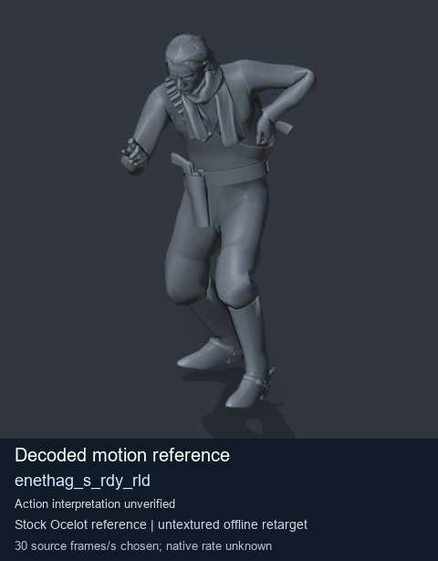
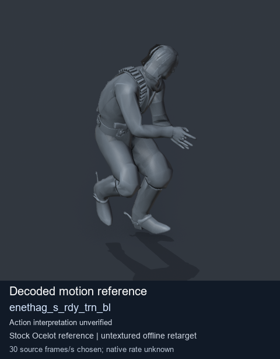
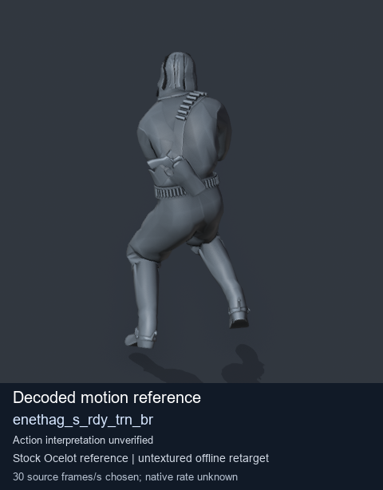
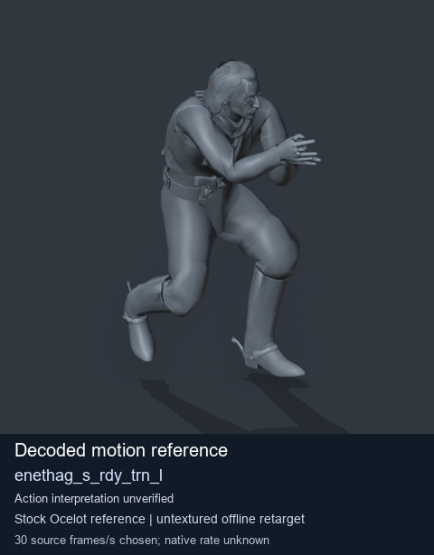

# Stock Soldier_common motion references / /Assets/tpp/motion/SI_game/fani/bodies/enet/enethag - page 9

[Library](../README.md) · [Grouped directory](../browse/README.md) · [This source family](../browse/stock-soldier-enethag-40ac3f36.md) · [Switch mode](browse-stock-soldier-enethag-40ac3f36-9.md)

**Still images: no GIFs loaded** · 4 clips · 0.38 MiB downloaded.

Images reuse existing files. A small display width does not reduce download size. Open one clip for its larger titled GIF and original technical data.

Source-family grouping uses only recorded virtual directories; it does not establish an action, weapon, actor, rig or native compatibility. Existing descriptions and tags below are unchanged. Per-clip visual review may be pending; chosen preview speed is separate from unmeasured native timing.

| Preview | Animation | Category | Tags | Virtual GANI directory / file | MTAR / container location | Description | Frames / data |
| --- | --- | --- | --- | --- | --- | --- | --- |
|  | [Stock motion reference: enethag_s_rdy_rld](../clips/mgsv-tpp-soldier_common-payloadsha256-3bd5fa7786db4581a2622bdb3c01b6f89a9537971d831c8b3899eec876d1a6bf.md) <code>enethag_s_rdy_rld</code> | Stock Soldier_common motion references | <code>stock body motion</code> <code>Soldier_common</code> <code>source-derived label</code> <code>Ocelot reference mesh</code> | <code>/Assets/tpp/motion/SI_game/fani/bodies/enet/enethag</code> <code>enethag_s_rdy_rld.gani</code> | Retained MTAR: <code>Soldier_common.mtar</code> DAT / FPK membership unverified | Decoded stock body-motion reference enethag_s_rdy_rld; action interpretation unverified. | 102 raw 3.4 s chosen; native rate unknown [Full data](../clips/mgsv-tpp-soldier_common-payloadsha256-3bd5fa7786db4581a2622bdb3c01b6f89a9537971d831c8b3899eec876d1a6bf.md#technical-data) |
|  | [Stock motion reference: enethag_s_rdy_trn_bl](../clips/mgsv-tpp-soldier_common-payloadsha256-558c2e8a3feb41070a5ed4e7bf389e07a4838e64b735b211abde69ef331811f7.md) <code>enethag_s_rdy_trn_bl</code> | Stock Soldier_common motion references | <code>stock body motion</code> <code>Soldier_common</code> <code>source-derived label</code> <code>Ocelot reference mesh</code> | <code>/Assets/tpp/motion/SI_game/fani/bodies/enet/enethag</code> <code>enethag_s_rdy_trn_bl.gani</code> | Retained MTAR: <code>Soldier_common.mtar</code> DAT / FPK membership unverified | Decoded stock body-motion reference enethag_s_rdy_trn_bl; action interpretation unverified. | 65 raw 2.17 s chosen; native rate unknown [Full data](../clips/mgsv-tpp-soldier_common-payloadsha256-558c2e8a3feb41070a5ed4e7bf389e07a4838e64b735b211abde69ef331811f7.md#technical-data) |
|  | [Stock motion reference: enethag_s_rdy_trn_br](../clips/mgsv-tpp-soldier_common-payloadsha256-0c2be38ee30228ca503cdc2398e7568bc702aeeed6a15bd3144d8bd0fbcef949.md) <code>enethag_s_rdy_trn_br</code> | Stock Soldier_common motion references | <code>stock body motion</code> <code>Soldier_common</code> <code>source-derived label</code> <code>Ocelot reference mesh</code> | <code>/Assets/tpp/motion/SI_game/fani/bodies/enet/enethag</code> <code>enethag_s_rdy_trn_br.gani</code> | Retained MTAR: <code>Soldier_common.mtar</code> DAT / FPK membership unverified | Decoded stock body-motion reference enethag_s_rdy_trn_br; action interpretation unverified. | 75 raw 2.5 s chosen; native rate unknown [Full data](../clips/mgsv-tpp-soldier_common-payloadsha256-0c2be38ee30228ca503cdc2398e7568bc702aeeed6a15bd3144d8bd0fbcef949.md#technical-data) |
|  | [Stock motion reference: enethag_s_rdy_trn_l](../clips/mgsv-tpp-soldier_common-payloadsha256-9b1669f8660abde7cc14ce80da5f5ce4411559e99503e4fa750de9b6324fcab2.md) <code>enethag_s_rdy_trn_l</code> | Stock Soldier_common motion references | <code>stock body motion</code> <code>Soldier_common</code> <code>source-derived label</code> <code>Ocelot reference mesh</code> | <code>/Assets/tpp/motion/SI_game/fani/bodies/enet/enethag</code> <code>enethag_s_rdy_trn_l.gani</code> | Retained MTAR: <code>Soldier_common.mtar</code> DAT / FPK membership unverified | Decoded stock body-motion reference enethag_s_rdy_trn_l; action interpretation unverified. | 61 raw 2.03 s chosen; native rate unknown [Full data](../clips/mgsv-tpp-soldier_common-payloadsha256-9b1669f8660abde7cc14ce80da5f5ce4411559e99503e4fa750de9b6324fcab2.md#technical-data) |

[Source descriptions, confidence and credits](../description-sources.md) · [Complete JSON](../catalogue.json) · [CSV](../catalogue.csv)
