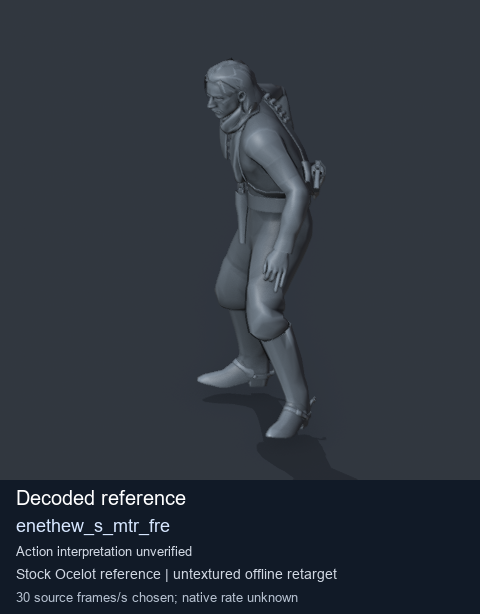

# Stock Soldier_common motion references / /Assets/tpp/motion/SI_game/fani/bodies/enet/enethew - page 2

[Library](../README.md) · [Grouped directory](../browse/README.md) · [This source family](../browse/stock-soldier-enethew-67fa6451.md) · [Switch mode](browse-stock-soldier-enethew-67fa6451-2.md)

**Still images: no GIFs loaded** · 1 clips · 0.08 MiB downloaded.

Images reuse existing files. A small display width does not reduce download size. Open one clip for its larger titled GIF and original technical data.

Source-family grouping uses only recorded virtual directories; it does not establish an action, weapon, actor, rig or native compatibility. Existing descriptions and tags below are unchanged. Per-clip visual review may be pending; chosen preview speed is separate from unmeasured native timing.

| Preview | Animation | Category | Tags | Virtual GANI directory / file | MTAR / container location | Description | Frames / data |
| --- | --- | --- | --- | --- | --- | --- | --- |
|  | [Stock reference: enethew_s_mtr_fre](../clips/mgsv-tpp-soldier_common-payloadsha256-a3d0a98142296de0dc4e990e819cd432c9c83bcd48228070d2218beec2e2235c.md) <code>enethew_s_mtr_fre</code> | Stock Soldier_common motion references | <code>stock animation reference</code> <code>Soldier_common</code> <code>source-derived label</code> <code>Ocelot reference mesh</code> | <code>/Assets/tpp/motion/SI_game/fani/bodies/enet/enethew</code> <code>enethew_s_mtr_fre.gani</code> | Retained MTAR: <code>Soldier_common.mtar</code> DAT / FPK membership unverified | Decoded stock reference enethew_s_mtr_fre; action interpretation unverified. | 350 raw 11.67 s chosen; native rate unknown [Full data](../clips/mgsv-tpp-soldier_common-payloadsha256-a3d0a98142296de0dc4e990e819cd432c9c83bcd48228070d2218beec2e2235c.md#technical-data) |

[Source descriptions, confidence and credits](../description-sources.md) · [Complete JSON](../catalogue.json) · [CSV](../catalogue.csv)
