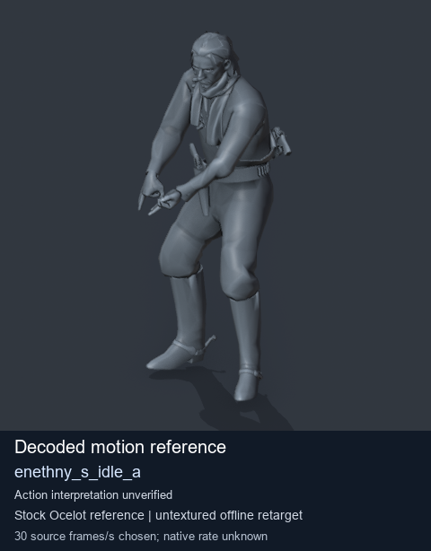
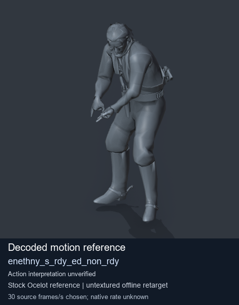
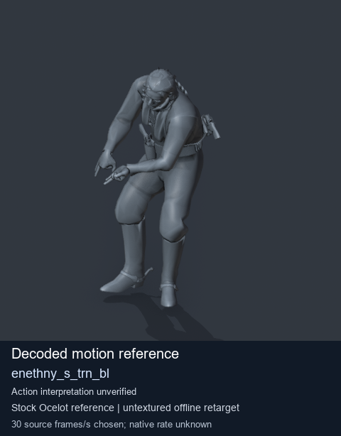

# Stock Soldier_common motion references / /Assets/tpp/motion/SI_game/fani/bodies/enet/enethny - page 1

[Library](../README.md) · [Grouped directory](../browse/README.md) · [This source family](../browse/stock-soldier-enethny-9b0ebf61.md) · [Switch mode](browse-stock-soldier-enethny-9b0ebf61-1.md)

**Still images: no GIFs loaded** · 3 clips · 0.28 MiB downloaded.

Images reuse existing files. A small display width does not reduce download size. Open one clip for its larger titled GIF and original technical data.

Source-family grouping uses only recorded virtual directories; it does not establish an action, weapon, actor, rig or native compatibility. Existing descriptions and tags below are unchanged. Per-clip visual review may be pending; chosen preview speed is separate from unmeasured native timing.

| Preview | Animation | Category | Tags | Virtual GANI directory / file | MTAR / container location | Description | Frames / data |
| --- | --- | --- | --- | --- | --- | --- | --- |
|  | [Stock reference: enethny_s_idle_a](../clips/mgsv-tpp-soldier_common-payloadsha256-426902ea03747677ccb1c0fcdd82ae0af299ca2e7ff63bcf1ea9dc85d954fcc3.md) <code>enethny_s_idle_a</code> | Stock Soldier_common motion references | <code>stock animation reference</code> <code>Soldier_common</code> <code>source-derived label</code> <code>Ocelot reference mesh</code> | <code>/Assets/tpp/motion/SI_game/fani/bodies/enet/enethny</code> <code>enethny_s_idle_a.gani</code> | Retained MTAR: <code>Soldier_common.mtar</code> DAT / FPK membership unverified | Decoded stock reference enethny_s_idle_a; action interpretation unverified. | 93 raw 3.1 s chosen; native rate unknown [Full data](../clips/mgsv-tpp-soldier_common-payloadsha256-426902ea03747677ccb1c0fcdd82ae0af299ca2e7ff63bcf1ea9dc85d954fcc3.md#technical-data) |
|  | [Stock reference: enethny_s_rdy_ed_non_rdy](../clips/mgsv-tpp-soldier_common-payloadsha256-74a18a25bb90b56623ccc5a971e7cb474d5d85c2d268cb94a6344e5d15e0df1a.md) <code>enethny_s_rdy_ed_non_rdy</code> | Stock Soldier_common motion references | <code>stock animation reference</code> <code>Soldier_common</code> <code>source-derived label</code> <code>Ocelot reference mesh</code> | <code>/Assets/tpp/motion/SI_game/fani/bodies/enet/enethny</code> <code>enethny_s_rdy_ed_non_rdy.gani</code> | Retained MTAR: <code>Soldier_common.mtar</code> DAT / FPK membership unverified | Decoded stock reference enethny_s_rdy_ed_non_rdy; action interpretation unverified. | 236 raw 7.87 s chosen; native rate unknown [Full data](../clips/mgsv-tpp-soldier_common-payloadsha256-74a18a25bb90b56623ccc5a971e7cb474d5d85c2d268cb94a6344e5d15e0df1a.md#technical-data) |
|  | [Stock reference: enethny_s_trn_bl](../clips/mgsv-tpp-soldier_common-payloadsha256-65558d649a71b5dab9ca83973c2628056f414584ae8b5b3df97b291a96135659.md) <code>enethny_s_trn_bl</code> | Stock Soldier_common motion references | <code>stock animation reference</code> <code>Soldier_common</code> <code>source-derived label</code> <code>Ocelot reference mesh</code> | <code>/Assets/tpp/motion/SI_game/fani/bodies/enet/enethny</code> <code>enethny_s_trn_bl.gani</code> | Retained MTAR: <code>Soldier_common.mtar</code> DAT / FPK membership unverified | Decoded stock reference enethny_s_trn_bl; action interpretation unverified. | 182 raw 6.07 s chosen; native rate unknown [Full data](../clips/mgsv-tpp-soldier_common-payloadsha256-65558d649a71b5dab9ca83973c2628056f414584ae8b5b3df97b291a96135659.md#technical-data) |

[Source descriptions, confidence and credits](../description-sources.md) · [Complete JSON](../catalogue.json) · [CSV](../catalogue.csv)
