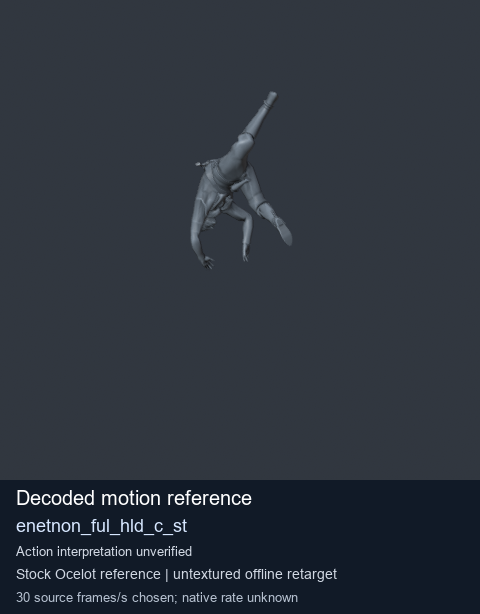
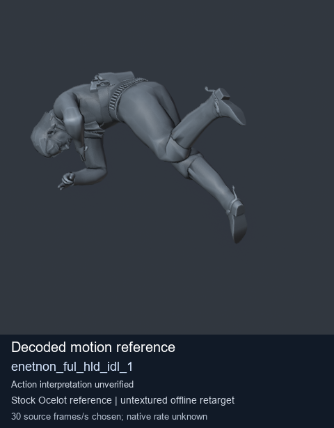
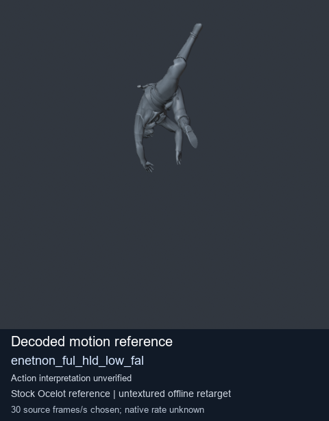
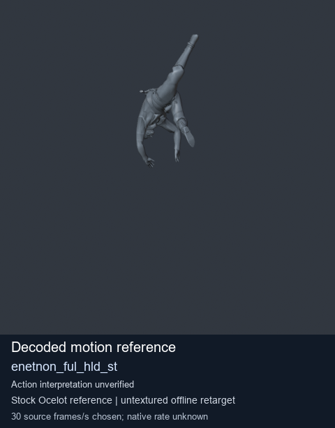

# Stock Soldier_common motion references / /Assets/tpp/motion/SI_game/fani/bodies/enet/enetnon - page 1

[Library](../README.md) · [Grouped directory](../browse/README.md) · [This source family](../browse/stock-soldier-enetnon-3a08aec1.md) · [Switch mode](browse-stock-soldier-enetnon-3a08aec1-1.md)

**Still images: no GIFs loaded** · 4 clips · 0.25 MiB downloaded.

Images reuse existing files. A small display width does not reduce download size. Open one clip for its larger titled GIF and original technical data.

Source-family grouping uses only recorded virtual directories; it does not establish an action, weapon, actor, rig or native compatibility. Existing descriptions and tags below are unchanged. Per-clip visual review may be pending; chosen preview speed is separate from unmeasured native timing.

| Preview | Animation | Category | Tags | Virtual GANI directory / file | MTAR / container location | Description | Frames / data |
| --- | --- | --- | --- | --- | --- | --- | --- |
|  | [Stock reference: enetnon_ful_hld_c_st](../clips/mgsv-tpp-soldier_common-payloadsha256-b7acf200183acfbdefcc12f8a18e4bed7841fed7da7e9b2865026961dc9028a0.md) <code>enetnon_ful_hld_c_st</code> | Stock Soldier_common motion references | <code>stock animation reference</code> <code>Soldier_common</code> <code>source-derived label</code> <code>Ocelot reference mesh</code> | <code>/Assets/tpp/motion/SI_game/fani/bodies/enet/enetnon</code> <code>enetnon_ful_hld_c_st.gani</code> | Retained MTAR: <code>Soldier_common.mtar</code> DAT / FPK membership unverified | Decoded stock reference enetnon_ful_hld_c_st; action interpretation unverified. | 110 raw 3.67 s chosen; native rate unknown [Full data](../clips/mgsv-tpp-soldier_common-payloadsha256-b7acf200183acfbdefcc12f8a18e4bed7841fed7da7e9b2865026961dc9028a0.md#technical-data) |
|  | [Stock motion reference: enetnon_ful_hld_idl_1](../clips/mgsv-tpp-soldier_common-payloadsha256-40ef2808354bd2d0f33ee7206626041c60aa9ad9a67c32eb3a76bcfb609b46e8.md) <code>enetnon_ful_hld_idl_1</code> | Stock Soldier_common motion references | <code>stock body motion</code> <code>Soldier_common</code> <code>source-derived label</code> <code>Ocelot reference mesh</code> | <code>/Assets/tpp/motion/SI_game/fani/bodies/enet/enetnon</code> <code>enetnon_ful_hld_idl_1.gani</code> | Retained MTAR: <code>Soldier_common.mtar</code> DAT / FPK membership unverified | Decoded stock body-motion reference enetnon_ful_hld_idl_1; action interpretation unverified. | 120 raw 4.0 s chosen; native rate unknown [Full data](../clips/mgsv-tpp-soldier_common-payloadsha256-40ef2808354bd2d0f33ee7206626041c60aa9ad9a67c32eb3a76bcfb609b46e8.md#technical-data) |
|  | [Stock reference: enetnon_ful_hld_low_fal](../clips/mgsv-tpp-soldier_common-payloadsha256-5ce450c8dae5a2e2e9d59e15ae24c8b90530838ca4c9483e24a69e56ed007470.md) <code>enetnon_ful_hld_low_fal</code> | Stock Soldier_common motion references | <code>stock animation reference</code> <code>Soldier_common</code> <code>source-derived label</code> <code>Ocelot reference mesh</code> | <code>/Assets/tpp/motion/SI_game/fani/bodies/enet/enetnon</code> <code>enetnon_ful_hld_low_fal.gani</code> | Retained MTAR: <code>Soldier_common.mtar</code> DAT / FPK membership unverified | Decoded stock reference enetnon_ful_hld_low_fal; action interpretation unverified. | 105 raw 3.5 s chosen; native rate unknown [Full data](../clips/mgsv-tpp-soldier_common-payloadsha256-5ce450c8dae5a2e2e9d59e15ae24c8b90530838ca4c9483e24a69e56ed007470.md#technical-data) |
|  | [Stock motion reference: enetnon_ful_hld_st](../clips/mgsv-tpp-soldier_common-payloadsha256-c0fdd2ffec7c73fd6ef07429f7578c1454c14a5b2eec552028c6b59a7a8e94d7.md) <code>enetnon_ful_hld_st</code> | Stock Soldier_common motion references | <code>stock body motion</code> <code>Soldier_common</code> <code>source-derived label</code> <code>Ocelot reference mesh</code> | <code>/Assets/tpp/motion/SI_game/fani/bodies/enet/enetnon</code> <code>enetnon_ful_hld_st.gani</code> | Retained MTAR: <code>Soldier_common.mtar</code> DAT / FPK membership unverified | Decoded stock body-motion reference enetnon_ful_hld_st; action interpretation unverified. | 110 raw 3.67 s chosen; native rate unknown [Full data](../clips/mgsv-tpp-soldier_common-payloadsha256-c0fdd2ffec7c73fd6ef07429f7578c1454c14a5b2eec552028c6b59a7a8e94d7.md#technical-data) |

[Source descriptions, confidence and credits](../description-sources.md) · [Complete JSON](../catalogue.json) · [CSV](../catalogue.csv)
