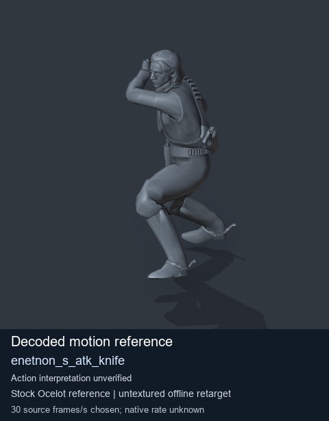
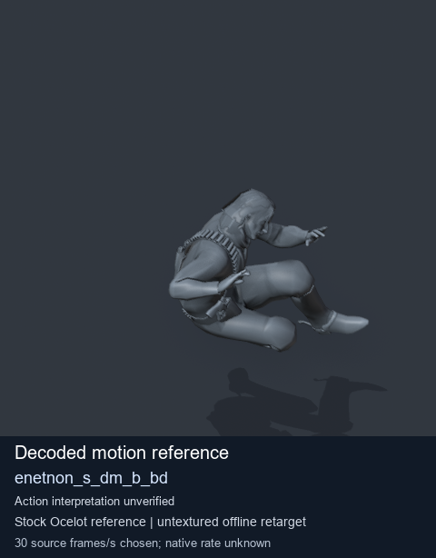
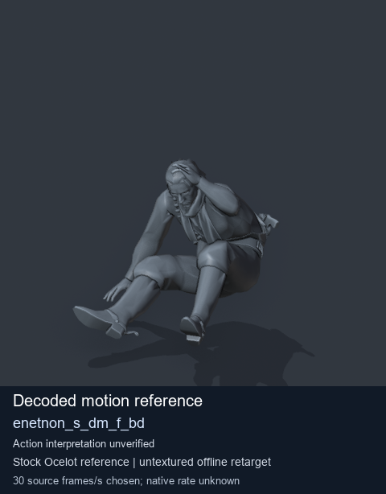
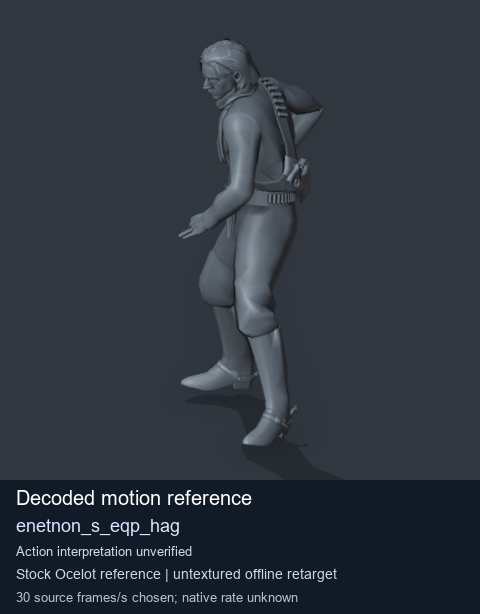

# Stock Soldier_common motion references / /Assets/tpp/motion/SI_game/fani/bodies/enet/enetnon - page 2

[Library](../README.md) · [Grouped directory](../browse/README.md) · [This source family](../browse/stock-soldier-enetnon-3a08aec1.md) · [Switch mode](browse-stock-soldier-enetnon-3a08aec1-2.md)

**Still images: no GIFs loaded** · 4 clips · 0.33 MiB downloaded.

Images reuse existing files. A small display width does not reduce download size. Open one clip for its larger titled GIF and original technical data.

Source-family grouping uses only recorded virtual directories; it does not establish an action, weapon, actor, rig or native compatibility. Existing descriptions and tags below are unchanged. Per-clip visual review may be pending; chosen preview speed is separate from unmeasured native timing.

| Preview | Animation | Category | Tags | Virtual GANI directory / file | MTAR / container location | Description | Frames / data |
| --- | --- | --- | --- | --- | --- | --- | --- |
|  | [Stock motion reference: enetnon_s_atk_knife](../clips/mgsv-tpp-soldier_common-payloadsha256-204ca53fef5615635455f337a31aaacb5cfe73d69e6657eff914bf086718078e.md) <code>enetnon_s_atk_knife</code> | Stock Soldier_common motion references | <code>stock body motion</code> <code>Soldier_common</code> <code>source-derived label</code> <code>Ocelot reference mesh</code> | <code>/Assets/tpp/motion/SI_game/fani/bodies/enet/enetnon</code> <code>enetnon_s_atk_knife.gani</code> | Retained MTAR: <code>Soldier_common.mtar</code> DAT / FPK membership unverified | Decoded stock body-motion reference enetnon_s_atk_knife; action interpretation unverified. | 105 raw 3.5 s chosen; native rate unknown [Full data](../clips/mgsv-tpp-soldier_common-payloadsha256-204ca53fef5615635455f337a31aaacb5cfe73d69e6657eff914bf086718078e.md#technical-data) |
|  | [Stock reference: enetnon_s_dm_b_bd](../clips/mgsv-tpp-soldier_common-payloadsha256-b8f8dcc5c195421ff06504f49dbf3b277caf26f12ad7d1da3cfc98690bc9c76f.md) <code>enetnon_s_dm_b_bd</code> | Stock Soldier_common motion references | <code>stock animation reference</code> <code>Soldier_common</code> <code>source-derived label</code> <code>Ocelot reference mesh</code> | <code>/Assets/tpp/motion/SI_game/fani/bodies/enet/enetnon</code> <code>enetnon_s_dm_b_bd.gani</code> | Retained MTAR: <code>Soldier_common.mtar</code> DAT / FPK membership unverified | Decoded stock reference enetnon_s_dm_b_bd; action interpretation unverified. | 85 raw 2.83 s chosen; native rate unknown [Full data](../clips/mgsv-tpp-soldier_common-payloadsha256-b8f8dcc5c195421ff06504f49dbf3b277caf26f12ad7d1da3cfc98690bc9c76f.md#technical-data) |
|  | [Stock motion reference: enetnon_s_dm_f_bd](../clips/mgsv-tpp-soldier_common-payloadsha256-47cb84014508deb7fcd680e833bd0506d997b5da3ecbc74e084b270b3b192411.md) <code>enetnon_s_dm_f_bd</code> | Stock Soldier_common motion references | <code>stock body motion</code> <code>Soldier_common</code> <code>source-derived label</code> <code>Ocelot reference mesh</code> | <code>/Assets/tpp/motion/SI_game/fani/bodies/enet/enetnon</code> <code>enetnon_s_dm_f_bd.gani</code> | Retained MTAR: <code>Soldier_common.mtar</code> DAT / FPK membership unverified | Decoded stock body-motion reference enetnon_s_dm_f_bd; action interpretation unverified. | 78 raw 2.6 s chosen; native rate unknown [Full data](../clips/mgsv-tpp-soldier_common-payloadsha256-47cb84014508deb7fcd680e833bd0506d997b5da3ecbc74e084b270b3b192411.md#technical-data) |
|  | [Stock reference: enetnon_s_eqp_hag](../clips/mgsv-tpp-soldier_common-payloadsha256-3c8f6a8650369f3e31c5339b41bfe64ce25a2f72c3b49c687511f2633a0cb6a0.md) <code>enetnon_s_eqp_hag</code> | Stock Soldier_common motion references | <code>stock animation reference</code> <code>Soldier_common</code> <code>source-derived label</code> <code>Ocelot reference mesh</code> | <code>/Assets/tpp/motion/SI_game/fani/bodies/enet/enetnon</code> <code>enetnon_s_eqp_hag.gani</code> | Retained MTAR: <code>Soldier_common.mtar</code> DAT / FPK membership unverified | Decoded stock reference enetnon_s_eqp_hag; action interpretation unverified. | 90 raw 3.0 s chosen; native rate unknown [Full data](../clips/mgsv-tpp-soldier_common-payloadsha256-3c8f6a8650369f3e31c5339b41bfe64ce25a2f72c3b49c687511f2633a0cb6a0.md#technical-data) |

[Source descriptions, confidence and credits](../description-sources.md) · [Complete JSON](../catalogue.json) · [CSV](../catalogue.csv)
