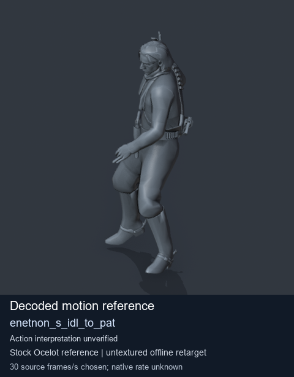
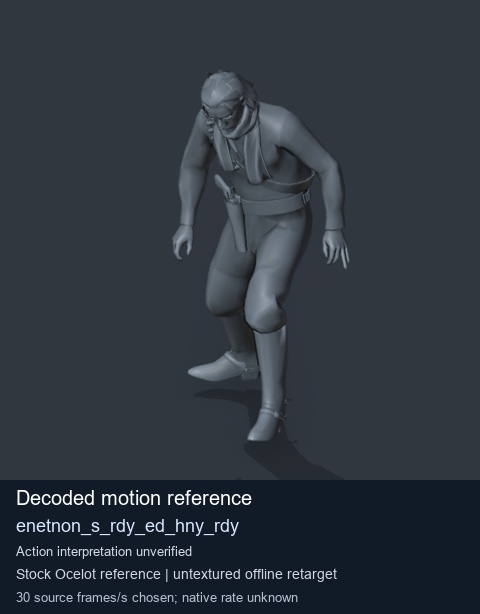

# Stock Soldier_common motion references / /Assets/tpp/motion/SI_game/fani/bodies/enet/enetnon - page 4

[Library](../README.md) · [Grouped directory](../browse/README.md) · [This source family](../browse/stock-soldier-enetnon-3a08aec1.md) · [Switch mode](browse-stock-soldier-enetnon-3a08aec1-4.md)

**Still images: no GIFs loaded** · 2 clips · 0.17 MiB downloaded.

Images reuse existing files. A small display width does not reduce download size. Open one clip for its larger titled GIF and original technical data.

Source-family grouping uses only recorded virtual directories; it does not establish an action, weapon, actor, rig or native compatibility. Existing descriptions and tags below are unchanged. Per-clip visual review may be pending; chosen preview speed is separate from unmeasured native timing.

| Preview | Animation | Category | Tags | Virtual GANI directory / file | MTAR / container location | Description | Frames / data |
| --- | --- | --- | --- | --- | --- | --- | --- |
|  | [Stock reference: enetnon_s_idl_to_pat](../clips/mgsv-tpp-soldier_common-payloadsha256-a873d5b355311f6979f614e11d142e2a174cf0ef96da9c893c4fe6f2c4dca1b4.md) <code>enetnon_s_idl_to_pat</code> | Stock Soldier_common motion references | <code>stock animation reference</code> <code>Soldier_common</code> <code>source-derived label</code> <code>Ocelot reference mesh</code> | <code>/Assets/tpp/motion/SI_game/fani/bodies/enet/enetnon</code> <code>enetnon_s_idl_to_pat.gani</code> | Retained MTAR: <code>Soldier_common.mtar</code> DAT / FPK membership unverified | Decoded stock reference enetnon_s_idl_to_pat; action interpretation unverified. | 204 raw 6.8 s chosen; native rate unknown [Full data](../clips/mgsv-tpp-soldier_common-payloadsha256-a873d5b355311f6979f614e11d142e2a174cf0ef96da9c893c4fe6f2c4dca1b4.md#technical-data) |
|  | [Stock reference: enetnon_s_rdy_ed_hny_rdy](../clips/mgsv-tpp-soldier_common-payloadsha256-adb8da4e18afed46adba75f7fb3e49be9b1d2b74a8c1d9e0c6e7a87fd2ee7a9b.md) <code>enetnon_s_rdy_ed_hny_rdy</code> | Stock Soldier_common motion references | <code>stock animation reference</code> <code>Soldier_common</code> <code>source-derived label</code> <code>Ocelot reference mesh</code> | <code>/Assets/tpp/motion/SI_game/fani/bodies/enet/enetnon</code> <code>enetnon_s_rdy_ed_hny_rdy.gani</code> | Retained MTAR: <code>Soldier_common.mtar</code> DAT / FPK membership unverified | Decoded stock reference enetnon_s_rdy_ed_hny_rdy; action interpretation unverified. | 230 raw 7.67 s chosen; native rate unknown [Full data](../clips/mgsv-tpp-soldier_common-payloadsha256-adb8da4e18afed46adba75f7fb3e49be9b1d2b74a8c1d9e0c6e7a87fd2ee7a9b.md#technical-data) |

[Source descriptions, confidence and credits](../description-sources.md) · [Complete JSON](../catalogue.json) · [CSV](../catalogue.csv)
