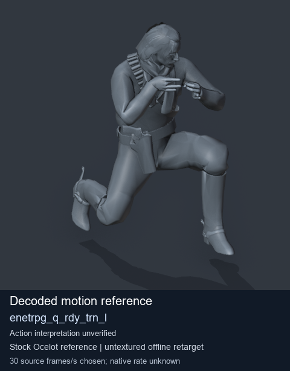
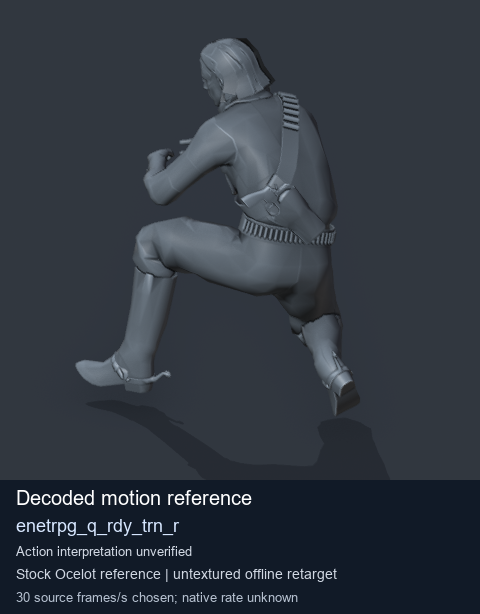
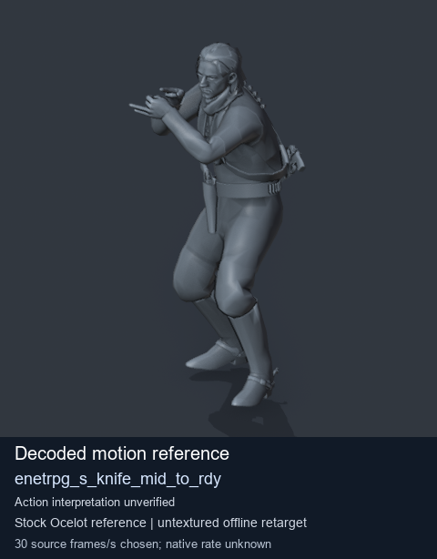
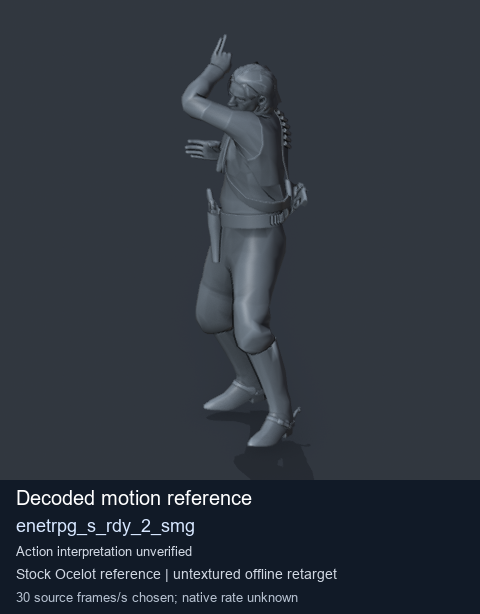

# Stock Soldier_common motion references / /Assets/tpp/motion/SI_game/fani/bodies/enet/enetrpg - page 3

[Library](../README.md) · [Grouped directory](../browse/README.md) · [This source family](../browse/stock-soldier-enetrpg-5b7480fa.md) · [Switch mode](browse-stock-soldier-enetrpg-5b7480fa-3.md)

**Still images: no GIFs loaded** · 4 clips · 0.40 MiB downloaded.

Images reuse existing files. A small display width does not reduce download size. Open one clip for its larger titled GIF and original technical data.

Source-family grouping uses only recorded virtual directories; it does not establish an action, weapon, actor, rig or native compatibility. Existing descriptions and tags below are unchanged. Per-clip visual review may be pending; chosen preview speed is separate from unmeasured native timing.

| Preview | Animation | Category | Tags | Virtual GANI directory / file | MTAR / container location | Description | Frames / data |
| --- | --- | --- | --- | --- | --- | --- | --- |
|  | [Stock motion reference: enetrpg_q_rdy_trn_l](../clips/mgsv-tpp-soldier_common-payloadsha256-8ddc5dc0e0c5c6b6d0d47cfaba582b9fdf7153360ba2647e28da87db5e2bb37f.md) <code>enetrpg_q_rdy_trn_l</code> | Stock Soldier_common motion references | <code>stock body motion</code> <code>Soldier_common</code> <code>source-derived label</code> <code>Ocelot reference mesh</code> | <code>/Assets/tpp/motion/SI_game/fani/bodies/enet/enetrpg</code> <code>enetrpg_q_rdy_trn_l.gani</code> | Retained MTAR: <code>Soldier_common.mtar</code> DAT / FPK membership unverified | Decoded stock body-motion reference enetrpg_q_rdy_trn_l; action interpretation unverified. | 50 raw 1.67 s chosen; native rate unknown [Full data](../clips/mgsv-tpp-soldier_common-payloadsha256-8ddc5dc0e0c5c6b6d0d47cfaba582b9fdf7153360ba2647e28da87db5e2bb37f.md#technical-data) |
|  | [Stock motion reference: enetrpg_q_rdy_trn_r](../clips/mgsv-tpp-soldier_common-payloadsha256-b1fa1d04a20d7514b2c78d510f15ed651acd9f0806b7facd699711ccb2704c8e.md) <code>enetrpg_q_rdy_trn_r</code> | Stock Soldier_common motion references | <code>stock body motion</code> <code>Soldier_common</code> <code>source-derived label</code> <code>Ocelot reference mesh</code> | <code>/Assets/tpp/motion/SI_game/fani/bodies/enet/enetrpg</code> <code>enetrpg_q_rdy_trn_r.gani</code> | Retained MTAR: <code>Soldier_common.mtar</code> DAT / FPK membership unverified | Decoded stock body-motion reference enetrpg_q_rdy_trn_r; action interpretation unverified. | 50 raw 1.67 s chosen; native rate unknown [Full data](../clips/mgsv-tpp-soldier_common-payloadsha256-b1fa1d04a20d7514b2c78d510f15ed651acd9f0806b7facd699711ccb2704c8e.md#technical-data) |
|  | [Stock motion reference: enetrpg_s_knife_mid_to_rdy](../clips/mgsv-tpp-soldier_common-payloadsha256-5927bab3c64b8c25cce7c7b5d81e99890d0860d7f25119defe330460e7d49639.md) <code>enetrpg_s_knife_mid_to_rdy</code> | Stock Soldier_common motion references | <code>stock body motion</code> <code>Soldier_common</code> <code>source-derived label</code> <code>Ocelot reference mesh</code> | <code>/Assets/tpp/motion/SI_game/fani/bodies/enet/enetrpg</code> <code>enetrpg_s_knife_mid_to_rdy.gani</code> | Retained MTAR: <code>Soldier_common.mtar</code> DAT / FPK membership unverified | Decoded stock body-motion reference enetrpg_s_knife_mid_to_rdy; action interpretation unverified. | 45 raw 1.5 s chosen; native rate unknown [Full data](../clips/mgsv-tpp-soldier_common-payloadsha256-5927bab3c64b8c25cce7c7b5d81e99890d0860d7f25119defe330460e7d49639.md#technical-data) |
|  | [Stock motion reference: enetrpg_s_rdy_2_smg](../clips/mgsv-tpp-soldier_common-payloadsha256-dbf6044a3dee5dc9f21eeb95882bebe44ce4ea1edb8b4800569f15c3d49b847b.md) <code>enetrpg_s_rdy_2_smg</code> | Stock Soldier_common motion references | <code>stock body motion</code> <code>Soldier_common</code> <code>source-derived label</code> <code>Ocelot reference mesh</code> | <code>/Assets/tpp/motion/SI_game/fani/bodies/enet/enetrpg</code> <code>enetrpg_s_rdy_2_smg.gani</code> | Retained MTAR: <code>Soldier_common.mtar</code> DAT / FPK membership unverified | Decoded stock body-motion reference enetrpg_s_rdy_2_smg; action interpretation unverified. | 95 raw 3.17 s chosen; native rate unknown [Full data](../clips/mgsv-tpp-soldier_common-payloadsha256-dbf6044a3dee5dc9f21eeb95882bebe44ce4ea1edb8b4800569f15c3d49b847b.md#technical-data) |

[Source descriptions, confidence and credits](../description-sources.md) · [Complete JSON](../catalogue.json) · [CSV](../catalogue.csv)
