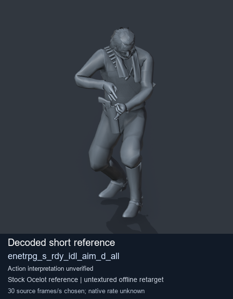
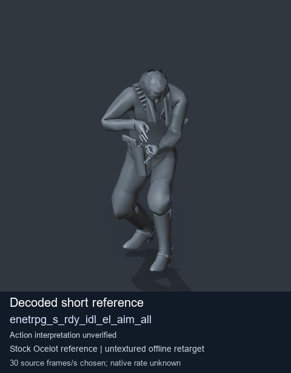
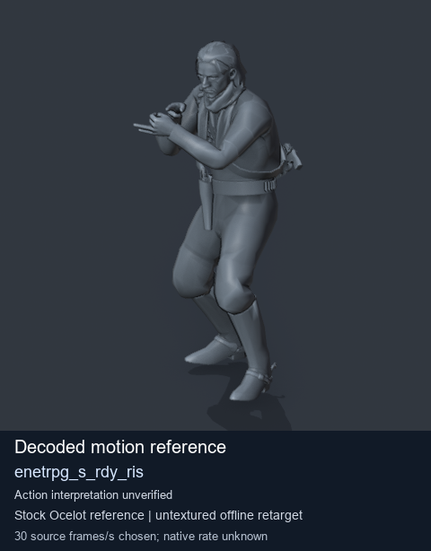
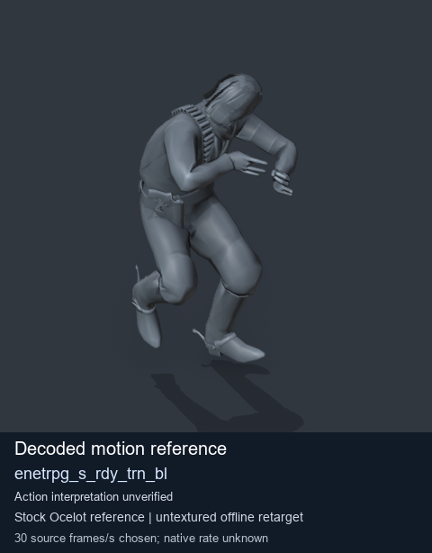

# Stock Soldier_common motion references / /Assets/tpp/motion/SI_game/fani/bodies/enet/enetrpg - page 4

[Library](../README.md) · [Grouped directory](../browse/README.md) · [This source family](../browse/stock-soldier-enetrpg-5b7480fa.md) · [Switch mode](browse-stock-soldier-enetrpg-5b7480fa-4.md)

**Still images: no GIFs loaded** · 4 clips · 0.36 MiB downloaded.

Images reuse existing files. A small display width does not reduce download size. Open one clip for its larger titled GIF and original technical data.

Source-family grouping uses only recorded virtual directories; it does not establish an action, weapon, actor, rig or native compatibility. Existing descriptions and tags below are unchanged. Per-clip visual review may be pending; chosen preview speed is separate from unmeasured native timing.

| Preview | Animation | Category | Tags | Virtual GANI directory / file | MTAR / container location | Description | Frames / data |
| --- | --- | --- | --- | --- | --- | --- | --- |
|  | [Stock reference: enetrpg_s_rdy_idl_aim_d_all](../clips/mgsv-tpp-soldier_common-payloadsha256-dce88161f147800ff53eee1bf8f849db268a4a175fdd42ddf320695d5a339fe5.md) <code>enetrpg_s_rdy_idl_aim_d_all</code> | Stock Soldier_common motion references | <code>stock animation reference</code> <code>Soldier_common</code> <code>source-derived label</code> <code>Ocelot reference mesh</code> | <code>/Assets/tpp/motion/SI_game/fani/bodies/enet/enetrpg</code> <code>enetrpg_s_rdy_idl_aim_d_all.gani</code> | Retained MTAR: <code>Soldier_common.mtar</code> DAT / FPK membership unverified | Decoded stock reference enetrpg_s_rdy_idl_aim_d_all; action interpretation unverified. | 8 raw 0.27 s chosen; native rate unknown [Full data](../clips/mgsv-tpp-soldier_common-payloadsha256-dce88161f147800ff53eee1bf8f849db268a4a175fdd42ddf320695d5a339fe5.md#technical-data) |
|  | [Stock reference: enetrpg_s_rdy_idl_el_aim_all](../clips/mgsv-tpp-soldier_common-payloadsha256-7dce354ce935abd597acdd00925d47a493fb2996c8de4069bc04aaaac7342d9a.md) <code>enetrpg_s_rdy_idl_el_aim_all</code> | Stock Soldier_common motion references | <code>stock animation reference</code> <code>Soldier_common</code> <code>source-derived label</code> <code>Ocelot reference mesh</code> | <code>/Assets/tpp/motion/SI_game/fani/bodies/enet/enetrpg</code> <code>enetrpg_s_rdy_idl_el_aim_all.gani</code> | Retained MTAR: <code>Soldier_common.mtar</code> DAT / FPK membership unverified | Decoded stock reference enetrpg_s_rdy_idl_el_aim_all; action interpretation unverified. | 8 raw 0.27 s chosen; native rate unknown [Full data](../clips/mgsv-tpp-soldier_common-payloadsha256-7dce354ce935abd597acdd00925d47a493fb2996c8de4069bc04aaaac7342d9a.md#technical-data) |
|  | [Stock motion reference: enetrpg_s_rdy_ris](../clips/mgsv-tpp-soldier_common-payloadsha256-b68a556895b08fbe93a64eef78e43347e50af5a8f29f147d14cb3c7d678a63d9.md) <code>enetrpg_s_rdy_ris</code> | Stock Soldier_common motion references | <code>stock body motion</code> <code>Soldier_common</code> <code>source-derived label</code> <code>Ocelot reference mesh</code> | <code>/Assets/tpp/motion/SI_game/fani/bodies/enet/enetrpg</code> <code>enetrpg_s_rdy_ris.gani</code> | Retained MTAR: <code>Soldier_common.mtar</code> DAT / FPK membership unverified | Decoded stock body-motion reference enetrpg_s_rdy_ris; action interpretation unverified. | 44 raw 1.47 s chosen; native rate unknown [Full data](../clips/mgsv-tpp-soldier_common-payloadsha256-b68a556895b08fbe93a64eef78e43347e50af5a8f29f147d14cb3c7d678a63d9.md#technical-data) |
|  | [Stock motion reference: enetrpg_s_rdy_trn_bl](../clips/mgsv-tpp-soldier_common-payloadsha256-42d29d44d22feaecf6c2c785ea4ded419f61ec74836a1ae5d6451ebd3eebd7b7.md) <code>enetrpg_s_rdy_trn_bl</code> | Stock Soldier_common motion references | <code>stock body motion</code> <code>Soldier_common</code> <code>source-derived label</code> <code>Ocelot reference mesh</code> | <code>/Assets/tpp/motion/SI_game/fani/bodies/enet/enetrpg</code> <code>enetrpg_s_rdy_trn_bl.gani</code> | Retained MTAR: <code>Soldier_common.mtar</code> DAT / FPK membership unverified | Decoded stock body-motion reference enetrpg_s_rdy_trn_bl; action interpretation unverified. | 65 raw 2.17 s chosen; native rate unknown [Full data](../clips/mgsv-tpp-soldier_common-payloadsha256-42d29d44d22feaecf6c2c785ea4ded419f61ec74836a1ae5d6451ebd3eebd7b7.md#technical-data) |

[Source descriptions, confidence and credits](../description-sources.md) · [Complete JSON](../catalogue.json) · [CSV](../catalogue.csv)
