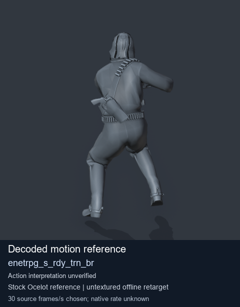
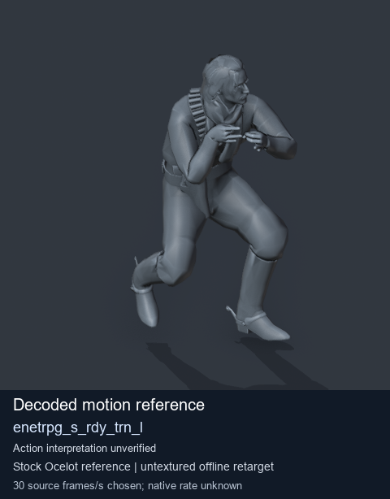
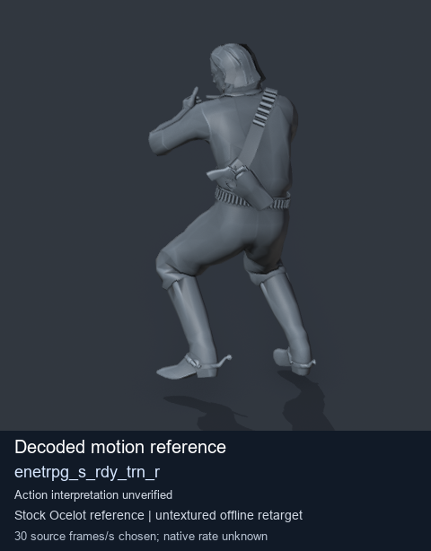

# Stock Soldier_common motion references / /Assets/tpp/motion/SI_game/fani/bodies/enet/enetrpg - page 5

[Library](../README.md) · [Grouped directory](../browse/README.md) · [This source family](../browse/stock-soldier-enetrpg-5b7480fa.md) · [Switch mode](browse-stock-soldier-enetrpg-5b7480fa-5.md)

**Still images: no GIFs loaded** · 3 clips · 0.28 MiB downloaded.

Images reuse existing files. A small display width does not reduce download size. Open one clip for its larger titled GIF and original technical data.

Source-family grouping uses only recorded virtual directories; it does not establish an action, weapon, actor, rig or native compatibility. Existing descriptions and tags below are unchanged. Per-clip visual review may be pending; chosen preview speed is separate from unmeasured native timing.

| Preview | Animation | Category | Tags | Virtual GANI directory / file | MTAR / container location | Description | Frames / data |
| --- | --- | --- | --- | --- | --- | --- | --- |
|  | [Stock motion reference: enetrpg_s_rdy_trn_br](../clips/mgsv-tpp-soldier_common-payloadsha256-3275fbba516870800cc01b90db7e52d6806b98ea4050bcf1dc5f56dd45744f9a.md) <code>enetrpg_s_rdy_trn_br</code> | Stock Soldier_common motion references | <code>stock body motion</code> <code>Soldier_common</code> <code>source-derived label</code> <code>Ocelot reference mesh</code> | <code>/Assets/tpp/motion/SI_game/fani/bodies/enet/enetrpg</code> <code>enetrpg_s_rdy_trn_br.gani</code> | Retained MTAR: <code>Soldier_common.mtar</code> DAT / FPK membership unverified | Decoded stock body-motion reference enetrpg_s_rdy_trn_br; action interpretation unverified. | 75 raw 2.5 s chosen; native rate unknown [Full data](../clips/mgsv-tpp-soldier_common-payloadsha256-3275fbba516870800cc01b90db7e52d6806b98ea4050bcf1dc5f56dd45744f9a.md#technical-data) |
|  | [Stock motion reference: enetrpg_s_rdy_trn_l](../clips/mgsv-tpp-soldier_common-payloadsha256-58043da86cbc3beb740c3c1880b2c5b75982e0dcb86b4c4bafcdc058f0b15c47.md) <code>enetrpg_s_rdy_trn_l</code> | Stock Soldier_common motion references | <code>stock body motion</code> <code>Soldier_common</code> <code>source-derived label</code> <code>Ocelot reference mesh</code> | <code>/Assets/tpp/motion/SI_game/fani/bodies/enet/enetrpg</code> <code>enetrpg_s_rdy_trn_l.gani</code> | Retained MTAR: <code>Soldier_common.mtar</code> DAT / FPK membership unverified | Decoded stock body-motion reference enetrpg_s_rdy_trn_l; action interpretation unverified. | 61 raw 2.03 s chosen; native rate unknown [Full data](../clips/mgsv-tpp-soldier_common-payloadsha256-58043da86cbc3beb740c3c1880b2c5b75982e0dcb86b4c4bafcdc058f0b15c47.md#technical-data) |
|  | [Stock motion reference: enetrpg_s_rdy_trn_r](../clips/mgsv-tpp-soldier_common-payloadsha256-d0eb05225242a92edf4fd5b07ec35a1fac6ecee9828a8c947d679b78e3df6871.md) <code>enetrpg_s_rdy_trn_r</code> | Stock Soldier_common motion references | <code>stock body motion</code> <code>Soldier_common</code> <code>source-derived label</code> <code>Ocelot reference mesh</code> | <code>/Assets/tpp/motion/SI_game/fani/bodies/enet/enetrpg</code> <code>enetrpg_s_rdy_trn_r.gani</code> | Retained MTAR: <code>Soldier_common.mtar</code> DAT / FPK membership unverified | Decoded stock body-motion reference enetrpg_s_rdy_trn_r; action interpretation unverified. | 60 raw 2.0 s chosen; native rate unknown [Full data](../clips/mgsv-tpp-soldier_common-payloadsha256-d0eb05225242a92edf4fd5b07ec35a1fac6ecee9828a8c947d679b78e3df6871.md#technical-data) |

[Source descriptions, confidence and credits](../description-sources.md) · [Complete JSON](../catalogue.json) · [CSV](../catalogue.csv)
