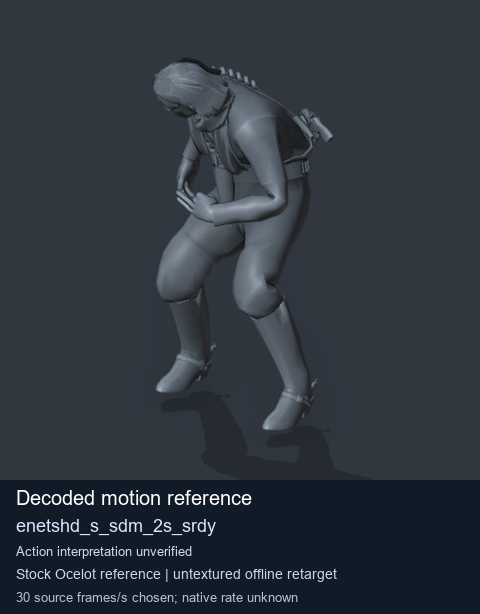
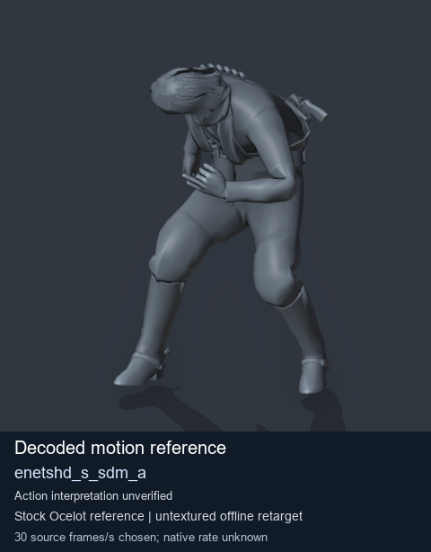
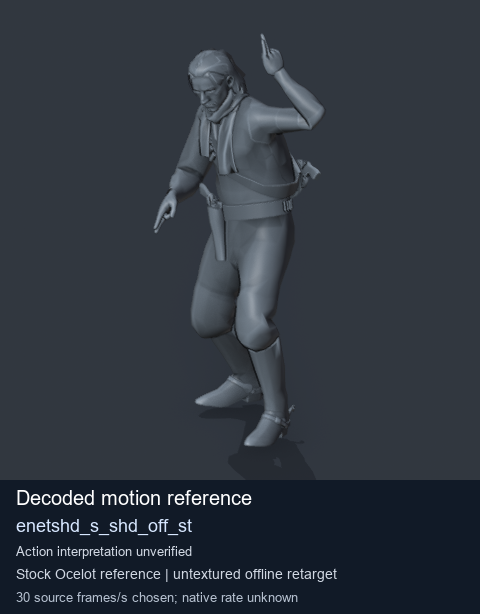

# Stock Soldier_common motion references / /Assets/tpp/motion/SI_game/fani/bodies/enet/enetshd - page 12

[Library](../README.md) · [Grouped directory](../browse/README.md) · [This source family](../browse/stock-soldier-enetshd-5ac8cae9.md) · [Switch mode](browse-stock-soldier-enetshd-5ac8cae9-12.md)

**Still images: no GIFs loaded** · 3 clips · 0.30 MiB downloaded.

Images reuse existing files. A small display width does not reduce download size. Open one clip for its larger titled GIF and original technical data.

Source-family grouping uses only recorded virtual directories; it does not establish an action, weapon, actor, rig or native compatibility. Existing descriptions and tags below are unchanged. Per-clip visual review may be pending; chosen preview speed is separate from unmeasured native timing.

| Preview | Animation | Category | Tags | Virtual GANI directory / file | MTAR / container location | Description | Frames / data |
| --- | --- | --- | --- | --- | --- | --- | --- |
|  | [Stock reference: enetshd_s_sdm_2s_srdy](../clips/mgsv-tpp-soldier_common-payloadsha256-4fb29a6c0abdf066d6dbd454f739cfbc76223c491c7b038b743d1dabbb088182.md) <code>enetshd_s_sdm_2s_srdy</code> | Stock Soldier_common motion references | <code>stock animation reference</code> <code>Soldier_common</code> <code>source-derived label</code> <code>Ocelot reference mesh</code> | <code>/Assets/tpp/motion/SI_game/fani/bodies/enet/enetshd</code> <code>enetshd_s_sdm_2s_srdy.gani</code> | Retained MTAR: <code>Soldier_common.mtar</code> DAT / FPK membership unverified | Decoded stock reference enetshd_s_sdm_2s_srdy; action interpretation unverified. | 117 raw 3.9 s chosen; native rate unknown [Full data](../clips/mgsv-tpp-soldier_common-payloadsha256-4fb29a6c0abdf066d6dbd454f739cfbc76223c491c7b038b743d1dabbb088182.md#technical-data) |
|  | [Stock reference: enetshd_s_sdm_a](../clips/mgsv-tpp-soldier_common-payloadsha256-032a5c732173450c29572d97ffa10e22235138604aa08e4e36e33a51cdc75b18.md) <code>enetshd_s_sdm_a</code> | Stock Soldier_common motion references | <code>stock animation reference</code> <code>Soldier_common</code> <code>source-derived label</code> <code>Ocelot reference mesh</code> | <code>/Assets/tpp/motion/SI_game/fani/bodies/enet/enetshd</code> <code>enetshd_s_sdm_a.gani</code> | Retained MTAR: <code>Soldier_common.mtar</code> DAT / FPK membership unverified | Decoded stock reference enetshd_s_sdm_a; action interpretation unverified. | 270 raw 9.0 s chosen; native rate unknown [Full data](../clips/mgsv-tpp-soldier_common-payloadsha256-032a5c732173450c29572d97ffa10e22235138604aa08e4e36e33a51cdc75b18.md#technical-data) |
|  | [Stock motion reference: enetshd_s_shd_off_st](../clips/mgsv-tpp-soldier_common-payloadsha256-033044d29bae7b7589f1a6e2a885a3d001e583e325149db3bb36f009b88b770d.md) <code>enetshd_s_shd_off_st</code> | Stock Soldier_common motion references | <code>stock body motion</code> <code>Soldier_common</code> <code>source-derived label</code> <code>Ocelot reference mesh</code> | <code>/Assets/tpp/motion/SI_game/fani/bodies/enet/enetshd</code> <code>enetshd_s_shd_off_st.gani</code> | Retained MTAR: <code>Soldier_common.mtar</code> DAT / FPK membership unverified | Decoded stock body-motion reference enetshd_s_shd_off_st; action interpretation unverified. | 60 raw 2.0 s chosen; native rate unknown [Full data](../clips/mgsv-tpp-soldier_common-payloadsha256-033044d29bae7b7589f1a6e2a885a3d001e583e325149db3bb36f009b88b770d.md#technical-data) |

[Source descriptions, confidence and credits](../description-sources.md) · [Complete JSON](../catalogue.json) · [CSV](../catalogue.csv)
