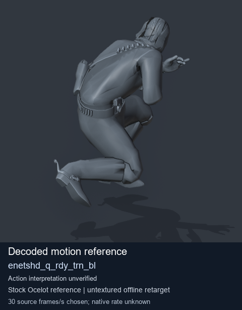
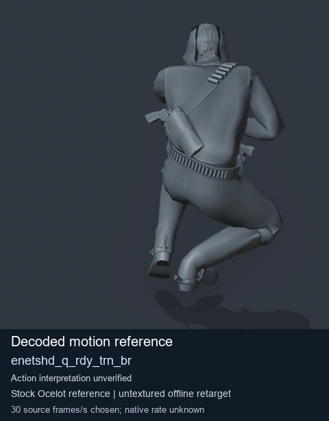
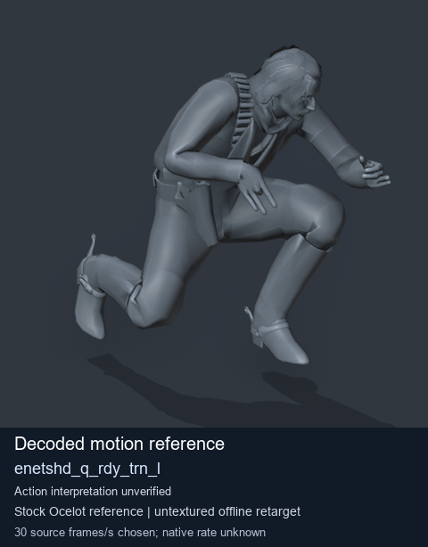
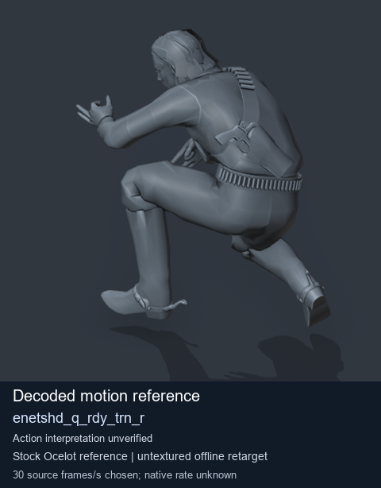

# Stock Soldier_common motion references / /Assets/tpp/motion/SI_game/fani/bodies/enet/enetshd - page 2

[Library](../README.md) · [Grouped directory](../browse/README.md) · [This source family](../browse/stock-soldier-enetshd-5ac8cae9.md) · [Switch mode](browse-stock-soldier-enetshd-5ac8cae9-2.md)

**Still images: no GIFs loaded** · 4 clips · 0.46 MiB downloaded.

Images reuse existing files. A small display width does not reduce download size. Open one clip for its larger titled GIF and original technical data.

Source-family grouping uses only recorded virtual directories; it does not establish an action, weapon, actor, rig or native compatibility. Existing descriptions and tags below are unchanged. Per-clip visual review may be pending; chosen preview speed is separate from unmeasured native timing.

| Preview | Animation | Category | Tags | Virtual GANI directory / file | MTAR / container location | Description | Frames / data |
| --- | --- | --- | --- | --- | --- | --- | --- |
|  | [Stock motion reference: enetshd_q_rdy_trn_bl](../clips/mgsv-tpp-soldier_common-payloadsha256-4057080e2b63462b31fec953095f9ae9f483d39bedc7ed5930e2009da3275081.md) <code>enetshd_q_rdy_trn_bl</code> | Stock Soldier_common motion references | <code>stock body motion</code> <code>Soldier_common</code> <code>source-derived label</code> <code>Ocelot reference mesh</code> | <code>/Assets/tpp/motion/SI_game/fani/bodies/enet/enetshd</code> <code>enetshd_q_rdy_trn_bl.gani</code> | Retained MTAR: <code>Soldier_common.mtar</code> DAT / FPK membership unverified | Decoded stock body-motion reference enetshd_q_rdy_trn_bl; action interpretation unverified. | 50 raw 1.67 s chosen; native rate unknown [Full data](../clips/mgsv-tpp-soldier_common-payloadsha256-4057080e2b63462b31fec953095f9ae9f483d39bedc7ed5930e2009da3275081.md#technical-data) |
|  | [Stock motion reference: enetshd_q_rdy_trn_br](../clips/mgsv-tpp-soldier_common-payloadsha256-8ab0a59f69f915054acb4b0c2764423c33b45d8325777a3fd825d97c5ca6a335.md) <code>enetshd_q_rdy_trn_br</code> | Stock Soldier_common motion references | <code>stock body motion</code> <code>Soldier_common</code> <code>source-derived label</code> <code>Ocelot reference mesh</code> | <code>/Assets/tpp/motion/SI_game/fani/bodies/enet/enetshd</code> <code>enetshd_q_rdy_trn_br.gani</code> | Retained MTAR: <code>Soldier_common.mtar</code> DAT / FPK membership unverified | Decoded stock body-motion reference enetshd_q_rdy_trn_br; action interpretation unverified. | 50 raw 1.67 s chosen; native rate unknown [Full data](../clips/mgsv-tpp-soldier_common-payloadsha256-8ab0a59f69f915054acb4b0c2764423c33b45d8325777a3fd825d97c5ca6a335.md#technical-data) |
|  | [Stock motion reference: enetshd_q_rdy_trn_l](../clips/mgsv-tpp-soldier_common-payloadsha256-d4134686d5d22e4cc1f1dd4e403d38f64eb7c43f3fbfd2daf8d6d40759ccbfc7.md) <code>enetshd_q_rdy_trn_l</code> | Stock Soldier_common motion references | <code>stock body motion</code> <code>Soldier_common</code> <code>source-derived label</code> <code>Ocelot reference mesh</code> | <code>/Assets/tpp/motion/SI_game/fani/bodies/enet/enetshd</code> <code>enetshd_q_rdy_trn_l.gani</code> | Retained MTAR: <code>Soldier_common.mtar</code> DAT / FPK membership unverified | Decoded stock body-motion reference enetshd_q_rdy_trn_l; action interpretation unverified. | 50 raw 1.67 s chosen; native rate unknown [Full data](../clips/mgsv-tpp-soldier_common-payloadsha256-d4134686d5d22e4cc1f1dd4e403d38f64eb7c43f3fbfd2daf8d6d40759ccbfc7.md#technical-data) |
|  | [Stock motion reference: enetshd_q_rdy_trn_r](../clips/mgsv-tpp-soldier_common-payloadsha256-5900248670a68a0cd0b0fdd296008f121c7b7222e1443157769a299836432500.md) <code>enetshd_q_rdy_trn_r</code> | Stock Soldier_common motion references | <code>stock body motion</code> <code>Soldier_common</code> <code>source-derived label</code> <code>Ocelot reference mesh</code> | <code>/Assets/tpp/motion/SI_game/fani/bodies/enet/enetshd</code> <code>enetshd_q_rdy_trn_r.gani</code> | Retained MTAR: <code>Soldier_common.mtar</code> DAT / FPK membership unverified | Decoded stock body-motion reference enetshd_q_rdy_trn_r; action interpretation unverified. | 50 raw 1.67 s chosen; native rate unknown [Full data](../clips/mgsv-tpp-soldier_common-payloadsha256-5900248670a68a0cd0b0fdd296008f121c7b7222e1443157769a299836432500.md#technical-data) |

[Source descriptions, confidence and credits](../description-sources.md) · [Complete JSON](../catalogue.json) · [CSV](../catalogue.csv)
