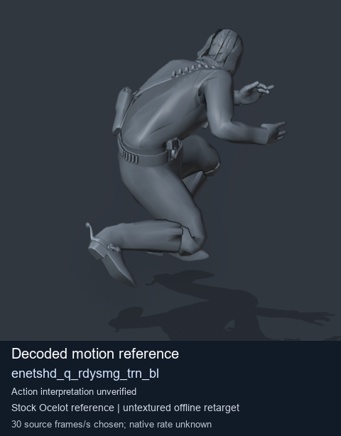
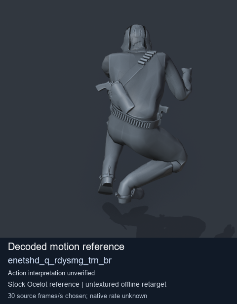
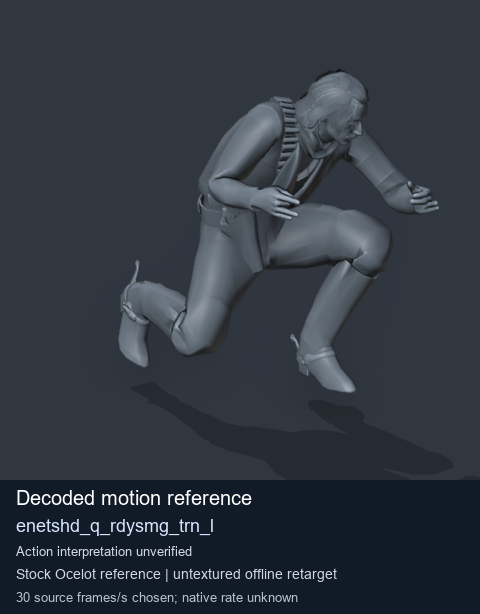
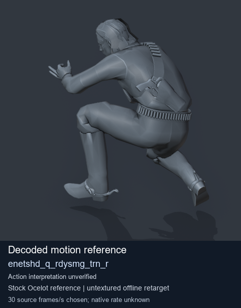

# Stock Soldier_common motion references / /Assets/tpp/motion/SI_game/fani/bodies/enet/enetshd - page 3

[Library](../README.md) · [Grouped directory](../browse/README.md) · [This source family](../browse/stock-soldier-enetshd-5ac8cae9.md) · [Switch mode](browse-stock-soldier-enetshd-5ac8cae9-3.md)

**Still images: no GIFs loaded** · 4 clips · 0.45 MiB downloaded.

Images reuse existing files. A small display width does not reduce download size. Open one clip for its larger titled GIF and original technical data.

Source-family grouping uses only recorded virtual directories; it does not establish an action, weapon, actor, rig or native compatibility. Existing descriptions and tags below are unchanged. Per-clip visual review may be pending; chosen preview speed is separate from unmeasured native timing.

| Preview | Animation | Category | Tags | Virtual GANI directory / file | MTAR / container location | Description | Frames / data |
| --- | --- | --- | --- | --- | --- | --- | --- |
|  | [Stock reference: enetshd_q_rdysmg_trn_bl](../clips/mgsv-tpp-soldier_common-payloadsha256-b6d91c1f28b9a7af2d3ea8c69399e2cb082e2b7de780a5d631c6d5eedbb9186c.md) <code>enetshd_q_rdysmg_trn_bl</code> | Stock Soldier_common motion references | <code>stock animation reference</code> <code>Soldier_common</code> <code>source-derived label</code> <code>Ocelot reference mesh</code> | <code>/Assets/tpp/motion/SI_game/fani/bodies/enet/enetshd</code> <code>enetshd_q_rdysmg_trn_bl.gani</code> | Retained MTAR: <code>Soldier_common.mtar</code> DAT / FPK membership unverified | Decoded stock reference enetshd_q_rdysmg_trn_bl; action interpretation unverified. | 50 raw 1.67 s chosen; native rate unknown [Full data](../clips/mgsv-tpp-soldier_common-payloadsha256-b6d91c1f28b9a7af2d3ea8c69399e2cb082e2b7de780a5d631c6d5eedbb9186c.md#technical-data) |
|  | [Stock reference: enetshd_q_rdysmg_trn_br](../clips/mgsv-tpp-soldier_common-payloadsha256-e37f5709b08b42db798cae41baadb935f215f45c4c0371056f9a7451ea28fc20.md) <code>enetshd_q_rdysmg_trn_br</code> | Stock Soldier_common motion references | <code>stock animation reference</code> <code>Soldier_common</code> <code>source-derived label</code> <code>Ocelot reference mesh</code> | <code>/Assets/tpp/motion/SI_game/fani/bodies/enet/enetshd</code> <code>enetshd_q_rdysmg_trn_br.gani</code> | Retained MTAR: <code>Soldier_common.mtar</code> DAT / FPK membership unverified | Decoded stock reference enetshd_q_rdysmg_trn_br; action interpretation unverified. | 50 raw 1.67 s chosen; native rate unknown [Full data](../clips/mgsv-tpp-soldier_common-payloadsha256-e37f5709b08b42db798cae41baadb935f215f45c4c0371056f9a7451ea28fc20.md#technical-data) |
|  | [Stock reference: enetshd_q_rdysmg_trn_l](../clips/mgsv-tpp-soldier_common-payloadsha256-ab3b1248201ce62fa810bb243b20d7e0d71eb5ad7fb0b7bfaa36cb05c4720145.md) <code>enetshd_q_rdysmg_trn_l</code> | Stock Soldier_common motion references | <code>stock animation reference</code> <code>Soldier_common</code> <code>source-derived label</code> <code>Ocelot reference mesh</code> | <code>/Assets/tpp/motion/SI_game/fani/bodies/enet/enetshd</code> <code>enetshd_q_rdysmg_trn_l.gani</code> | Retained MTAR: <code>Soldier_common.mtar</code> DAT / FPK membership unverified | Decoded stock reference enetshd_q_rdysmg_trn_l; action interpretation unverified. | 50 raw 1.67 s chosen; native rate unknown [Full data](../clips/mgsv-tpp-soldier_common-payloadsha256-ab3b1248201ce62fa810bb243b20d7e0d71eb5ad7fb0b7bfaa36cb05c4720145.md#technical-data) |
|  | [Stock reference: enetshd_q_rdysmg_trn_r](../clips/mgsv-tpp-soldier_common-payloadsha256-9b01aab084d42c4082d5e14456d39c6d5b3d18c9a63d16e94333481d63d48d70.md) <code>enetshd_q_rdysmg_trn_r</code> | Stock Soldier_common motion references | <code>stock animation reference</code> <code>Soldier_common</code> <code>source-derived label</code> <code>Ocelot reference mesh</code> | <code>/Assets/tpp/motion/SI_game/fani/bodies/enet/enetshd</code> <code>enetshd_q_rdysmg_trn_r.gani</code> | Retained MTAR: <code>Soldier_common.mtar</code> DAT / FPK membership unverified | Decoded stock reference enetshd_q_rdysmg_trn_r; action interpretation unverified. | 50 raw 1.67 s chosen; native rate unknown [Full data](../clips/mgsv-tpp-soldier_common-payloadsha256-9b01aab084d42c4082d5e14456d39c6d5b3d18c9a63d16e94333481d63d48d70.md#technical-data) |

[Source descriptions, confidence and credits](../description-sources.md) · [Complete JSON](../catalogue.json) · [CSV](../catalogue.csv)
