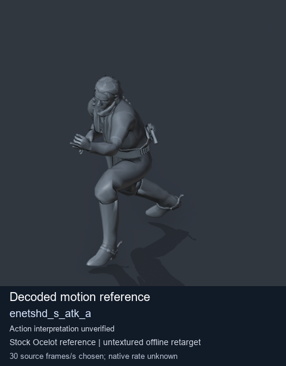
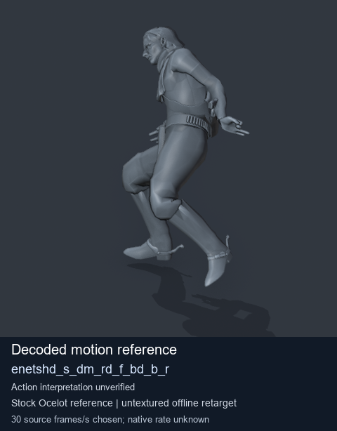
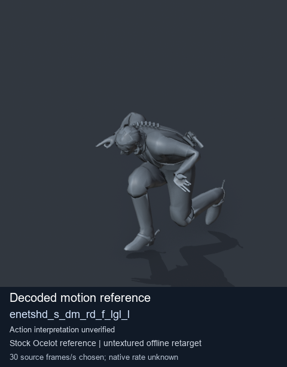
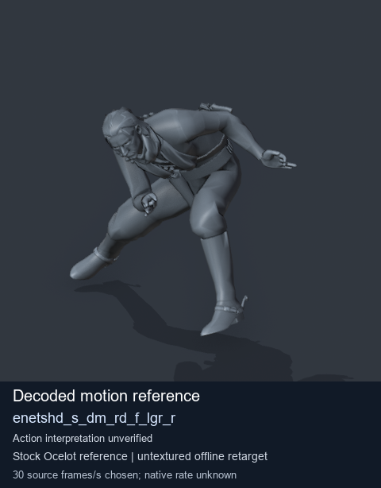

# Stock Soldier_common motion references / /Assets/tpp/motion/SI_game/fani/bodies/enet/enetshd - page 7

[Library](../README.md) · [Grouped directory](../browse/README.md) · [This source family](../browse/stock-soldier-enetshd-5ac8cae9.md) · [Switch mode](browse-stock-soldier-enetshd-5ac8cae9-7.md)

**Still images: no GIFs loaded** · 4 clips · 0.35 MiB downloaded.

Images reuse existing files. A small display width does not reduce download size. Open one clip for its larger titled GIF and original technical data.

Source-family grouping uses only recorded virtual directories; it does not establish an action, weapon, actor, rig or native compatibility. Existing descriptions and tags below are unchanged. Per-clip visual review may be pending; chosen preview speed is separate from unmeasured native timing.

| Preview | Animation | Category | Tags | Virtual GANI directory / file | MTAR / container location | Description | Frames / data |
| --- | --- | --- | --- | --- | --- | --- | --- |
|  | [Stock motion reference: enetshd_s_atk_a](../clips/mgsv-tpp-soldier_common-payloadsha256-23746a3080a2ab20689dba570f722ac69b66e3a1c1afa531be79ccfa211e4357.md) <code>enetshd_s_atk_a</code> | Stock Soldier_common motion references | <code>stock body motion</code> <code>Soldier_common</code> <code>source-derived label</code> <code>Ocelot reference mesh</code> | <code>/Assets/tpp/motion/SI_game/fani/bodies/enet/enetshd</code> <code>enetshd_s_atk_a.gani</code> | Retained MTAR: <code>Soldier_common.mtar</code> DAT / FPK membership unverified | Decoded stock body-motion reference enetshd_s_atk_a; action interpretation unverified. | 117 raw 3.9 s chosen; native rate unknown [Full data](../clips/mgsv-tpp-soldier_common-payloadsha256-23746a3080a2ab20689dba570f722ac69b66e3a1c1afa531be79ccfa211e4357.md#technical-data) |
|  | [Stock reference: enetshd_s_dm_rd_f_bd_b_r](../clips/mgsv-tpp-soldier_common-payloadsha256-c546fa2b4762251a65e743d8fe67b51b6cd28270a129240375ed115c3cd0da36.md) <code>enetshd_s_dm_rd_f_bd_b_r</code> | Stock Soldier_common motion references | <code>stock animation reference</code> <code>Soldier_common</code> <code>source-derived label</code> <code>Ocelot reference mesh</code> | <code>/Assets/tpp/motion/SI_game/fani/bodies/enet/enetshd</code> <code>enetshd_s_dm_rd_f_bd_b_r.gani</code> | Retained MTAR: <code>Soldier_common.mtar</code> DAT / FPK membership unverified | Decoded stock reference enetshd_s_dm_rd_f_bd_b_r; action interpretation unverified. | 120 raw 4.0 s chosen; native rate unknown [Full data](../clips/mgsv-tpp-soldier_common-payloadsha256-c546fa2b4762251a65e743d8fe67b51b6cd28270a129240375ed115c3cd0da36.md#technical-data) |
|  | [Stock reference: enetshd_s_dm_rd_f_lgl_l](../clips/mgsv-tpp-soldier_common-payloadsha256-806509ccd2fe83e9e3b884d16b86d76867d75a109f83b4b87176b164560cdc0a.md) <code>enetshd_s_dm_rd_f_lgl_l</code> | Stock Soldier_common motion references | <code>stock animation reference</code> <code>Soldier_common</code> <code>source-derived label</code> <code>Ocelot reference mesh</code> | <code>/Assets/tpp/motion/SI_game/fani/bodies/enet/enetshd</code> <code>enetshd_s_dm_rd_f_lgl_l.gani</code> | Retained MTAR: <code>Soldier_common.mtar</code> DAT / FPK membership unverified | Decoded stock reference enetshd_s_dm_rd_f_lgl_l; action interpretation unverified. | 125 raw 4.17 s chosen; native rate unknown [Full data](../clips/mgsv-tpp-soldier_common-payloadsha256-806509ccd2fe83e9e3b884d16b86d76867d75a109f83b4b87176b164560cdc0a.md#technical-data) |
|  | [Stock reference: enetshd_s_dm_rd_f_lgr_r](../clips/mgsv-tpp-soldier_common-payloadsha256-cf5a53cbdfd2e3378714b3b644919ca87cdf922357dd86dda1e24550a48bf0d1.md) <code>enetshd_s_dm_rd_f_lgr_r</code> | Stock Soldier_common motion references | <code>stock animation reference</code> <code>Soldier_common</code> <code>source-derived label</code> <code>Ocelot reference mesh</code> | <code>/Assets/tpp/motion/SI_game/fani/bodies/enet/enetshd</code> <code>enetshd_s_dm_rd_f_lgr_r.gani</code> | Retained MTAR: <code>Soldier_common.mtar</code> DAT / FPK membership unverified | Decoded stock reference enetshd_s_dm_rd_f_lgr_r; action interpretation unverified. | 125 raw 4.17 s chosen; native rate unknown [Full data](../clips/mgsv-tpp-soldier_common-payloadsha256-cf5a53cbdfd2e3378714b3b644919ca87cdf922357dd86dda1e24550a48bf0d1.md#technical-data) |

[Source descriptions, confidence and credits](../description-sources.md) · [Complete JSON](../catalogue.json) · [CSV](../catalogue.csv)
