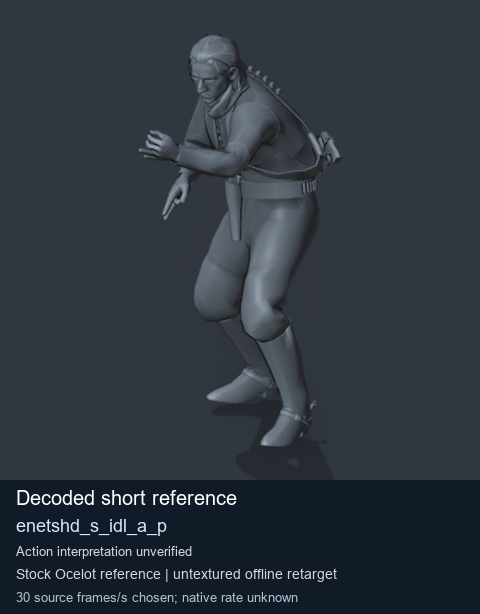
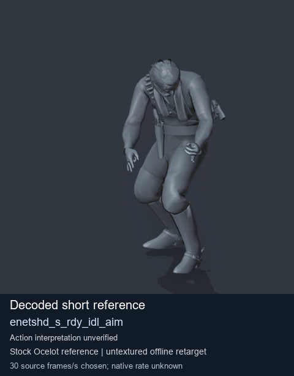
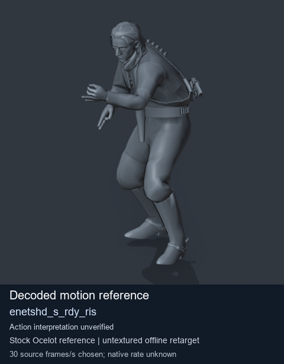
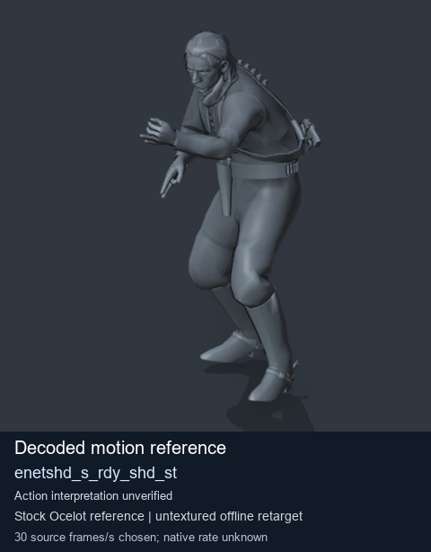

# Stock Soldier_common motion references / /Assets/tpp/motion/SI_game/fani/bodies/enet/enetshd - page 8

[Library](../README.md) · [Grouped directory](../browse/README.md) · [This source family](../browse/stock-soldier-enetshd-5ac8cae9.md) · [Switch mode](browse-stock-soldier-enetshd-5ac8cae9-8.md)

**Still images: no GIFs loaded** · 4 clips · 0.37 MiB downloaded.

Images reuse existing files. A small display width does not reduce download size. Open one clip for its larger titled GIF and original technical data.

Source-family grouping uses only recorded virtual directories; it does not establish an action, weapon, actor, rig or native compatibility. Existing descriptions and tags below are unchanged. Per-clip visual review may be pending; chosen preview speed is separate from unmeasured native timing.

| Preview | Animation | Category | Tags | Virtual GANI directory / file | MTAR / container location | Description | Frames / data |
| --- | --- | --- | --- | --- | --- | --- | --- |
|  | [Stock reference: enetshd_s_idl_a_p](../clips/mgsv-tpp-soldier_common-payloadsha256-7392581fcf82ca8fd5f3c7bface454ae4ddd307b24f7a6b3835e1fb60934e09c.md) <code>enetshd_s_idl_a_p</code> | Stock Soldier_common motion references | <code>stock animation reference</code> <code>Soldier_common</code> <code>source-derived label</code> <code>Ocelot reference mesh</code> | <code>/Assets/tpp/motion/SI_game/fani/bodies/enet/enetshd</code> <code>enetshd_s_idl_a_p.gani</code> | Retained MTAR: <code>Soldier_common.mtar</code> DAT / FPK membership unverified | Decoded stock reference enetshd_s_idl_a_p; action interpretation unverified. | 1 raw 0.03 s chosen; native rate unknown [Full data](../clips/mgsv-tpp-soldier_common-payloadsha256-7392581fcf82ca8fd5f3c7bface454ae4ddd307b24f7a6b3835e1fb60934e09c.md#technical-data) |
|  | [Stock reference: enetshd_s_rdy_idl_aim](../clips/mgsv-tpp-soldier_common-payloadsha256-1f842332269ae5c05eb177c801e508b8d59e22172940b26e93abeb054c907bbf.md) <code>enetshd_s_rdy_idl_aim</code> | Stock Soldier_common motion references | <code>stock animation reference</code> <code>Soldier_common</code> <code>source-derived label</code> <code>Ocelot reference mesh</code> | <code>/Assets/tpp/motion/SI_game/fani/bodies/enet/enetshd</code> <code>enetshd_s_rdy_idl_aim.gani</code> | Retained MTAR: <code>Soldier_common.mtar</code> DAT / FPK membership unverified | Decoded stock reference enetshd_s_rdy_idl_aim; action interpretation unverified. | 8 raw 0.27 s chosen; native rate unknown [Full data](../clips/mgsv-tpp-soldier_common-payloadsha256-1f842332269ae5c05eb177c801e508b8d59e22172940b26e93abeb054c907bbf.md#technical-data) |
|  | [Stock motion reference: enetshd_s_rdy_ris](../clips/mgsv-tpp-soldier_common-payloadsha256-d67bd1b4203f0b16caf7527a80ff43c452c8e83dc5f9c46dcf2f1dd4cea7a332.md) <code>enetshd_s_rdy_ris</code> | Stock Soldier_common motion references | <code>stock body motion</code> <code>Soldier_common</code> <code>source-derived label</code> <code>Ocelot reference mesh</code> | <code>/Assets/tpp/motion/SI_game/fani/bodies/enet/enetshd</code> <code>enetshd_s_rdy_ris.gani</code> | Retained MTAR: <code>Soldier_common.mtar</code> DAT / FPK membership unverified | Decoded stock body-motion reference enetshd_s_rdy_ris; action interpretation unverified. | 40 raw 1.33 s chosen; native rate unknown [Full data](../clips/mgsv-tpp-soldier_common-payloadsha256-d67bd1b4203f0b16caf7527a80ff43c452c8e83dc5f9c46dcf2f1dd4cea7a332.md#technical-data) |
|  | [Stock motion reference: enetshd_s_rdy_shd_st](../clips/mgsv-tpp-soldier_common-payloadsha256-867ec808173f1fd0c40e1c4ec340beafb588d377c0caf27846588d3c959ddf6d.md) <code>enetshd_s_rdy_shd_st</code> | Stock Soldier_common motion references | <code>stock body motion</code> <code>Soldier_common</code> <code>source-derived label</code> <code>Ocelot reference mesh</code> | <code>/Assets/tpp/motion/SI_game/fani/bodies/enet/enetshd</code> <code>enetshd_s_rdy_shd_st.gani</code> | Retained MTAR: <code>Soldier_common.mtar</code> DAT / FPK membership unverified | Decoded stock body-motion reference enetshd_s_rdy_shd_st; action interpretation unverified. | 30 raw 1.0 s chosen; native rate unknown [Full data](../clips/mgsv-tpp-soldier_common-payloadsha256-867ec808173f1fd0c40e1c4ec340beafb588d377c0caf27846588d3c959ddf6d.md#technical-data) |

[Source descriptions, confidence and credits](../description-sources.md) · [Complete JSON](../catalogue.json) · [CSV](../catalogue.csv)
