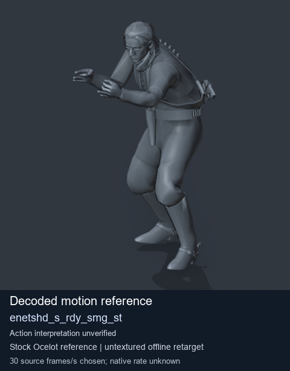
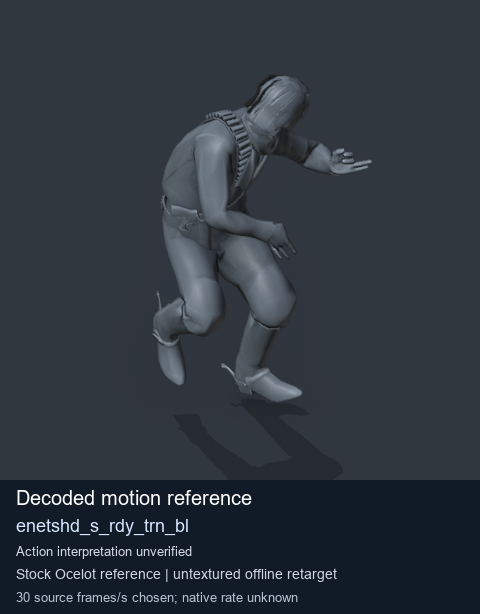
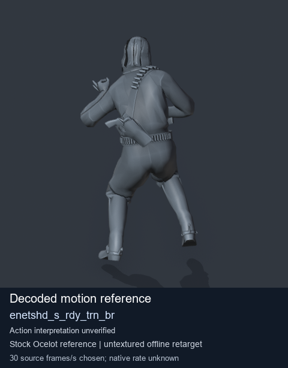
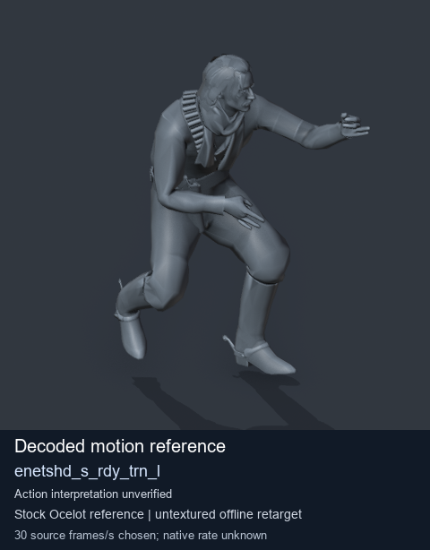

# Stock Soldier_common motion references / /Assets/tpp/motion/SI_game/fani/bodies/enet/enetshd - page 9

[Library](../README.md) · [Grouped directory](../browse/README.md) · [This source family](../browse/stock-soldier-enetshd-5ac8cae9.md) · [Switch mode](browse-stock-soldier-enetshd-5ac8cae9-9.md)

**Still images: no GIFs loaded** · 4 clips · 0.39 MiB downloaded.

Images reuse existing files. A small display width does not reduce download size. Open one clip for its larger titled GIF and original technical data.

Source-family grouping uses only recorded virtual directories; it does not establish an action, weapon, actor, rig or native compatibility. Existing descriptions and tags below are unchanged. Per-clip visual review may be pending; chosen preview speed is separate from unmeasured native timing.

| Preview | Animation | Category | Tags | Virtual GANI directory / file | MTAR / container location | Description | Frames / data |
| --- | --- | --- | --- | --- | --- | --- | --- |
|  | [Stock motion reference: enetshd_s_rdy_smg_st](../clips/mgsv-tpp-soldier_common-payloadsha256-382daf868bfad8620bcba11bb3429d61ba5d5c44df2d516051b85bd28f370a20.md) <code>enetshd_s_rdy_smg_st</code> | Stock Soldier_common motion references | <code>stock body motion</code> <code>Soldier_common</code> <code>source-derived label</code> <code>Ocelot reference mesh</code> | <code>/Assets/tpp/motion/SI_game/fani/bodies/enet/enetshd</code> <code>enetshd_s_rdy_smg_st.gani</code> | Retained MTAR: <code>Soldier_common.mtar</code> DAT / FPK membership unverified | Decoded stock body-motion reference enetshd_s_rdy_smg_st; action interpretation unverified. | 30 raw 1.0 s chosen; native rate unknown [Full data](../clips/mgsv-tpp-soldier_common-payloadsha256-382daf868bfad8620bcba11bb3429d61ba5d5c44df2d516051b85bd28f370a20.md#technical-data) |
|  | [Stock motion reference: enetshd_s_rdy_trn_bl](../clips/mgsv-tpp-soldier_common-payloadsha256-a1af38ea360f8049f979fe2b4f09ba26eef0fac1cd13fa0b6d76ff47868acb8f.md) <code>enetshd_s_rdy_trn_bl</code> | Stock Soldier_common motion references | <code>stock body motion</code> <code>Soldier_common</code> <code>source-derived label</code> <code>Ocelot reference mesh</code> | <code>/Assets/tpp/motion/SI_game/fani/bodies/enet/enetshd</code> <code>enetshd_s_rdy_trn_bl.gani</code> | Retained MTAR: <code>Soldier_common.mtar</code> DAT / FPK membership unverified | Decoded stock body-motion reference enetshd_s_rdy_trn_bl; action interpretation unverified. | 65 raw 2.17 s chosen; native rate unknown [Full data](../clips/mgsv-tpp-soldier_common-payloadsha256-a1af38ea360f8049f979fe2b4f09ba26eef0fac1cd13fa0b6d76ff47868acb8f.md#technical-data) |
|  | [Stock motion reference: enetshd_s_rdy_trn_br](../clips/mgsv-tpp-soldier_common-payloadsha256-b40caec711c3ecefe9eac3464bde511b9fffacc85d0fbcc2f235fbe455e60a47.md) <code>enetshd_s_rdy_trn_br</code> | Stock Soldier_common motion references | <code>stock body motion</code> <code>Soldier_common</code> <code>source-derived label</code> <code>Ocelot reference mesh</code> | <code>/Assets/tpp/motion/SI_game/fani/bodies/enet/enetshd</code> <code>enetshd_s_rdy_trn_br.gani</code> | Retained MTAR: <code>Soldier_common.mtar</code> DAT / FPK membership unverified | Decoded stock body-motion reference enetshd_s_rdy_trn_br; action interpretation unverified. | 75 raw 2.5 s chosen; native rate unknown [Full data](../clips/mgsv-tpp-soldier_common-payloadsha256-b40caec711c3ecefe9eac3464bde511b9fffacc85d0fbcc2f235fbe455e60a47.md#technical-data) |
|  | [Stock motion reference: enetshd_s_rdy_trn_l](../clips/mgsv-tpp-soldier_common-payloadsha256-00d8d734a8578fed8f2f943bf0ad6e8b6efd82b195698af318b06260acb7b784.md) <code>enetshd_s_rdy_trn_l</code> | Stock Soldier_common motion references | <code>stock body motion</code> <code>Soldier_common</code> <code>source-derived label</code> <code>Ocelot reference mesh</code> | <code>/Assets/tpp/motion/SI_game/fani/bodies/enet/enetshd</code> <code>enetshd_s_rdy_trn_l.gani</code> | Retained MTAR: <code>Soldier_common.mtar</code> DAT / FPK membership unverified | Decoded stock body-motion reference enetshd_s_rdy_trn_l; action interpretation unverified. | 61 raw 2.03 s chosen; native rate unknown [Full data](../clips/mgsv-tpp-soldier_common-payloadsha256-00d8d734a8578fed8f2f943bf0ad6e8b6efd82b195698af318b06260acb7b784.md#technical-data) |

[Source descriptions, confidence and credits](../description-sources.md) · [Complete JSON](../catalogue.json) · [CSV](../catalogue.csv)
