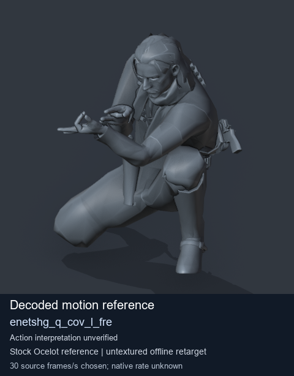
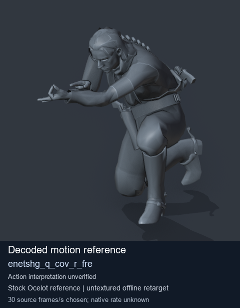
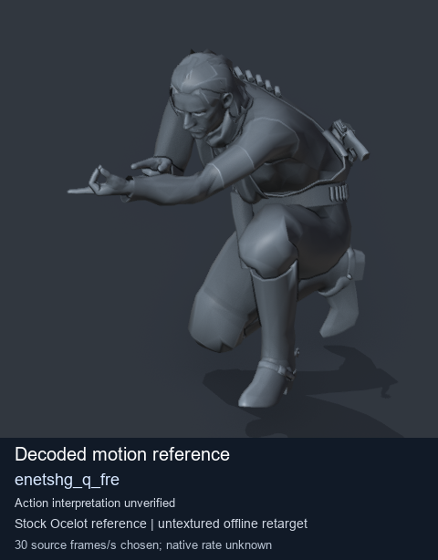
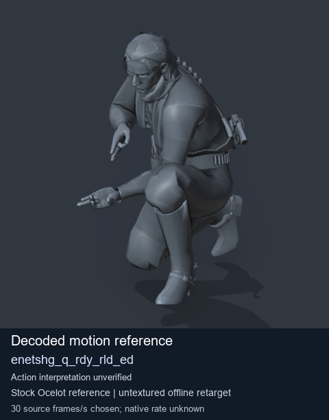

# Stock Soldier_common motion references / /Assets/tpp/motion/SI_game/fani/bodies/enet/enetshg - page 1

[Library](../README.md) · [Grouped directory](../browse/README.md) · [This source family](../browse/stock-soldier-enetshg-c29384f7.md) · [Switch mode](browse-stock-soldier-enetshg-c29384f7-1.md)

**Still images: no GIFs loaded** · 4 clips · 0.46 MiB downloaded.

Images reuse existing files. A small display width does not reduce download size. Open one clip for its larger titled GIF and original technical data.

Source-family grouping uses only recorded virtual directories; it does not establish an action, weapon, actor, rig or native compatibility. Existing descriptions and tags below are unchanged. Per-clip visual review may be pending; chosen preview speed is separate from unmeasured native timing.

| Preview | Animation | Category | Tags | Virtual GANI directory / file | MTAR / container location | Description | Frames / data |
| --- | --- | --- | --- | --- | --- | --- | --- |
|  | [Stock reference: enetshg_q_cov_l_fre](../clips/mgsv-tpp-soldier_common-payloadsha256-7662a1486ac306196eb8a53c7d2b1665d753f03db46946f16e61f93d83265c14.md) <code>enetshg_q_cov_l_fre</code> | Stock Soldier_common motion references | <code>stock animation reference</code> <code>Soldier_common</code> <code>source-derived label</code> <code>Ocelot reference mesh</code> | <code>/Assets/tpp/motion/SI_game/fani/bodies/enet/enetshg</code> <code>enetshg_q_cov_l_fre.gani</code> | Retained MTAR: <code>Soldier_common.mtar</code> DAT / FPK membership unverified | Decoded stock reference enetshg_q_cov_l_fre; action interpretation unverified. | 55 raw 1.83 s chosen; native rate unknown [Full data](../clips/mgsv-tpp-soldier_common-payloadsha256-7662a1486ac306196eb8a53c7d2b1665d753f03db46946f16e61f93d83265c14.md#technical-data) |
|  | [Stock reference: enetshg_q_cov_r_fre](../clips/mgsv-tpp-soldier_common-payloadsha256-f5b89c06fed80e5b9335f304d783d5b687ced1b78313b2431a366474dff2ad37.md) <code>enetshg_q_cov_r_fre</code> | Stock Soldier_common motion references | <code>stock animation reference</code> <code>Soldier_common</code> <code>source-derived label</code> <code>Ocelot reference mesh</code> | <code>/Assets/tpp/motion/SI_game/fani/bodies/enet/enetshg</code> <code>enetshg_q_cov_r_fre.gani</code> | Retained MTAR: <code>Soldier_common.mtar</code> DAT / FPK membership unverified | Decoded stock reference enetshg_q_cov_r_fre; action interpretation unverified. | 55 raw 1.83 s chosen; native rate unknown [Full data](../clips/mgsv-tpp-soldier_common-payloadsha256-f5b89c06fed80e5b9335f304d783d5b687ced1b78313b2431a366474dff2ad37.md#technical-data) |
|  | [Stock motion reference: enetshg_q_fre](../clips/mgsv-tpp-soldier_common-payloadsha256-8b4cdc8f30e997a4e734613c2e5872ffff70fda77be2f42d98391b37ad1ff616.md) <code>enetshg_q_fre</code> | Stock Soldier_common motion references | <code>stock body motion</code> <code>Soldier_common</code> <code>source-derived label</code> <code>Ocelot reference mesh</code> | <code>/Assets/tpp/motion/SI_game/fani/bodies/enet/enetshg</code> <code>enetshg_q_fre.gani</code> | Retained MTAR: <code>Soldier_common.mtar</code> DAT / FPK membership unverified | Decoded stock body-motion reference enetshg_q_fre; action interpretation unverified. | 55 raw 1.83 s chosen; native rate unknown [Full data](../clips/mgsv-tpp-soldier_common-payloadsha256-8b4cdc8f30e997a4e734613c2e5872ffff70fda77be2f42d98391b37ad1ff616.md#technical-data) |
|  | [Stock motion reference: enetshg_q_rdy_rld_ed](../clips/mgsv-tpp-soldier_common-payloadsha256-3c24cc0d2732c80d88c263fdca4d2f11a861f1712c10d0cc816af141684270fd.md) <code>enetshg_q_rdy_rld_ed</code> | Stock Soldier_common motion references | <code>stock body motion</code> <code>Soldier_common</code> <code>source-derived label</code> <code>Ocelot reference mesh</code> | <code>/Assets/tpp/motion/SI_game/fani/bodies/enet/enetshg</code> <code>enetshg_q_rdy_rld_ed.gani</code> | Retained MTAR: <code>Soldier_common.mtar</code> DAT / FPK membership unverified | Decoded stock body-motion reference enetshg_q_rdy_rld_ed; action interpretation unverified. | 55 raw 1.83 s chosen; native rate unknown [Full data](../clips/mgsv-tpp-soldier_common-payloadsha256-3c24cc0d2732c80d88c263fdca4d2f11a861f1712c10d0cc816af141684270fd.md#technical-data) |

[Source descriptions, confidence and credits](../description-sources.md) · [Complete JSON](../catalogue.json) · [CSV](../catalogue.csv)
