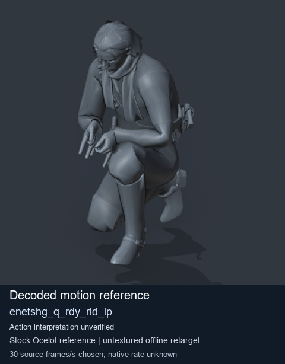
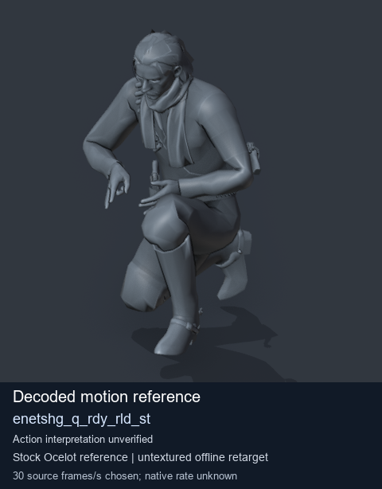
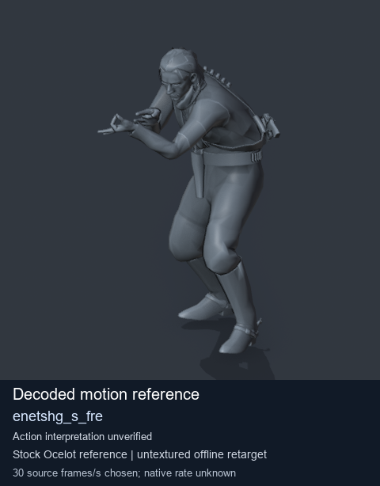
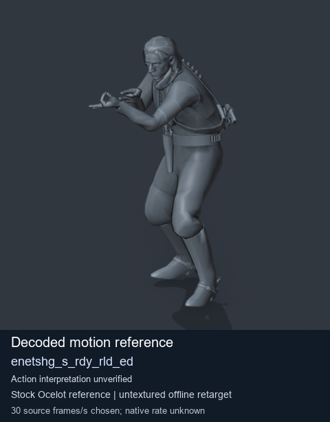

# Stock Soldier_common motion references / /Assets/tpp/motion/SI_game/fani/bodies/enet/enetshg - page 2

[Library](../README.md) · [Grouped directory](../browse/README.md) · [This source family](../browse/stock-soldier-enetshg-c29384f7.md) · [Switch mode](browse-stock-soldier-enetshg-c29384f7-2.md)

**Still images: no GIFs loaded** · 4 clips · 0.41 MiB downloaded.

Images reuse existing files. A small display width does not reduce download size. Open one clip for its larger titled GIF and original technical data.

Source-family grouping uses only recorded virtual directories; it does not establish an action, weapon, actor, rig or native compatibility. Existing descriptions and tags below are unchanged. Per-clip visual review may be pending; chosen preview speed is separate from unmeasured native timing.

| Preview | Animation | Category | Tags | Virtual GANI directory / file | MTAR / container location | Description | Frames / data |
| --- | --- | --- | --- | --- | --- | --- | --- |
|  | [Stock motion reference: enetshg_q_rdy_rld_lp](../clips/mgsv-tpp-soldier_common-payloadsha256-f3adbf017e961d47154718211517a3a8204e33b2527fecaa6ddc1bbf0a3502af.md) <code>enetshg_q_rdy_rld_lp</code> | Stock Soldier_common motion references | <code>stock body motion</code> <code>Soldier_common</code> <code>source-derived label</code> <code>Ocelot reference mesh</code> | <code>/Assets/tpp/motion/SI_game/fani/bodies/enet/enetshg</code> <code>enetshg_q_rdy_rld_lp.gani</code> | Retained MTAR: <code>Soldier_common.mtar</code> DAT / FPK membership unverified | Decoded stock body-motion reference enetshg_q_rdy_rld_lp; action interpretation unverified. | 74 raw 2.47 s chosen; native rate unknown [Full data](../clips/mgsv-tpp-soldier_common-payloadsha256-f3adbf017e961d47154718211517a3a8204e33b2527fecaa6ddc1bbf0a3502af.md#technical-data) |
|  | [Stock motion reference: enetshg_q_rdy_rld_st](../clips/mgsv-tpp-soldier_common-payloadsha256-4ba93c31370562e36287d5f512ccde39e10d64e6163b900a3b4f221befac34cb.md) <code>enetshg_q_rdy_rld_st</code> | Stock Soldier_common motion references | <code>stock body motion</code> <code>Soldier_common</code> <code>source-derived label</code> <code>Ocelot reference mesh</code> | <code>/Assets/tpp/motion/SI_game/fani/bodies/enet/enetshg</code> <code>enetshg_q_rdy_rld_st.gani</code> | Retained MTAR: <code>Soldier_common.mtar</code> DAT / FPK membership unverified | Decoded stock body-motion reference enetshg_q_rdy_rld_st; action interpretation unverified. | 133 raw 4.43 s chosen; native rate unknown [Full data](../clips/mgsv-tpp-soldier_common-payloadsha256-4ba93c31370562e36287d5f512ccde39e10d64e6163b900a3b4f221befac34cb.md#technical-data) |
|  | [Stock motion reference: enetshg_s_fre](../clips/mgsv-tpp-soldier_common-payloadsha256-04e30fec572ba91362a20b193220ebb3480a4fbd99b6f1cd946d4f3ec7e9aa25.md) <code>enetshg_s_fre</code> | Stock Soldier_common motion references | <code>stock body motion</code> <code>Soldier_common</code> <code>source-derived label</code> <code>Ocelot reference mesh</code> | <code>/Assets/tpp/motion/SI_game/fani/bodies/enet/enetshg</code> <code>enetshg_s_fre.gani</code> | Retained MTAR: <code>Soldier_common.mtar</code> DAT / FPK membership unverified | Decoded stock body-motion reference enetshg_s_fre; action interpretation unverified. | 55 raw 1.83 s chosen; native rate unknown [Full data](../clips/mgsv-tpp-soldier_common-payloadsha256-04e30fec572ba91362a20b193220ebb3480a4fbd99b6f1cd946d4f3ec7e9aa25.md#technical-data) |
|  | [Stock motion reference: enetshg_s_rdy_rld_ed](../clips/mgsv-tpp-soldier_common-payloadsha256-3993170c75ca47d83d7a865a8ce17d018a0806e9889fcd3894fbc9c7ec8d393c.md) <code>enetshg_s_rdy_rld_ed</code> | Stock Soldier_common motion references | <code>stock body motion</code> <code>Soldier_common</code> <code>source-derived label</code> <code>Ocelot reference mesh</code> | <code>/Assets/tpp/motion/SI_game/fani/bodies/enet/enetshg</code> <code>enetshg_s_rdy_rld_ed.gani</code> | Retained MTAR: <code>Soldier_common.mtar</code> DAT / FPK membership unverified | Decoded stock body-motion reference enetshg_s_rdy_rld_ed; action interpretation unverified. | 45 raw 1.5 s chosen; native rate unknown [Full data](../clips/mgsv-tpp-soldier_common-payloadsha256-3993170c75ca47d83d7a865a8ce17d018a0806e9889fcd3894fbc9c7ec8d393c.md#technical-data) |

[Source descriptions, confidence and credits](../description-sources.md) · [Complete JSON](../catalogue.json) · [CSV](../catalogue.csv)
