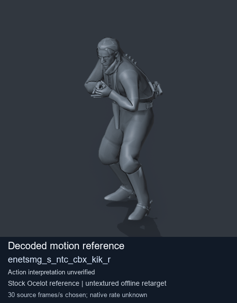
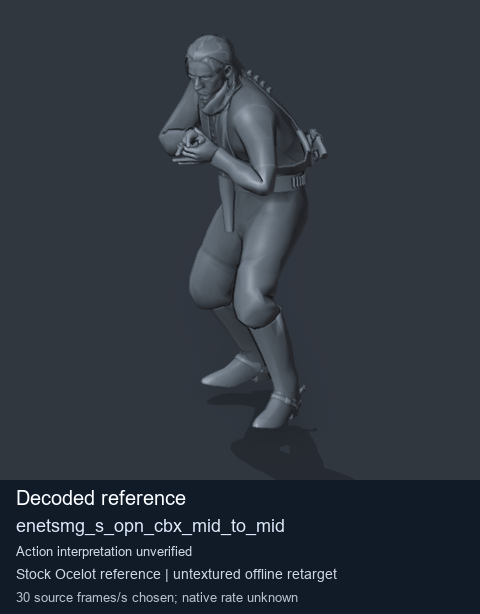
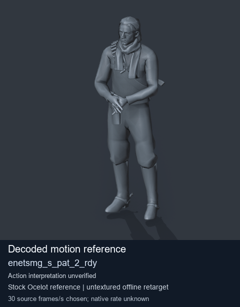

# Stock Soldier_common motion references / /Assets/tpp/motion/SI_game/fani/bodies/enet/enetsmg - page 13

[Library](../README.md) · [Grouped directory](../browse/README.md) · [This source family](../browse/stock-soldier-enetsmg-febc9a59.md) · [Switch mode](browse-stock-soldier-enetsmg-febc9a59-13-stills.md)

**Animated references** · 3 clips · 15.76 MiB downloaded.

Images reuse existing files. A small display width does not reduce download size. Animated previews use full existing GIFs where no separate thumbnail exists. Open one clip for its larger titled GIF and original technical data.

Source-family grouping uses only recorded virtual directories; it does not establish an action, weapon, actor, rig or native compatibility. Existing descriptions and tags below are unchanged. Per-clip visual review may be pending; chosen preview speed is separate from unmeasured native timing.

| Preview | Animation | Category | Tags | Virtual GANI directory / file | MTAR / container location | Description | Frames / data |
| --- | --- | --- | --- | --- | --- | --- | --- |
|  | [Stock reference: enetsmg_s_ntc_cbx_kik_r](../clips/mgsv-tpp-soldier_common-payloadsha256-0bc93f6e8b8cc7e8fc093f6a1f5bc13854525d23785b821f4bd66b521d23811e.md) <code>enetsmg_s_ntc_cbx_kik_r</code> | Stock Soldier_common motion references | <code>stock animation reference</code> <code>Soldier_common</code> <code>source-derived label</code> <code>Ocelot reference mesh</code> | <code>/Assets/tpp/motion/SI_game/fani/bodies/enet/enetsmg</code> <code>enetsmg_s_ntc_cbx_kik_r.gani</code> | Retained MTAR: <code>Soldier_common.mtar</code> DAT / FPK membership unverified | Decoded stock reference enetsmg_s_ntc_cbx_kik_r; action interpretation unverified. | 123 raw 4.1 s chosen; native rate unknown [Full data](../clips/mgsv-tpp-soldier_common-payloadsha256-0bc93f6e8b8cc7e8fc093f6a1f5bc13854525d23785b821f4bd66b521d23811e.md#technical-data) |
|  | [Stock reference: enetsmg_s_opn_cbx_mid_to_mid](../clips/mgsv-tpp-soldier_common-payloadsha256-50b83f30dab73821a1d379200bbde296875618700816fd4e845bea50f324ae2d.md) <code>enetsmg_s_opn_cbx_mid_to_mid</code> | Stock Soldier_common motion references | <code>stock animation reference</code> <code>Soldier_common</code> <code>source-derived label</code> <code>Ocelot reference mesh</code> | <code>/Assets/tpp/motion/SI_game/fani/bodies/enet/enetsmg</code> <code>enetsmg_s_opn_cbx_mid_to_mid.gani</code> | Retained MTAR: <code>Soldier_common.mtar</code> DAT / FPK membership unverified | Decoded stock reference enetsmg_s_opn_cbx_mid_to_mid; action interpretation unverified. | 356 raw 11.87 s chosen; native rate unknown [Full data](../clips/mgsv-tpp-soldier_common-payloadsha256-50b83f30dab73821a1d379200bbde296875618700816fd4e845bea50f324ae2d.md#technical-data) |
|  | [Stock motion reference: enetsmg_s_pat_2_rdy](../clips/mgsv-tpp-soldier_common-payloadsha256-5646465d4efe289266132cc191119ab6588f14475528c13bccc5bdda889b8bb2.md) <code>enetsmg_s_pat_2_rdy</code> | Stock Soldier_common motion references | <code>stock body motion</code> <code>Soldier_common</code> <code>source-derived label</code> <code>Ocelot reference mesh</code> | <code>/Assets/tpp/motion/SI_game/fani/bodies/enet/enetsmg</code> <code>enetsmg_s_pat_2_rdy.gani</code> | Retained MTAR: <code>Soldier_common.mtar</code> DAT / FPK membership unverified | Decoded stock body-motion reference enetsmg_s_pat_2_rdy; action interpretation unverified. | 48 raw 1.6 s chosen; native rate unknown [Full data](../clips/mgsv-tpp-soldier_common-payloadsha256-5646465d4efe289266132cc191119ab6588f14475528c13bccc5bdda889b8bb2.md#technical-data) |

[Source descriptions, confidence and credits](../description-sources.md) · [Complete JSON](../catalogue.json) · [CSV](../catalogue.csv)
