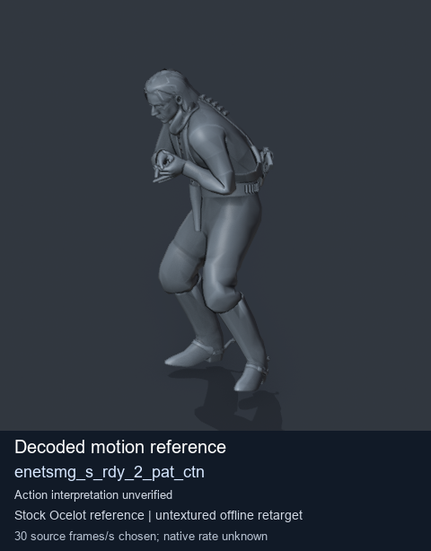
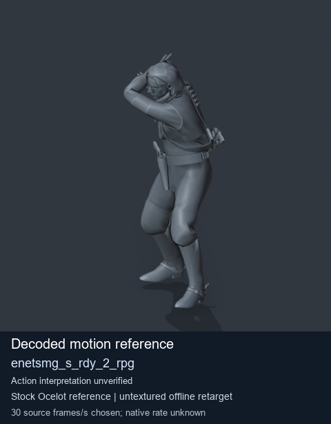
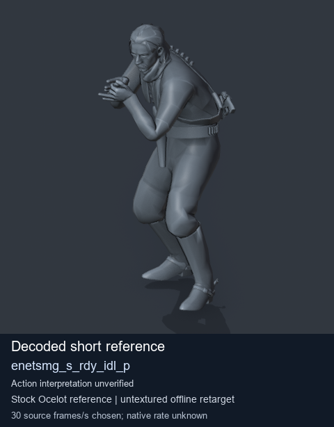
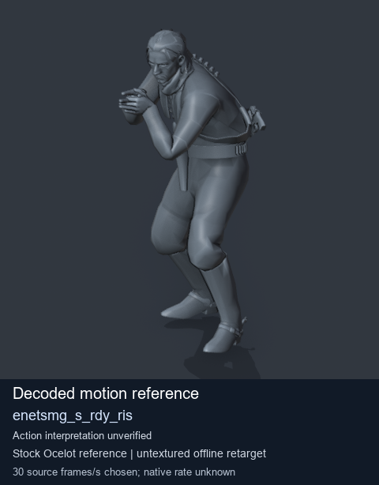

# Stock Soldier_common motion references / /Assets/tpp/motion/SI_game/fani/bodies/enet/enetsmg - page 20

[Library](../README.md) · [Grouped directory](../browse/README.md) · [This source family](../browse/stock-soldier-enetsmg-febc9a59.md) · [Switch mode](browse-stock-soldier-enetsmg-febc9a59-20.md)

**Still images: no GIFs loaded** · 4 clips · 0.36 MiB downloaded.

Images reuse existing files. A small display width does not reduce download size. Open one clip for its larger titled GIF and original technical data.

Source-family grouping uses only recorded virtual directories; it does not establish an action, weapon, actor, rig or native compatibility. Existing descriptions and tags below are unchanged. Per-clip visual review may be pending; chosen preview speed is separate from unmeasured native timing.

| Preview | Animation | Category | Tags | Virtual GANI directory / file | MTAR / container location | Description | Frames / data |
| --- | --- | --- | --- | --- | --- | --- | --- |
|  | [Stock motion reference: enetsmg_s_rdy_2_pat_ctn](../clips/mgsv-tpp-soldier_common-payloadsha256-3342edb15b796582b97a6a3618f2ab4ddad33a11610e2ff18b6c29d246c709ab.md) <code>enetsmg_s_rdy_2_pat_ctn</code> | Stock Soldier_common motion references | <code>stock body motion</code> <code>Soldier_common</code> <code>source-derived label</code> <code>Ocelot reference mesh</code> | <code>/Assets/tpp/motion/SI_game/fani/bodies/enet/enetsmg</code> <code>enetsmg_s_rdy_2_pat_ctn.gani</code> | Retained MTAR: <code>Soldier_common.mtar</code> DAT / FPK membership unverified | Decoded stock body-motion reference enetsmg_s_rdy_2_pat_ctn; action interpretation unverified. | 140 raw 4.67 s chosen; native rate unknown [Full data](../clips/mgsv-tpp-soldier_common-payloadsha256-3342edb15b796582b97a6a3618f2ab4ddad33a11610e2ff18b6c29d246c709ab.md#technical-data) |
|  | [Stock motion reference: enetsmg_s_rdy_2_rpg](../clips/mgsv-tpp-soldier_common-payloadsha256-4e83551f5e607299d49f34c2980d5b704cc833eedf7edfd81ff369c0bdf6beb5.md) <code>enetsmg_s_rdy_2_rpg</code> | Stock Soldier_common motion references | <code>stock body motion</code> <code>Soldier_common</code> <code>source-derived label</code> <code>Ocelot reference mesh</code> | <code>/Assets/tpp/motion/SI_game/fani/bodies/enet/enetsmg</code> <code>enetsmg_s_rdy_2_rpg.gani</code> | Retained MTAR: <code>Soldier_common.mtar</code> DAT / FPK membership unverified | Decoded stock body-motion reference enetsmg_s_rdy_2_rpg; action interpretation unverified. | 95 raw 3.17 s chosen; native rate unknown [Full data](../clips/mgsv-tpp-soldier_common-payloadsha256-4e83551f5e607299d49f34c2980d5b704cc833eedf7edfd81ff369c0bdf6beb5.md#technical-data) |
|  | [Stock reference: enetsmg_s_rdy_idl_p](../clips/mgsv-tpp-soldier_common-payloadsha256-6523e6307ef2bd04f52cb53570aefc9346578ae63f444ea9582b12678970e8a6.md) <code>enetsmg_s_rdy_idl_p</code> | Stock Soldier_common motion references | <code>stock animation reference</code> <code>Soldier_common</code> <code>source-derived label</code> <code>Ocelot reference mesh</code> | <code>/Assets/tpp/motion/SI_game/fani/bodies/enet/enetsmg</code> <code>enetsmg_s_rdy_idl_p.gani</code> | Retained MTAR: <code>Soldier_common.mtar</code> DAT / FPK membership unverified | Decoded stock reference enetsmg_s_rdy_idl_p; action interpretation unverified. | 1 raw 0.03 s chosen; native rate unknown [Full data](../clips/mgsv-tpp-soldier_common-payloadsha256-6523e6307ef2bd04f52cb53570aefc9346578ae63f444ea9582b12678970e8a6.md#technical-data) |
|  | [Stock motion reference: enetsmg_s_rdy_ris](../clips/mgsv-tpp-soldier_common-payloadsha256-6db8f5aae562b90bd23c92ddb811aed27fec3991f68b29612c574facb9adc115.md) <code>enetsmg_s_rdy_ris</code> | Stock Soldier_common motion references | <code>stock body motion</code> <code>Soldier_common</code> <code>source-derived label</code> <code>Ocelot reference mesh</code> | <code>/Assets/tpp/motion/SI_game/fani/bodies/enet/enetsmg</code> <code>enetsmg_s_rdy_ris.gani</code> | Retained MTAR: <code>Soldier_common.mtar</code> DAT / FPK membership unverified | Decoded stock body-motion reference enetsmg_s_rdy_ris; action interpretation unverified. | 30 raw 1.0 s chosen; native rate unknown [Full data](../clips/mgsv-tpp-soldier_common-payloadsha256-6db8f5aae562b90bd23c92ddb811aed27fec3991f68b29612c574facb9adc115.md#technical-data) |

[Source descriptions, confidence and credits](../description-sources.md) · [Complete JSON](../catalogue.json) · [CSV](../catalogue.csv)
