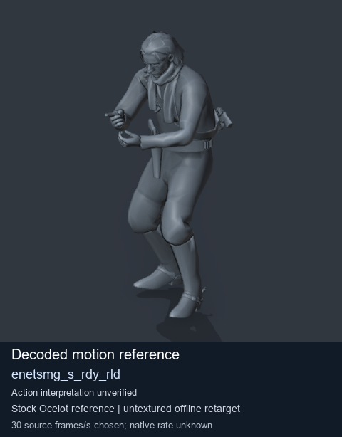
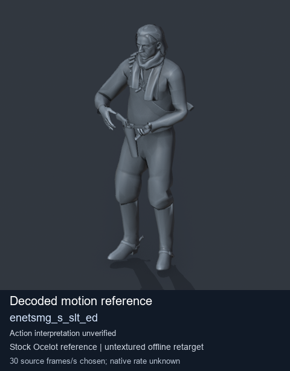
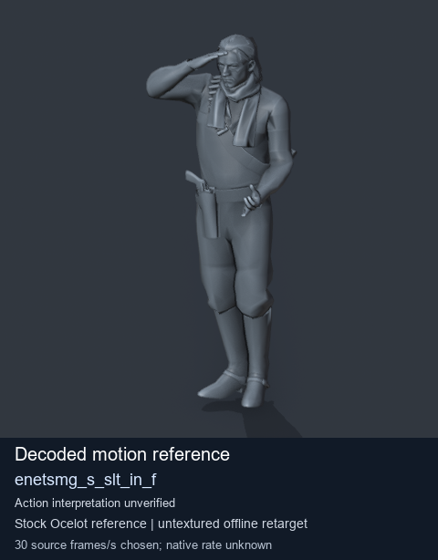
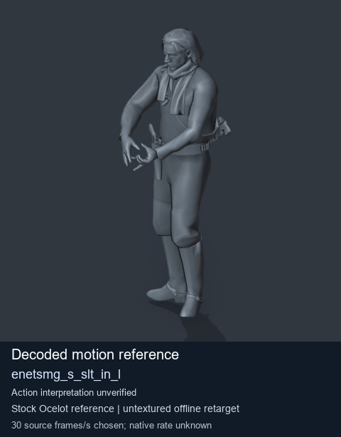

# Stock Soldier_common motion references / /Assets/tpp/motion/SI_game/fani/bodies/enet/enetsmg - page 21

[Library](../README.md) · [Grouped directory](../browse/README.md) · [This source family](../browse/stock-soldier-enetsmg-febc9a59.md) · [Switch mode](browse-stock-soldier-enetsmg-febc9a59-21.md)

**Still images: no GIFs loaded** · 4 clips · 0.36 MiB downloaded.

Images reuse existing files. A small display width does not reduce download size. Open one clip for its larger titled GIF and original technical data.

Source-family grouping uses only recorded virtual directories; it does not establish an action, weapon, actor, rig or native compatibility. Existing descriptions and tags below are unchanged. Per-clip visual review may be pending; chosen preview speed is separate from unmeasured native timing.

| Preview | Animation | Category | Tags | Virtual GANI directory / file | MTAR / container location | Description | Frames / data |
| --- | --- | --- | --- | --- | --- | --- | --- |
|  | [Stock motion reference: enetsmg_s_rdy_rld](../clips/mgsv-tpp-soldier_common-payloadsha256-350df993f91aba70c421d60acbe91bcda4e88faba56e84c112ae53f0ab62e818.md) <code>enetsmg_s_rdy_rld</code> | Stock Soldier_common motion references | <code>stock body motion</code> <code>Soldier_common</code> <code>source-derived label</code> <code>Ocelot reference mesh</code> | <code>/Assets/tpp/motion/SI_game/fani/bodies/enet/enetsmg</code> <code>enetsmg_s_rdy_rld.gani</code> | Retained MTAR: <code>Soldier_common.mtar</code> DAT / FPK membership unverified | Decoded stock body-motion reference enetsmg_s_rdy_rld; action interpretation unverified. | 180 raw 6.0 s chosen; native rate unknown [Full data](../clips/mgsv-tpp-soldier_common-payloadsha256-350df993f91aba70c421d60acbe91bcda4e88faba56e84c112ae53f0ab62e818.md#technical-data) |
|  | [Stock motion reference: enetsmg_s_slt_ed](../clips/mgsv-tpp-soldier_common-payloadsha256-3718869852b1e2219719b833baa8daa21487716573d3944cf930fb4dfb33d48f.md) <code>enetsmg_s_slt_ed</code> | Stock Soldier_common motion references | <code>stock body motion</code> <code>Soldier_common</code> <code>source-derived label</code> <code>Ocelot reference mesh</code> | <code>/Assets/tpp/motion/SI_game/fani/bodies/enet/enetsmg</code> <code>enetsmg_s_slt_ed.gani</code> | Retained MTAR: <code>Soldier_common.mtar</code> DAT / FPK membership unverified | Decoded stock body-motion reference enetsmg_s_slt_ed; action interpretation unverified. | 138 raw 4.6 s chosen; native rate unknown [Full data](../clips/mgsv-tpp-soldier_common-payloadsha256-3718869852b1e2219719b833baa8daa21487716573d3944cf930fb4dfb33d48f.md#technical-data) |
|  | [Stock motion reference: enetsmg_s_slt_in_f](../clips/mgsv-tpp-soldier_common-payloadsha256-b69fb2d77214bcbb71600bcac178418123664d26f7ec862508a34b05547797d5.md) <code>enetsmg_s_slt_in_f</code> | Stock Soldier_common motion references | <code>stock body motion</code> <code>Soldier_common</code> <code>source-derived label</code> <code>Ocelot reference mesh</code> | <code>/Assets/tpp/motion/SI_game/fani/bodies/enet/enetsmg</code> <code>enetsmg_s_slt_in_f.gani</code> | Retained MTAR: <code>Soldier_common.mtar</code> DAT / FPK membership unverified | Decoded stock body-motion reference enetsmg_s_slt_in_f; action interpretation unverified. | 65 raw 2.17 s chosen; native rate unknown [Full data](../clips/mgsv-tpp-soldier_common-payloadsha256-b69fb2d77214bcbb71600bcac178418123664d26f7ec862508a34b05547797d5.md#technical-data) |
|  | [Stock reference: enetsmg_s_slt_in_l](../clips/mgsv-tpp-soldier_common-payloadsha256-6eabbc5c358ded9509309679dee3d4fcc3c4f77e374f51fcc0aec2a0ae84ed6e.md) <code>enetsmg_s_slt_in_l</code> | Stock Soldier_common motion references | <code>stock animation reference</code> <code>Soldier_common</code> <code>source-derived label</code> <code>Ocelot reference mesh</code> | <code>/Assets/tpp/motion/SI_game/fani/bodies/enet/enetsmg</code> <code>enetsmg_s_slt_in_l.gani</code> | Retained MTAR: <code>Soldier_common.mtar</code> DAT / FPK membership unverified | Decoded stock reference enetsmg_s_slt_in_l; action interpretation unverified. | 108 raw 3.6 s chosen; native rate unknown [Full data](../clips/mgsv-tpp-soldier_common-payloadsha256-6eabbc5c358ded9509309679dee3d4fcc3c4f77e374f51fcc0aec2a0ae84ed6e.md#technical-data) |

[Source descriptions, confidence and credits](../description-sources.md) · [Complete JSON](../catalogue.json) · [CSV](../catalogue.csv)
