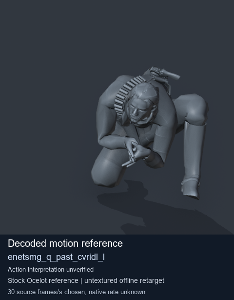
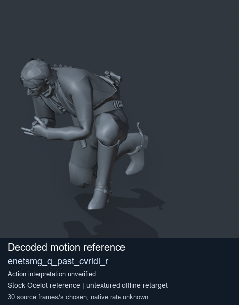
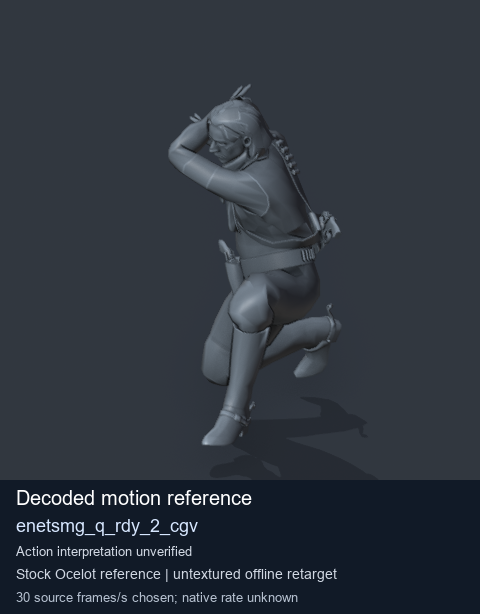

# Stock Soldier_common motion references / /Assets/tpp/motion/SI_game/fani/bodies/enet/enetsmg - page 3

[Library](../README.md) · [Grouped directory](../browse/README.md) · [This source family](../browse/stock-soldier-enetsmg-febc9a59.md) · [Switch mode](browse-stock-soldier-enetsmg-febc9a59-3.md)

**Still images: no GIFs loaded** · 4 clips · 0.40 MiB downloaded.

Images reuse existing files. A small display width does not reduce download size. Open one clip for its larger titled GIF and original technical data.

Source-family grouping uses only recorded virtual directories; it does not establish an action, weapon, actor, rig or native compatibility. Existing descriptions and tags below are unchanged. Per-clip visual review may be pending; chosen preview speed is separate from unmeasured native timing.

| Preview | Animation | Category | Tags | Virtual GANI directory / file | MTAR / container location | Description | Frames / data |
| --- | --- | --- | --- | --- | --- | --- | --- |
|  | [Stock reference: enetsmg_q_past_cvridl_l](../clips/mgsv-tpp-soldier_common-payloadsha256-0a95c4e9e7a3dc473ecab54976ae250d69a9ef791938fbe7f6ff5dfa06a6b5e5.md) <code>enetsmg_q_past_cvridl_l</code> | Stock Soldier_common motion references | <code>stock animation reference</code> <code>Soldier_common</code> <code>source-derived label</code> <code>Ocelot reference mesh</code> | <code>/Assets/tpp/motion/SI_game/fani/bodies/enet/enetsmg</code> <code>enetsmg_q_past_cvridl_l.gani</code> | Retained MTAR: <code>Soldier_common.mtar</code> DAT / FPK membership unverified | Decoded stock reference enetsmg_q_past_cvridl_l; action interpretation unverified. | 96 raw 3.2 s chosen; native rate unknown [Full data](../clips/mgsv-tpp-soldier_common-payloadsha256-0a95c4e9e7a3dc473ecab54976ae250d69a9ef791938fbe7f6ff5dfa06a6b5e5.md#technical-data) |
|  | [Stock reference: enetsmg_q_past_cvridl_r](../clips/mgsv-tpp-soldier_common-payloadsha256-4d8cbe8056b4efafd21a18f10616e06a4a11056b002845fa45e0c60428999e83.md) <code>enetsmg_q_past_cvridl_r</code> | Stock Soldier_common motion references | <code>stock animation reference</code> <code>Soldier_common</code> <code>source-derived label</code> <code>Ocelot reference mesh</code> | <code>/Assets/tpp/motion/SI_game/fani/bodies/enet/enetsmg</code> <code>enetsmg_q_past_cvridl_r.gani</code> | Retained MTAR: <code>Soldier_common.mtar</code> DAT / FPK membership unverified | Decoded stock reference enetsmg_q_past_cvridl_r; action interpretation unverified. | 104 raw 3.47 s chosen; native rate unknown [Full data](../clips/mgsv-tpp-soldier_common-payloadsha256-4d8cbe8056b4efafd21a18f10616e06a4a11056b002845fa45e0c60428999e83.md#technical-data) |
|  | [Stock motion reference: enetsmg_q_rdy_2_cgv](../clips/mgsv-tpp-soldier_common-payloadsha256-e304cd4f0fac9f5fdbe8fe0d33abbfcc8aea8feff9e79fd33b3ce488950a96b1.md) <code>enetsmg_q_rdy_2_cgv</code> | Stock Soldier_common motion references | <code>stock body motion</code> <code>Soldier_common</code> <code>source-derived label</code> <code>Ocelot reference mesh</code> | <code>/Assets/tpp/motion/SI_game/fani/bodies/enet/enetsmg</code> <code>enetsmg_q_rdy_2_cgv.gani</code> | Retained MTAR: <code>Soldier_common.mtar</code> DAT / FPK membership unverified | Decoded stock body-motion reference enetsmg_q_rdy_2_cgv; action interpretation unverified. | 95 raw 3.17 s chosen; native rate unknown [Full data](../clips/mgsv-tpp-soldier_common-payloadsha256-e304cd4f0fac9f5fdbe8fe0d33abbfcc8aea8feff9e79fd33b3ce488950a96b1.md#technical-data) |
|  | [Stock motion reference: enetsmg_q_rdy_2_rpg](../clips/mgsv-tpp-soldier_common-payloadsha256-a9dfb38d707a29ada572583b891a3ff66d5c9d377bcb3c2c2d948ef990bc3180.md) <code>enetsmg_q_rdy_2_rpg</code> | Stock Soldier_common motion references | <code>stock body motion</code> <code>Soldier_common</code> <code>source-derived label</code> <code>Ocelot reference mesh</code> | <code>/Assets/tpp/motion/SI_game/fani/bodies/enet/enetsmg</code> <code>enetsmg_q_rdy_2_rpg.gani</code> | Retained MTAR: <code>Soldier_common.mtar</code> DAT / FPK membership unverified | Decoded stock body-motion reference enetsmg_q_rdy_2_rpg; action interpretation unverified. | 95 raw 3.17 s chosen; native rate unknown [Full data](../clips/mgsv-tpp-soldier_common-payloadsha256-a9dfb38d707a29ada572583b891a3ff66d5c9d377bcb3c2c2d948ef990bc3180.md#technical-data) |

[Source descriptions, confidence and credits](../description-sources.md) · [Complete JSON](../catalogue.json) · [CSV](../catalogue.csv)
