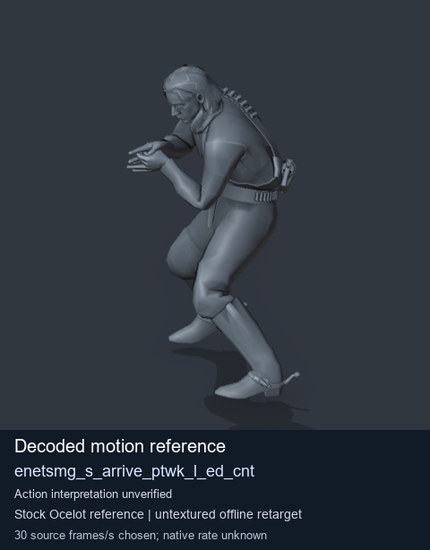
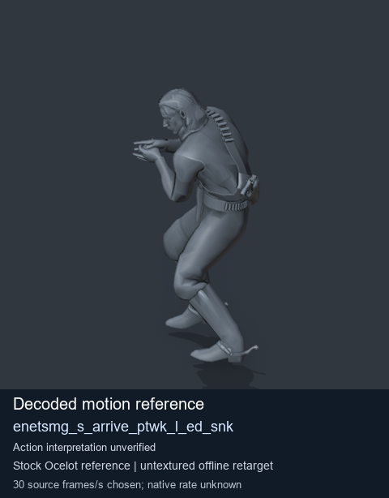
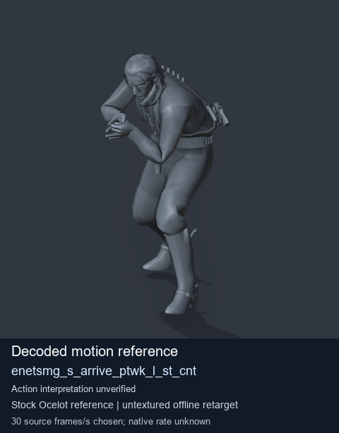
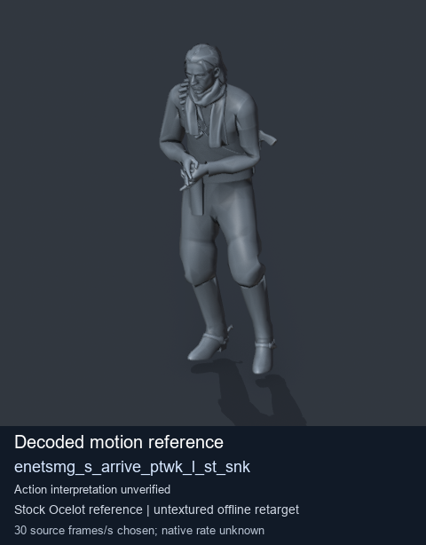

# Stock Soldier_common motion references / /Assets/tpp/motion/SI_game/fani/bodies/enet/enetsmg - page 5

[Library](../README.md) · [Grouped directory](../browse/README.md) · [This source family](../browse/stock-soldier-enetsmg-febc9a59.md) · [Switch mode](browse-stock-soldier-enetsmg-febc9a59-5.md)

**Still images: no GIFs loaded** · 4 clips · 0.35 MiB downloaded.

Images reuse existing files. A small display width does not reduce download size. Open one clip for its larger titled GIF and original technical data.

Source-family grouping uses only recorded virtual directories; it does not establish an action, weapon, actor, rig or native compatibility. Existing descriptions and tags below are unchanged. Per-clip visual review may be pending; chosen preview speed is separate from unmeasured native timing.

| Preview | Animation | Category | Tags | Virtual GANI directory / file | MTAR / container location | Description | Frames / data |
| --- | --- | --- | --- | --- | --- | --- | --- |
|  | [Stock reference: enetsmg_s_arrive_ptwk_l_ed_cnt](../clips/mgsv-tpp-soldier_common-payloadsha256-66cf90c567abca7b75e036c7bc3120293208f261a99b34a082c333cf6e786169.md) <code>enetsmg_s_arrive_ptwk_l_ed_cnt</code> | Stock Soldier_common motion references | <code>stock animation reference</code> <code>Soldier_common</code> <code>source-derived label</code> <code>Ocelot reference mesh</code> | <code>/Assets/tpp/motion/SI_game/fani/bodies/enet/enetsmg</code> <code>enetsmg_s_arrive_ptwk_l_ed_cnt.gani</code> | Retained MTAR: <code>Soldier_common.mtar</code> DAT / FPK membership unverified | Decoded stock reference enetsmg_s_arrive_ptwk_l_ed_cnt; action interpretation unverified. | 92 raw 3.07 s chosen; native rate unknown [Full data](../clips/mgsv-tpp-soldier_common-payloadsha256-66cf90c567abca7b75e036c7bc3120293208f261a99b34a082c333cf6e786169.md#technical-data) |
|  | [Stock motion reference: enetsmg_s_arrive_ptwk_l_ed_snk](../clips/mgsv-tpp-soldier_common-payloadsha256-5ec8fc212146f69ab66e84f74ebb6d4e97d0d57e37ae553658b2355b3aae5aea.md) <code>enetsmg_s_arrive_ptwk_l_ed_snk</code> | Stock Soldier_common motion references | <code>stock body motion</code> <code>Soldier_common</code> <code>source-derived label</code> <code>Ocelot reference mesh</code> | <code>/Assets/tpp/motion/SI_game/fani/bodies/enet/enetsmg</code> <code>enetsmg_s_arrive_ptwk_l_ed_snk.gani</code> | Retained MTAR: <code>Soldier_common.mtar</code> DAT / FPK membership unverified | Decoded stock body-motion reference enetsmg_s_arrive_ptwk_l_ed_snk; action interpretation unverified. | 137 raw 4.57 s chosen; native rate unknown [Full data](../clips/mgsv-tpp-soldier_common-payloadsha256-5ec8fc212146f69ab66e84f74ebb6d4e97d0d57e37ae553658b2355b3aae5aea.md#technical-data) |
|  | [Stock reference: enetsmg_s_arrive_ptwk_l_st_cnt](../clips/mgsv-tpp-soldier_common-payloadsha256-d1bd9e20f50d634344514920240234a9186f14627b2bb13c1a909b2139db605e.md) <code>enetsmg_s_arrive_ptwk_l_st_cnt</code> | Stock Soldier_common motion references | <code>stock animation reference</code> <code>Soldier_common</code> <code>source-derived label</code> <code>Ocelot reference mesh</code> | <code>/Assets/tpp/motion/SI_game/fani/bodies/enet/enetsmg</code> <code>enetsmg_s_arrive_ptwk_l_st_cnt.gani</code> | Retained MTAR: <code>Soldier_common.mtar</code> DAT / FPK membership unverified | Decoded stock reference enetsmg_s_arrive_ptwk_l_st_cnt; action interpretation unverified. | 58 raw 1.93 s chosen; native rate unknown [Full data](../clips/mgsv-tpp-soldier_common-payloadsha256-d1bd9e20f50d634344514920240234a9186f14627b2bb13c1a909b2139db605e.md#technical-data) |
|  | [Stock reference: enetsmg_s_arrive_ptwk_l_st_snk](../clips/mgsv-tpp-soldier_common-payloadsha256-c54669c4b6a2768f5a4be22ae5f2a9877dade94c036aaba6b40b279209677447.md) <code>enetsmg_s_arrive_ptwk_l_st_snk</code> | Stock Soldier_common motion references | <code>stock animation reference</code> <code>Soldier_common</code> <code>source-derived label</code> <code>Ocelot reference mesh</code> | <code>/Assets/tpp/motion/SI_game/fani/bodies/enet/enetsmg</code> <code>enetsmg_s_arrive_ptwk_l_st_snk.gani</code> | Retained MTAR: <code>Soldier_common.mtar</code> DAT / FPK membership unverified | Decoded stock reference enetsmg_s_arrive_ptwk_l_st_snk; action interpretation unverified. | 100 raw 3.33 s chosen; native rate unknown [Full data](../clips/mgsv-tpp-soldier_common-payloadsha256-c54669c4b6a2768f5a4be22ae5f2a9877dade94c036aaba6b40b279209677447.md#technical-data) |

[Source descriptions, confidence and credits](../description-sources.md) · [Complete JSON](../catalogue.json) · [CSV](../catalogue.csv)
