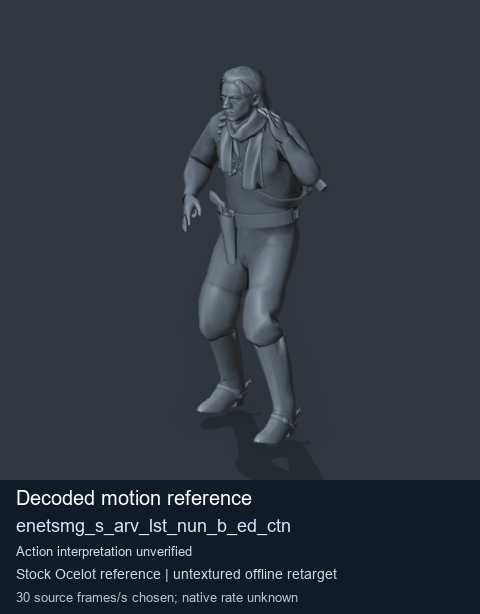
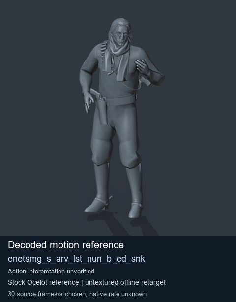
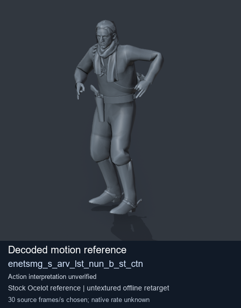
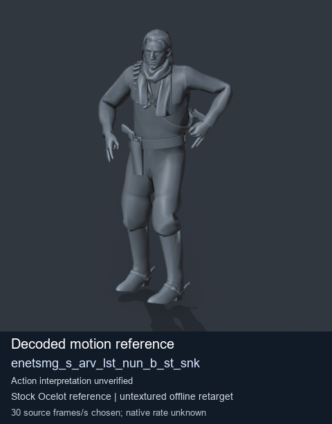

# Stock Soldier_common motion references / /Assets/tpp/motion/SI_game/fani/bodies/enet/enetsmg - page 6

[Library](../README.md) · [Grouped directory](../browse/README.md) · [This source family](../browse/stock-soldier-enetsmg-febc9a59.md) · [Switch mode](browse-stock-soldier-enetsmg-febc9a59-6.md)

**Still images: no GIFs loaded** · 4 clips · 0.37 MiB downloaded.

Images reuse existing files. A small display width does not reduce download size. Open one clip for its larger titled GIF and original technical data.

Source-family grouping uses only recorded virtual directories; it does not establish an action, weapon, actor, rig or native compatibility. Existing descriptions and tags below are unchanged. Per-clip visual review may be pending; chosen preview speed is separate from unmeasured native timing.

| Preview | Animation | Category | Tags | Virtual GANI directory / file | MTAR / container location | Description | Frames / data |
| --- | --- | --- | --- | --- | --- | --- | --- |
|  | [Stock motion reference: enetsmg_s_arv_lst_nun_b_ed_ctn](../clips/mgsv-tpp-soldier_common-payloadsha256-3829bc8efb07c7be77e919a03da9b770d09dbce0e11ed65e1865ec3e264e2a28.md) <code>enetsmg_s_arv_lst_nun_b_ed_ctn</code> | Stock Soldier_common motion references | <code>stock body motion</code> <code>Soldier_common</code> <code>source-derived label</code> <code>Ocelot reference mesh</code> | <code>/Assets/tpp/motion/SI_game/fani/bodies/enet/enetsmg</code> <code>enetsmg_s_arv_lst_nun_b_ed_ctn.gani</code> | Retained MTAR: <code>Soldier_common.mtar</code> DAT / FPK membership unverified | Decoded stock body-motion reference enetsmg_s_arv_lst_nun_b_ed_ctn; action interpretation unverified. | 145 raw 4.83 s chosen; native rate unknown [Full data](../clips/mgsv-tpp-soldier_common-payloadsha256-3829bc8efb07c7be77e919a03da9b770d09dbce0e11ed65e1865ec3e264e2a28.md#technical-data) |
|  | [Stock reference: enetsmg_s_arv_lst_nun_b_ed_snk](../clips/mgsv-tpp-soldier_common-payloadsha256-80050c038deee118b8ccb883dca76a7b121398318377876634676afeaddf342a.md) <code>enetsmg_s_arv_lst_nun_b_ed_snk</code> | Stock Soldier_common motion references | <code>stock animation reference</code> <code>Soldier_common</code> <code>source-derived label</code> <code>Ocelot reference mesh</code> | <code>/Assets/tpp/motion/SI_game/fani/bodies/enet/enetsmg</code> <code>enetsmg_s_arv_lst_nun_b_ed_snk.gani</code> | Retained MTAR: <code>Soldier_common.mtar</code> DAT / FPK membership unverified | Decoded stock reference enetsmg_s_arv_lst_nun_b_ed_snk; action interpretation unverified. | 160 raw 5.33 s chosen; native rate unknown [Full data](../clips/mgsv-tpp-soldier_common-payloadsha256-80050c038deee118b8ccb883dca76a7b121398318377876634676afeaddf342a.md#technical-data) |
|  | [Stock reference: enetsmg_s_arv_lst_nun_b_st_ctn](../clips/mgsv-tpp-soldier_common-payloadsha256-c805bf2f610aac394b6b631094c81da7ca2199a95f6f2fa5115657e4c5e05f66.md) <code>enetsmg_s_arv_lst_nun_b_st_ctn</code> | Stock Soldier_common motion references | <code>stock animation reference</code> <code>Soldier_common</code> <code>source-derived label</code> <code>Ocelot reference mesh</code> | <code>/Assets/tpp/motion/SI_game/fani/bodies/enet/enetsmg</code> <code>enetsmg_s_arv_lst_nun_b_st_ctn.gani</code> | Retained MTAR: <code>Soldier_common.mtar</code> DAT / FPK membership unverified | Decoded stock reference enetsmg_s_arv_lst_nun_b_st_ctn; action interpretation unverified. | 90 raw 3.0 s chosen; native rate unknown [Full data](../clips/mgsv-tpp-soldier_common-payloadsha256-c805bf2f610aac394b6b631094c81da7ca2199a95f6f2fa5115657e4c5e05f66.md#technical-data) |
|  | [Stock reference: enetsmg_s_arv_lst_nun_b_st_snk](../clips/mgsv-tpp-soldier_common-payloadsha256-fc71cbe7134f314e3b9becccc46abcdb9ccf8009b66bab4f026b5e063f62c693.md) <code>enetsmg_s_arv_lst_nun_b_st_snk</code> | Stock Soldier_common motion references | <code>stock animation reference</code> <code>Soldier_common</code> <code>source-derived label</code> <code>Ocelot reference mesh</code> | <code>/Assets/tpp/motion/SI_game/fani/bodies/enet/enetsmg</code> <code>enetsmg_s_arv_lst_nun_b_st_snk.gani</code> | Retained MTAR: <code>Soldier_common.mtar</code> DAT / FPK membership unverified | Decoded stock reference enetsmg_s_arv_lst_nun_b_st_snk; action interpretation unverified. | 90 raw 3.0 s chosen; native rate unknown [Full data](../clips/mgsv-tpp-soldier_common-payloadsha256-fc71cbe7134f314e3b9becccc46abcdb9ccf8009b66bab4f026b5e063f62c693.md#technical-data) |

[Source descriptions, confidence and credits](../description-sources.md) · [Complete JSON](../catalogue.json) · [CSV](../catalogue.csv)
