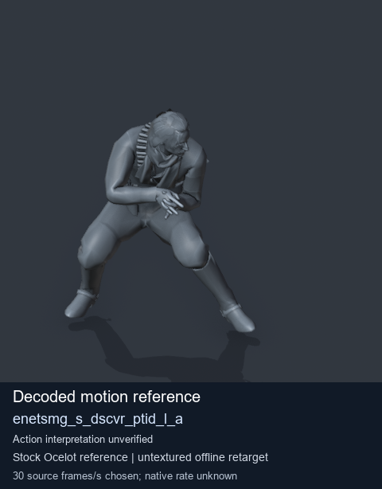
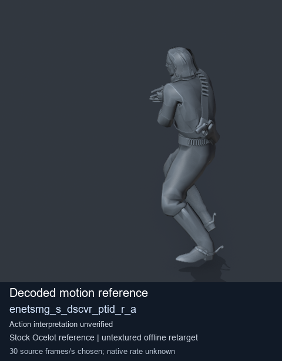
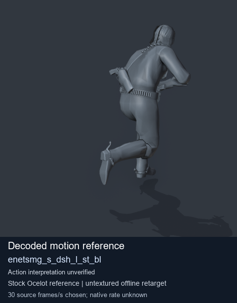
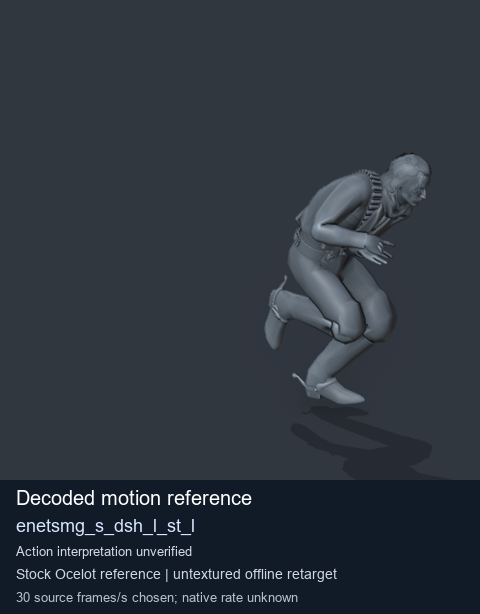

# Stock Soldier_common motion references / /Assets/tpp/motion/SI_game/fani/bodies/enet/enetsmg - page 9

[Library](../README.md) · [Grouped directory](../browse/README.md) · [This source family](../browse/stock-soldier-enetsmg-febc9a59.md) · [Switch mode](browse-stock-soldier-enetsmg-febc9a59-9.md)

**Still images: no GIFs loaded** · 4 clips · 0.33 MiB downloaded.

Images reuse existing files. A small display width does not reduce download size. Open one clip for its larger titled GIF and original technical data.

Source-family grouping uses only recorded virtual directories; it does not establish an action, weapon, actor, rig or native compatibility. Existing descriptions and tags below are unchanged. Per-clip visual review may be pending; chosen preview speed is separate from unmeasured native timing.

| Preview | Animation | Category | Tags | Virtual GANI directory / file | MTAR / container location | Description | Frames / data |
| --- | --- | --- | --- | --- | --- | --- | --- |
|  | [Stock motion reference: enetsmg_s_dscvr_ptid_l_a](../clips/mgsv-tpp-soldier_common-payloadsha256-aa988d560974707a706d66064dbcc67fa058271fbc6dd729e481297f61cd6613.md) <code>enetsmg_s_dscvr_ptid_l_a</code> | Stock Soldier_common motion references | <code>stock body motion</code> <code>Soldier_common</code> <code>source-derived label</code> <code>Ocelot reference mesh</code> | <code>/Assets/tpp/motion/SI_game/fani/bodies/enet/enetsmg</code> <code>enetsmg_s_dscvr_ptid_l_a.gani</code> | Retained MTAR: <code>Soldier_common.mtar</code> DAT / FPK membership unverified | Decoded stock body-motion reference enetsmg_s_dscvr_ptid_l_a; action interpretation unverified. | 84 raw 2.8 s chosen; native rate unknown [Full data](../clips/mgsv-tpp-soldier_common-payloadsha256-aa988d560974707a706d66064dbcc67fa058271fbc6dd729e481297f61cd6613.md#technical-data) |
|  | [Stock reference: enetsmg_s_dscvr_ptid_r_a](../clips/mgsv-tpp-soldier_common-payloadsha256-5a351a16bd99d9dd92c99ed247994e0238c5c69209a6e38396ad873b8755a52f.md) <code>enetsmg_s_dscvr_ptid_r_a</code> | Stock Soldier_common motion references | <code>stock animation reference</code> <code>Soldier_common</code> <code>source-derived label</code> <code>Ocelot reference mesh</code> | <code>/Assets/tpp/motion/SI_game/fani/bodies/enet/enetsmg</code> <code>enetsmg_s_dscvr_ptid_r_a.gani</code> | Retained MTAR: <code>Soldier_common.mtar</code> DAT / FPK membership unverified | Decoded stock reference enetsmg_s_dscvr_ptid_r_a; action interpretation unverified. | 74 raw 2.47 s chosen; native rate unknown [Full data](../clips/mgsv-tpp-soldier_common-payloadsha256-5a351a16bd99d9dd92c99ed247994e0238c5c69209a6e38396ad873b8755a52f.md#technical-data) |
|  | [Stock motion reference: enetsmg_s_dsh_l_st_bl](../clips/mgsv-tpp-soldier_common-payloadsha256-7b2ceea4d1002365e13f4cf1e92dad183c5bac9746696c46678dca6984a5a7a2.md) <code>enetsmg_s_dsh_l_st_bl</code> | Stock Soldier_common motion references | <code>stock body motion</code> <code>Soldier_common</code> <code>source-derived label</code> <code>Ocelot reference mesh</code> | <code>/Assets/tpp/motion/SI_game/fani/bodies/enet/enetsmg</code> <code>enetsmg_s_dsh_l_st_bl.gani</code> | Retained MTAR: <code>Soldier_common.mtar</code> DAT / FPK membership unverified | Decoded stock body-motion reference enetsmg_s_dsh_l_st_bl; action interpretation unverified. | 30 raw 1.0 s chosen; native rate unknown [Full data](../clips/mgsv-tpp-soldier_common-payloadsha256-7b2ceea4d1002365e13f4cf1e92dad183c5bac9746696c46678dca6984a5a7a2.md#technical-data) |
|  | [Stock reference: enetsmg_s_dsh_l_st_l](../clips/mgsv-tpp-soldier_common-payloadsha256-e71bbd6826295a86a420175fd5c5c01c30641c9ba3571b16c63d655fed77a88e.md) <code>enetsmg_s_dsh_l_st_l</code> | Stock Soldier_common motion references | <code>stock animation reference</code> <code>Soldier_common</code> <code>source-derived label</code> <code>Ocelot reference mesh</code> | <code>/Assets/tpp/motion/SI_game/fani/bodies/enet/enetsmg</code> <code>enetsmg_s_dsh_l_st_l.gani</code> | Retained MTAR: <code>Soldier_common.mtar</code> DAT / FPK membership unverified | Decoded stock reference enetsmg_s_dsh_l_st_l; action interpretation unverified. | 25 raw 0.83 s chosen; native rate unknown [Full data](../clips/mgsv-tpp-soldier_common-payloadsha256-e71bbd6826295a86a420175fd5c5c01c30641c9ba3571b16c63d655fed77a88e.md#technical-data) |

[Source descriptions, confidence and credits](../description-sources.md) · [Complete JSON](../catalogue.json) · [CSV](../catalogue.csv)
