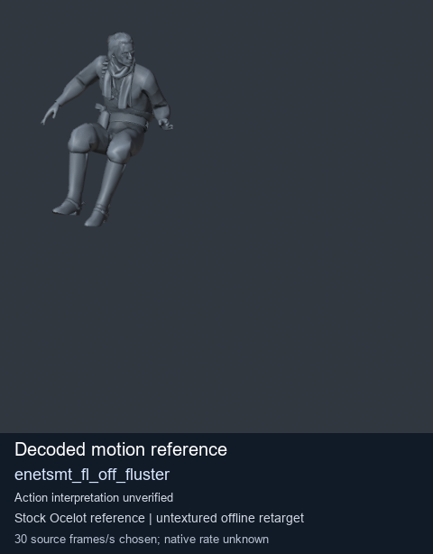
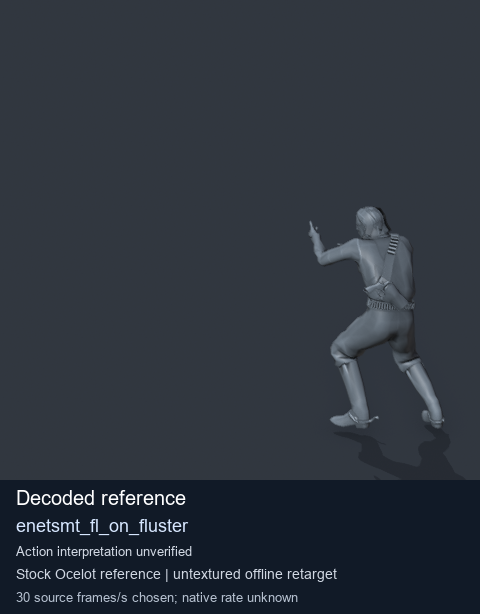

# Stock Soldier_common motion references / /Assets/tpp/motion/SI_game/fani/bodies/enet/enetsmt - page 1

[Library](../README.md) · [Grouped directory](../browse/README.md) · [This source family](../browse/stock-soldier-enetsmt-57632fde.md) · [Switch mode](browse-stock-soldier-enetsmt-57632fde-1.md)

**Still images: no GIFs loaded** · 2 clips · 0.12 MiB downloaded.

Images reuse existing files. A small display width does not reduce download size. Open one clip for its larger titled GIF and original technical data.

Source-family grouping uses only recorded virtual directories; it does not establish an action, weapon, actor, rig or native compatibility. Existing descriptions and tags below are unchanged. Per-clip visual review may be pending; chosen preview speed is separate from unmeasured native timing.

| Preview | Animation | Category | Tags | Virtual GANI directory / file | MTAR / container location | Description | Frames / data |
| --- | --- | --- | --- | --- | --- | --- | --- |
|  | [Stock reference: enetsmt_fl_off_fluster](../clips/mgsv-tpp-soldier_common-payloadsha256-f2823827bcfd0f1e729fa3ce731d472d0cd0be78a8dc99200a3170d169d1b84c.md) <code>enetsmt_fl_off_fluster</code> | Stock Soldier_common motion references | <code>stock animation reference</code> <code>Soldier_common</code> <code>source-derived label</code> <code>Ocelot reference mesh</code> | <code>/Assets/tpp/motion/SI_game/fani/bodies/enet/enetsmt</code> <code>enetsmt_fl_off_fluster.gani</code> | Retained MTAR: <code>Soldier_common.mtar</code> DAT / FPK membership unverified | Decoded stock reference enetsmt_fl_off_fluster; action interpretation unverified. | 230 raw 7.67 s chosen; native rate unknown [Full data](../clips/mgsv-tpp-soldier_common-payloadsha256-f2823827bcfd0f1e729fa3ce731d472d0cd0be78a8dc99200a3170d169d1b84c.md#technical-data) |
|  | [Stock reference: enetsmt_fl_on_fluster](../clips/mgsv-tpp-soldier_common-payloadsha256-db776d1e4b6f3a244397aa7e6adb2b75772d8cc77cfc2b28f0eed264a0f7c0cd.md) <code>enetsmt_fl_on_fluster</code> | Stock Soldier_common motion references | <code>stock animation reference</code> <code>Soldier_common</code> <code>source-derived label</code> <code>Ocelot reference mesh</code> | <code>/Assets/tpp/motion/SI_game/fani/bodies/enet/enetsmt</code> <code>enetsmt_fl_on_fluster.gani</code> | Retained MTAR: <code>Soldier_common.mtar</code> DAT / FPK membership unverified | Decoded stock reference enetsmt_fl_on_fluster; action interpretation unverified. | 330 raw 11.0 s chosen; native rate unknown [Full data](../clips/mgsv-tpp-soldier_common-payloadsha256-db776d1e4b6f3a244397aa7e6adb2b75772d8cc77cfc2b28f0eed264a0f7c0cd.md#technical-data) |

[Source descriptions, confidence and credits](../description-sources.md) · [Complete JSON](../catalogue.json) · [CSV](../catalogue.csv)
