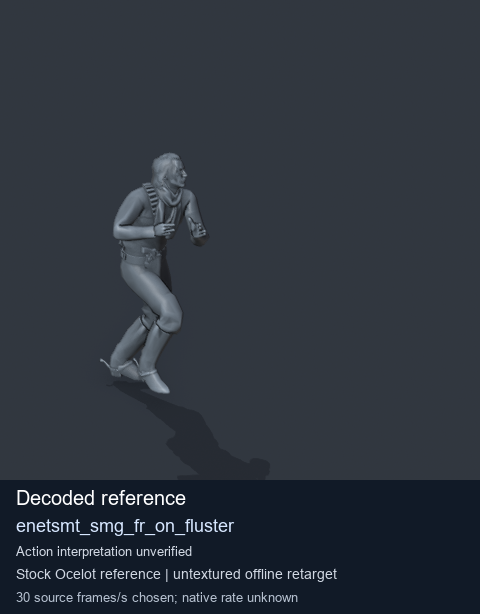

# Stock Soldier_common motion references / /Assets/tpp/motion/SI_game/fani/bodies/enet/enetsmt - page 7

[Library](../README.md) · [Grouped directory](../browse/README.md) · [This source family](../browse/stock-soldier-enetsmt-57632fde.md) · [Switch mode](browse-stock-soldier-enetsmt-57632fde-7.md)

**Still images: no GIFs loaded** · 1 clips · 0.07 MiB downloaded.

Images reuse existing files. A small display width does not reduce download size. Open one clip for its larger titled GIF and original technical data.

Source-family grouping uses only recorded virtual directories; it does not establish an action, weapon, actor, rig or native compatibility. Existing descriptions and tags below are unchanged. Per-clip visual review may be pending; chosen preview speed is separate from unmeasured native timing.

| Preview | Animation | Category | Tags | Virtual GANI directory / file | MTAR / container location | Description | Frames / data |
| --- | --- | --- | --- | --- | --- | --- | --- |
|  | [Stock reference: enetsmt_smg_fr_on_fluster](../clips/mgsv-tpp-soldier_common-payloadsha256-1ae36cd32a94f6951636a0fd238574614d59fd6f695d7e27b41f9a9a506661ce.md) <code>enetsmt_smg_fr_on_fluster</code> | Stock Soldier_common motion references | <code>stock animation reference</code> <code>Soldier_common</code> <code>source-derived label</code> <code>Ocelot reference mesh</code> | <code>/Assets/tpp/motion/SI_game/fani/bodies/enet/enetsmt</code> <code>enetsmt_smg_fr_on_fluster.gani</code> | Retained MTAR: <code>Soldier_common.mtar</code> DAT / FPK membership unverified | Decoded stock reference enetsmt_smg_fr_on_fluster; action interpretation unverified. | 340 raw 11.33 s chosen; native rate unknown [Full data](../clips/mgsv-tpp-soldier_common-payloadsha256-1ae36cd32a94f6951636a0fd238574614d59fd6f695d7e27b41f9a9a506661ce.md#technical-data) |

[Source descriptions, confidence and credits](../description-sources.md) · [Complete JSON](../catalogue.json) · [CSV](../catalogue.csv)
