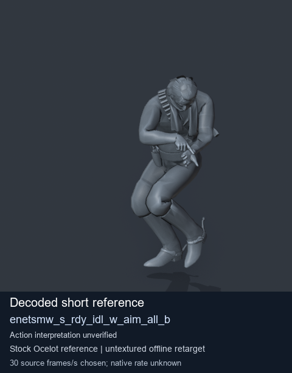
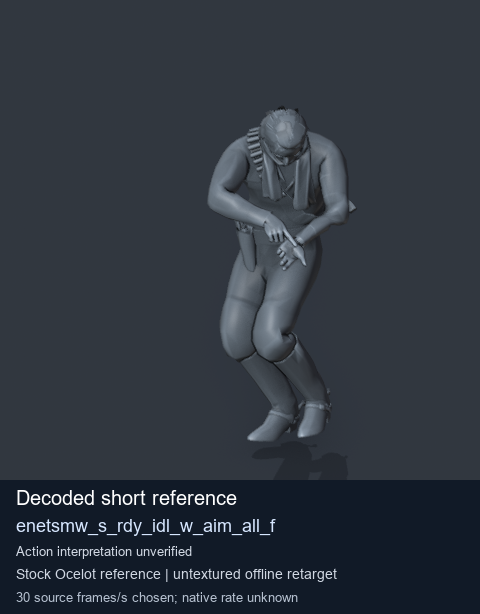
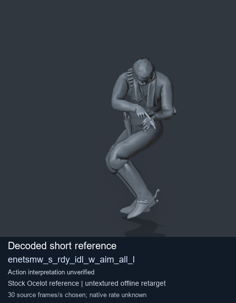
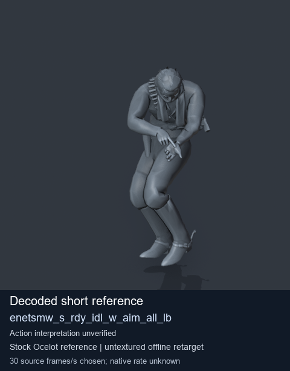

# Stock Soldier_common motion references / /Assets/tpp/motion/SI_game/fani/bodies/enet/enetsmw - page 3

[Library](../README.md) · [Grouped directory](../browse/README.md) · [This source family](../browse/stock-soldier-enetsmw-8cf2eba6.md) · [Switch mode](browse-stock-soldier-enetsmw-8cf2eba6-3.md)

**Still images: no GIFs loaded** · 4 clips · 0.34 MiB downloaded.

Images reuse existing files. A small display width does not reduce download size. Open one clip for its larger titled GIF and original technical data.

Source-family grouping uses only recorded virtual directories; it does not establish an action, weapon, actor, rig or native compatibility. Existing descriptions and tags below are unchanged. Per-clip visual review may be pending; chosen preview speed is separate from unmeasured native timing.

| Preview | Animation | Category | Tags | Virtual GANI directory / file | MTAR / container location | Description | Frames / data |
| --- | --- | --- | --- | --- | --- | --- | --- |
|  | [Stock reference: enetsmw_s_rdy_idl_w_aim_all_b](../clips/mgsv-tpp-soldier_common-payloadsha256-cd206abe0eeb143d445c34c27a45bb015bb1e0760fe4cf75d9af9f7ebe788592.md) <code>enetsmw_s_rdy_idl_w_aim_all_b</code> | Stock Soldier_common motion references | <code>stock animation reference</code> <code>Soldier_common</code> <code>source-derived label</code> <code>Ocelot reference mesh</code> | <code>/Assets/tpp/motion/SI_game/fani/bodies/enet/enetsmw</code> <code>enetsmw_s_rdy_idl_w_aim_all_b.gani</code> | Retained MTAR: <code>Soldier_common.mtar</code> DAT / FPK membership unverified | Decoded stock reference enetsmw_s_rdy_idl_w_aim_all_b; action interpretation unverified. | 8 raw 0.27 s chosen; native rate unknown [Full data](../clips/mgsv-tpp-soldier_common-payloadsha256-cd206abe0eeb143d445c34c27a45bb015bb1e0760fe4cf75d9af9f7ebe788592.md#technical-data) |
|  | [Stock reference: enetsmw_s_rdy_idl_w_aim_all_f](../clips/mgsv-tpp-soldier_common-payloadsha256-4335833a8b41fea0777b79b3fd887f364a88b0b1d1392415a77eb98c7dea98b1.md) <code>enetsmw_s_rdy_idl_w_aim_all_f</code> | Stock Soldier_common motion references | <code>stock animation reference</code> <code>Soldier_common</code> <code>source-derived label</code> <code>Ocelot reference mesh</code> | <code>/Assets/tpp/motion/SI_game/fani/bodies/enet/enetsmw</code> <code>enetsmw_s_rdy_idl_w_aim_all_f.gani</code> | Retained MTAR: <code>Soldier_common.mtar</code> DAT / FPK membership unverified | Decoded stock reference enetsmw_s_rdy_idl_w_aim_all_f; action interpretation unverified. | 8 raw 0.27 s chosen; native rate unknown [Full data](../clips/mgsv-tpp-soldier_common-payloadsha256-4335833a8b41fea0777b79b3fd887f364a88b0b1d1392415a77eb98c7dea98b1.md#technical-data) |
|  | [Stock reference: enetsmw_s_rdy_idl_w_aim_all_l](../clips/mgsv-tpp-soldier_common-payloadsha256-aa3cf7a2cd457d9789fff95069ba55a1514d278f186027e54e26d3e808e16f32.md) <code>enetsmw_s_rdy_idl_w_aim_all_l</code> | Stock Soldier_common motion references | <code>stock animation reference</code> <code>Soldier_common</code> <code>source-derived label</code> <code>Ocelot reference mesh</code> | <code>/Assets/tpp/motion/SI_game/fani/bodies/enet/enetsmw</code> <code>enetsmw_s_rdy_idl_w_aim_all_l.gani</code> | Retained MTAR: <code>Soldier_common.mtar</code> DAT / FPK membership unverified | Decoded stock reference enetsmw_s_rdy_idl_w_aim_all_l; action interpretation unverified. | 8 raw 0.27 s chosen; native rate unknown [Full data](../clips/mgsv-tpp-soldier_common-payloadsha256-aa3cf7a2cd457d9789fff95069ba55a1514d278f186027e54e26d3e808e16f32.md#technical-data) |
|  | [Stock reference: enetsmw_s_rdy_idl_w_aim_all_lb](../clips/mgsv-tpp-soldier_common-payloadsha256-0d93900ef9430d394edd994f730f429cae5c648a2302e1d700644aa32e3be5be.md) <code>enetsmw_s_rdy_idl_w_aim_all_lb</code> | Stock Soldier_common motion references | <code>stock animation reference</code> <code>Soldier_common</code> <code>source-derived label</code> <code>Ocelot reference mesh</code> | <code>/Assets/tpp/motion/SI_game/fani/bodies/enet/enetsmw</code> <code>enetsmw_s_rdy_idl_w_aim_all_lb.gani</code> | Retained MTAR: <code>Soldier_common.mtar</code> DAT / FPK membership unverified | Decoded stock reference enetsmw_s_rdy_idl_w_aim_all_lb; action interpretation unverified. | 8 raw 0.27 s chosen; native rate unknown [Full data](../clips/mgsv-tpp-soldier_common-payloadsha256-0d93900ef9430d394edd994f730f429cae5c648a2302e1d700644aa32e3be5be.md#technical-data) |

[Source descriptions, confidence and credits](../description-sources.md) · [Complete JSON](../catalogue.json) · [CSV](../catalogue.csv)
