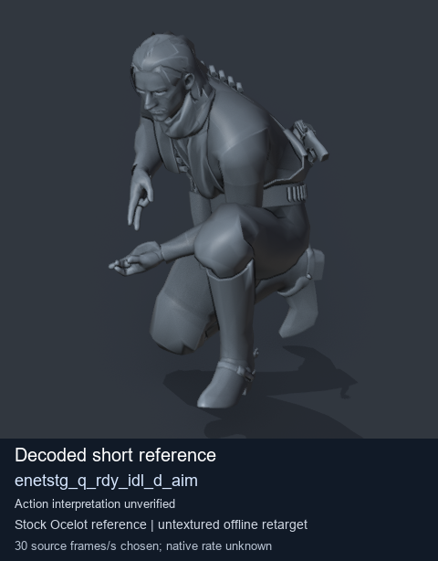
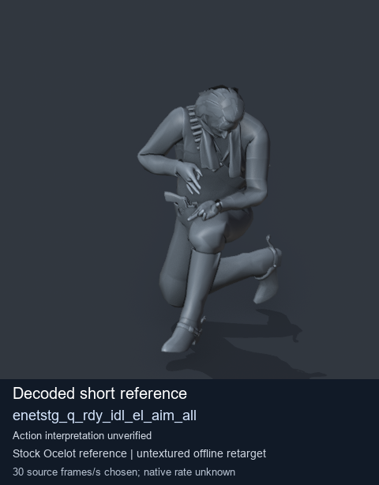
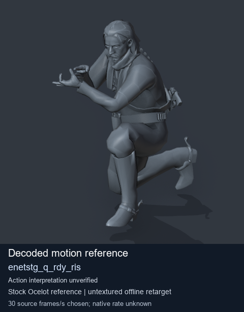
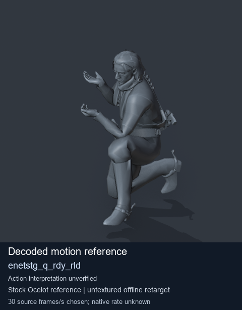

# Stock Soldier_common motion references / /Assets/tpp/motion/SI_game/fani/bodies/enet/enetstg - page 1

[Library](../README.md) · [Grouped directory](../browse/README.md) · [This source family](../browse/stock-soldier-enetstg-7a556e39.md) · [Switch mode](browse-stock-soldier-enetstg-7a556e39-1.md)

**Still images: no GIFs loaded** · 4 clips · 0.42 MiB downloaded.

Images reuse existing files. A small display width does not reduce download size. Open one clip for its larger titled GIF and original technical data.

Source-family grouping uses only recorded virtual directories; it does not establish an action, weapon, actor, rig or native compatibility. Existing descriptions and tags below are unchanged. Per-clip visual review may be pending; chosen preview speed is separate from unmeasured native timing.

| Preview | Animation | Category | Tags | Virtual GANI directory / file | MTAR / container location | Description | Frames / data |
| --- | --- | --- | --- | --- | --- | --- | --- |
|  | [Stock reference: enetstg_q_rdy_idl_d_aim](../clips/mgsv-tpp-soldier_common-payloadsha256-b43f310cbf7e3dc8e5f969c3b4a401f3ac7b03d55db717c6dcb4d45fea553a0d.md) <code>enetstg_q_rdy_idl_d_aim</code> | Stock Soldier_common motion references | <code>stock animation reference</code> <code>Soldier_common</code> <code>source-derived label</code> <code>Ocelot reference mesh</code> | <code>/Assets/tpp/motion/SI_game/fani/bodies/enet/enetstg</code> <code>enetstg_q_rdy_idl_d_aim.gani</code> | Retained MTAR: <code>Soldier_common.mtar</code> DAT / FPK membership unverified | Decoded stock reference enetstg_q_rdy_idl_d_aim; action interpretation unverified. | 1 raw 0.03 s chosen; native rate unknown [Full data](../clips/mgsv-tpp-soldier_common-payloadsha256-b43f310cbf7e3dc8e5f969c3b4a401f3ac7b03d55db717c6dcb4d45fea553a0d.md#technical-data) |
|  | [Stock reference: enetstg_q_rdy_idl_el_aim_all](../clips/mgsv-tpp-soldier_common-payloadsha256-2dcafc65f1f7c2a8c7a043447500f22121691496ceb0793d42ed5b623bf380e8.md) <code>enetstg_q_rdy_idl_el_aim_all</code> | Stock Soldier_common motion references | <code>stock animation reference</code> <code>Soldier_common</code> <code>source-derived label</code> <code>Ocelot reference mesh</code> | <code>/Assets/tpp/motion/SI_game/fani/bodies/enet/enetstg</code> <code>enetstg_q_rdy_idl_el_aim_all.gani</code> | Retained MTAR: <code>Soldier_common.mtar</code> DAT / FPK membership unverified | Decoded stock reference enetstg_q_rdy_idl_el_aim_all; action interpretation unverified. | 8 raw 0.27 s chosen; native rate unknown [Full data](../clips/mgsv-tpp-soldier_common-payloadsha256-2dcafc65f1f7c2a8c7a043447500f22121691496ceb0793d42ed5b623bf380e8.md#technical-data) |
|  | [Stock motion reference: enetstg_q_rdy_ris](../clips/mgsv-tpp-soldier_common-payloadsha256-c76594530ce8ca426e36b01bb7a2cd1c9b42c4edd14b5c7f4374079dc140a757.md) <code>enetstg_q_rdy_ris</code> | Stock Soldier_common motion references | <code>stock body motion</code> <code>Soldier_common</code> <code>source-derived label</code> <code>Ocelot reference mesh</code> | <code>/Assets/tpp/motion/SI_game/fani/bodies/enet/enetstg</code> <code>enetstg_q_rdy_ris.gani</code> | Retained MTAR: <code>Soldier_common.mtar</code> DAT / FPK membership unverified | Decoded stock body-motion reference enetstg_q_rdy_ris; action interpretation unverified. | 45 raw 1.5 s chosen; native rate unknown [Full data](../clips/mgsv-tpp-soldier_common-payloadsha256-c76594530ce8ca426e36b01bb7a2cd1c9b42c4edd14b5c7f4374079dc140a757.md#technical-data) |
|  | [Stock motion reference: enetstg_q_rdy_rld](../clips/mgsv-tpp-soldier_common-payloadsha256-cc87a74b008010fa33151575a881ef01e5c899d6a7f84afc120780029ef2348b.md) <code>enetstg_q_rdy_rld</code> | Stock Soldier_common motion references | <code>stock body motion</code> <code>Soldier_common</code> <code>source-derived label</code> <code>Ocelot reference mesh</code> | <code>/Assets/tpp/motion/SI_game/fani/bodies/enet/enetstg</code> <code>enetstg_q_rdy_rld.gani</code> | Retained MTAR: <code>Soldier_common.mtar</code> DAT / FPK membership unverified | Decoded stock body-motion reference enetstg_q_rdy_rld; action interpretation unverified. | 136 raw 4.53 s chosen; native rate unknown [Full data](../clips/mgsv-tpp-soldier_common-payloadsha256-cc87a74b008010fa33151575a881ef01e5c899d6a7f84afc120780029ef2348b.md#technical-data) |

[Source descriptions, confidence and credits](../description-sources.md) · [Complete JSON](../catalogue.json) · [CSV](../catalogue.csv)
