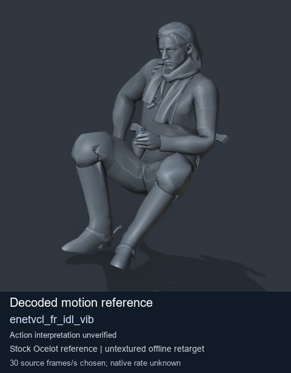
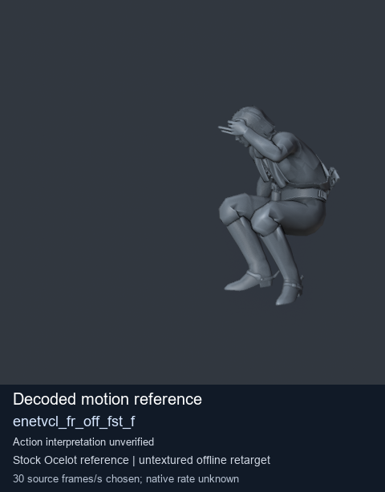
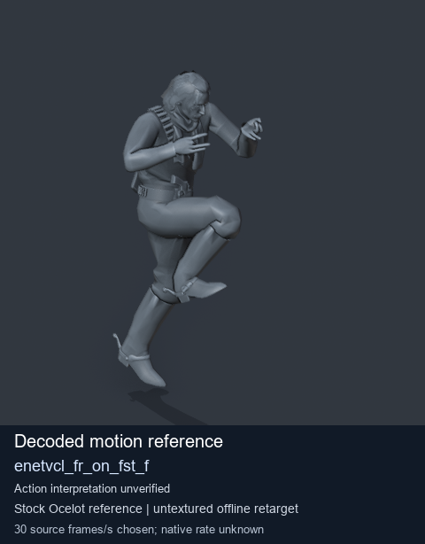
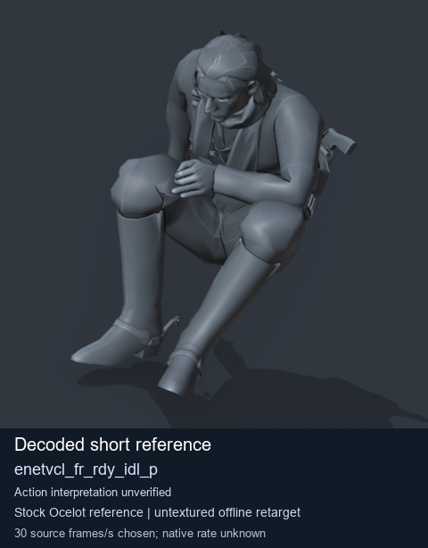

# Stock Soldier_common motion references / /Assets/tpp/motion/SI_game/fani/bodies/enet/enetvcl - page 15

[Library](../README.md) · [Grouped directory](../browse/README.md) · [This source family](../browse/stock-soldier-enetvcl-81e0562d.md) · [Switch mode](browse-stock-soldier-enetvcl-81e0562d-15.md)

**Still images: no GIFs loaded** · 4 clips · 0.39 MiB downloaded.

Images reuse existing files. A small display width does not reduce download size. Open one clip for its larger titled GIF and original technical data.

Source-family grouping uses only recorded virtual directories; it does not establish an action, weapon, actor, rig or native compatibility. Existing descriptions and tags below are unchanged. Per-clip visual review may be pending; chosen preview speed is separate from unmeasured native timing.

| Preview | Animation | Category | Tags | Virtual GANI directory / file | MTAR / container location | Description | Frames / data |
| --- | --- | --- | --- | --- | --- | --- | --- |
|  | [Stock motion reference: enetvcl_fr_idl_vib](../clips/mgsv-tpp-soldier_common-payloadsha256-01b61d59a856e6961abf900f1c16663ed03e8da2f154b00f77ca13456d66571b.md) <code>enetvcl_fr_idl_vib</code> | Stock Soldier_common motion references | <code>stock body motion</code> <code>Soldier_common</code> <code>source-derived label</code> <code>Ocelot reference mesh</code> | <code>/Assets/tpp/motion/SI_game/fani/bodies/enet/enetvcl</code> <code>enetvcl_fr_idl_vib.gani</code> | Retained MTAR: <code>Soldier_common.mtar</code> DAT / FPK membership unverified | Decoded stock body-motion reference enetvcl_fr_idl_vib; action interpretation unverified. | 72 raw 2.4 s chosen; native rate unknown [Full data](../clips/mgsv-tpp-soldier_common-payloadsha256-01b61d59a856e6961abf900f1c16663ed03e8da2f154b00f77ca13456d66571b.md#technical-data) |
|  | [Stock reference: enetvcl_fr_off_fst_f](../clips/mgsv-tpp-soldier_common-payloadsha256-83bd69ef197c7597478398a786d9f27ee7b623d291f50ce5d2b16e005d104885.md) <code>enetvcl_fr_off_fst_f</code> | Stock Soldier_common motion references | <code>stock animation reference</code> <code>Soldier_common</code> <code>source-derived label</code> <code>Ocelot reference mesh</code> | <code>/Assets/tpp/motion/SI_game/fani/bodies/enet/enetvcl</code> <code>enetvcl_fr_off_fst_f.gani</code> | Retained MTAR: <code>Soldier_common.mtar</code> DAT / FPK membership unverified | Decoded stock reference enetvcl_fr_off_fst_f; action interpretation unverified. | 123 raw 4.1 s chosen; native rate unknown [Full data](../clips/mgsv-tpp-soldier_common-payloadsha256-83bd69ef197c7597478398a786d9f27ee7b623d291f50ce5d2b16e005d104885.md#technical-data) |
|  | [Stock reference: enetvcl_fr_on_fst_f](../clips/mgsv-tpp-soldier_common-payloadsha256-0a1918240e973ac04aaa12c639f4b48ac5f507b5a1dea663a037e86572c0f3d6.md) <code>enetvcl_fr_on_fst_f</code> | Stock Soldier_common motion references | <code>stock animation reference</code> <code>Soldier_common</code> <code>source-derived label</code> <code>Ocelot reference mesh</code> | <code>/Assets/tpp/motion/SI_game/fani/bodies/enet/enetvcl</code> <code>enetvcl_fr_on_fst_f.gani</code> | Retained MTAR: <code>Soldier_common.mtar</code> DAT / FPK membership unverified | Decoded stock reference enetvcl_fr_on_fst_f; action interpretation unverified. | 140 raw 4.67 s chosen; native rate unknown [Full data](../clips/mgsv-tpp-soldier_common-payloadsha256-0a1918240e973ac04aaa12c639f4b48ac5f507b5a1dea663a037e86572c0f3d6.md#technical-data) |
|  | [Stock reference: enetvcl_fr_rdy_idl_p](../clips/mgsv-tpp-soldier_common-payloadsha256-064a3bb4ee731ec1793a23b81ab831f59893c4c975119c0feb7bee697a639ca4.md) <code>enetvcl_fr_rdy_idl_p</code> | Stock Soldier_common motion references | <code>stock animation reference</code> <code>Soldier_common</code> <code>source-derived label</code> <code>Ocelot reference mesh</code> | <code>/Assets/tpp/motion/SI_game/fani/bodies/enet/enetvcl</code> <code>enetvcl_fr_rdy_idl_p.gani</code> | Retained MTAR: <code>Soldier_common.mtar</code> DAT / FPK membership unverified | Decoded stock reference enetvcl_fr_rdy_idl_p; action interpretation unverified. | 1 raw 0.03 s chosen; native rate unknown [Full data](../clips/mgsv-tpp-soldier_common-payloadsha256-064a3bb4ee731ec1793a23b81ab831f59893c4c975119c0feb7bee697a639ca4.md#technical-data) |

[Source descriptions, confidence and credits](../description-sources.md) · [Complete JSON](../catalogue.json) · [CSV](../catalogue.csv)
