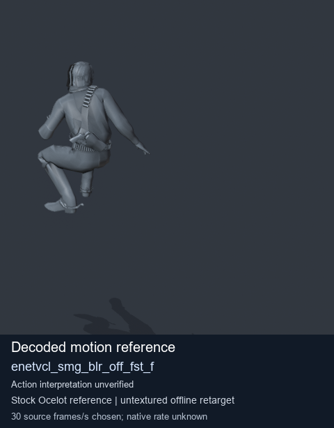
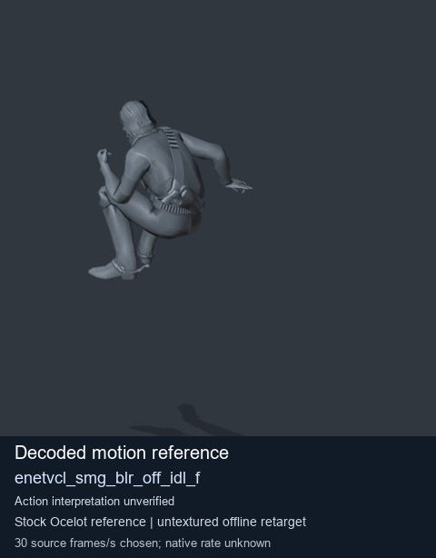
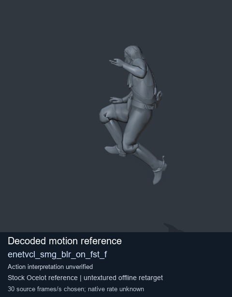

# Stock Soldier_common motion references / /Assets/tpp/motion/SI_game/fani/bodies/enet/enetvcl - page 17

[Library](../README.md) · [Grouped directory](../browse/README.md) · [This source family](../browse/stock-soldier-enetvcl-81e0562d.md) · [Switch mode](browse-stock-soldier-enetvcl-81e0562d-17.md)

**Still images: no GIFs loaded** · 3 clips · 0.20 MiB downloaded.

Images reuse existing files. A small display width does not reduce download size. Open one clip for its larger titled GIF and original technical data.

Source-family grouping uses only recorded virtual directories; it does not establish an action, weapon, actor, rig or native compatibility. Existing descriptions and tags below are unchanged. Per-clip visual review may be pending; chosen preview speed is separate from unmeasured native timing.

| Preview | Animation | Category | Tags | Virtual GANI directory / file | MTAR / container location | Description | Frames / data |
| --- | --- | --- | --- | --- | --- | --- | --- |
|  | [Stock reference: enetvcl_smg_blr_off_fst_f](../clips/mgsv-tpp-soldier_common-payloadsha256-988f12716294947ea5f3b5f0063bd8e29290bb848c25dd4f77ae8fa5d829d2c2.md) <code>enetvcl_smg_blr_off_fst_f</code> | Stock Soldier_common motion references | <code>stock animation reference</code> <code>Soldier_common</code> <code>source-derived label</code> <code>Ocelot reference mesh</code> | <code>/Assets/tpp/motion/SI_game/fani/bodies/enet/enetvcl</code> <code>enetvcl_smg_blr_off_fst_f.gani</code> | Retained MTAR: <code>Soldier_common.mtar</code> DAT / FPK membership unverified | Decoded stock reference enetvcl_smg_blr_off_fst_f; action interpretation unverified. | 164 raw 5.47 s chosen; native rate unknown [Full data](../clips/mgsv-tpp-soldier_common-payloadsha256-988f12716294947ea5f3b5f0063bd8e29290bb848c25dd4f77ae8fa5d829d2c2.md#technical-data) |
|  | [Stock reference: enetvcl_smg_blr_off_idl_f](../clips/mgsv-tpp-soldier_common-payloadsha256-cb81379d7916126d7625045a1aa6ba501b7c376db3a2822164d6b7d2beede8be.md) <code>enetvcl_smg_blr_off_idl_f</code> | Stock Soldier_common motion references | <code>stock animation reference</code> <code>Soldier_common</code> <code>source-derived label</code> <code>Ocelot reference mesh</code> | <code>/Assets/tpp/motion/SI_game/fani/bodies/enet/enetvcl</code> <code>enetvcl_smg_blr_off_idl_f.gani</code> | Retained MTAR: <code>Soldier_common.mtar</code> DAT / FPK membership unverified | Decoded stock reference enetvcl_smg_blr_off_idl_f; action interpretation unverified. | 184 raw 6.13 s chosen; native rate unknown [Full data](../clips/mgsv-tpp-soldier_common-payloadsha256-cb81379d7916126d7625045a1aa6ba501b7c376db3a2822164d6b7d2beede8be.md#technical-data) |
|  | [Stock reference: enetvcl_smg_blr_on_fst_f](../clips/mgsv-tpp-soldier_common-payloadsha256-74ce53bb672aece3798015a9412b012629ef13c38701a942c9a1e378cc33a460.md) <code>enetvcl_smg_blr_on_fst_f</code> | Stock Soldier_common motion references | <code>stock animation reference</code> <code>Soldier_common</code> <code>source-derived label</code> <code>Ocelot reference mesh</code> | <code>/Assets/tpp/motion/SI_game/fani/bodies/enet/enetvcl</code> <code>enetvcl_smg_blr_on_fst_f.gani</code> | Retained MTAR: <code>Soldier_common.mtar</code> DAT / FPK membership unverified | Decoded stock reference enetvcl_smg_blr_on_fst_f; action interpretation unverified. | 144 raw 4.8 s chosen; native rate unknown [Full data](../clips/mgsv-tpp-soldier_common-payloadsha256-74ce53bb672aece3798015a9412b012629ef13c38701a942c9a1e378cc33a460.md#technical-data) |

[Source descriptions, confidence and credits](../description-sources.md) · [Complete JSON](../catalogue.json) · [CSV](../catalogue.csv)
